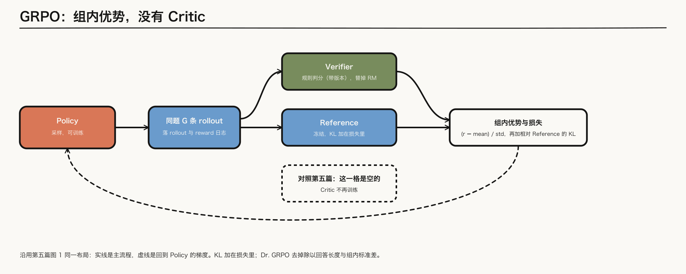
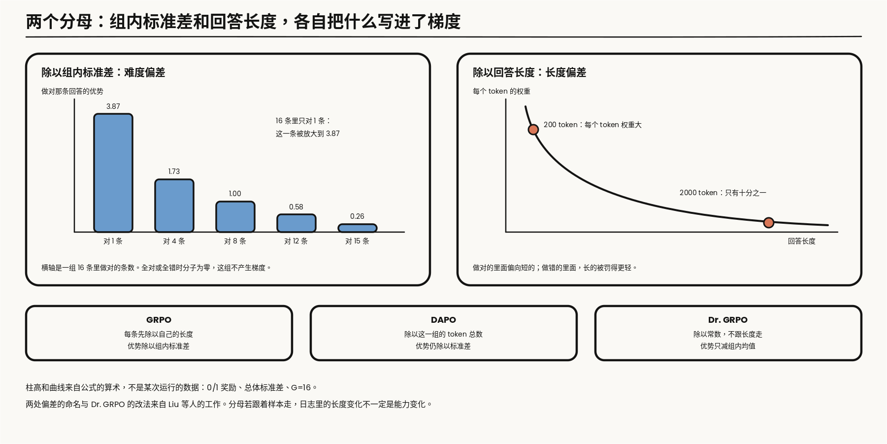
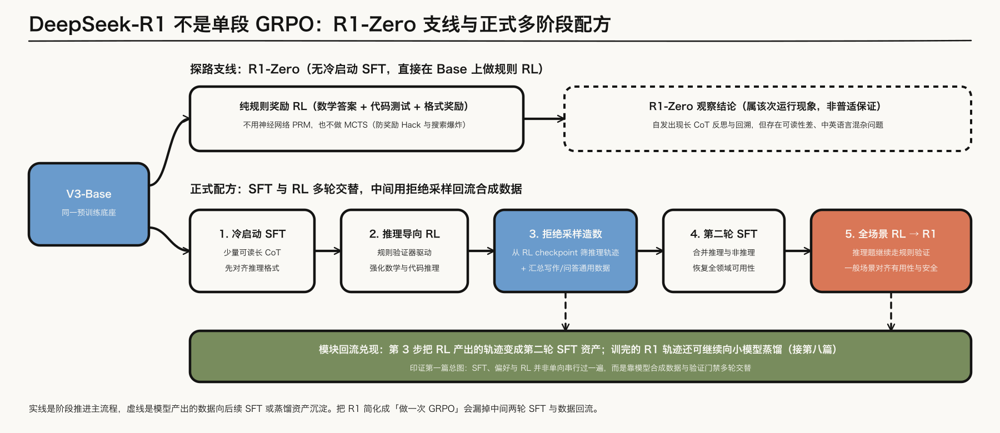
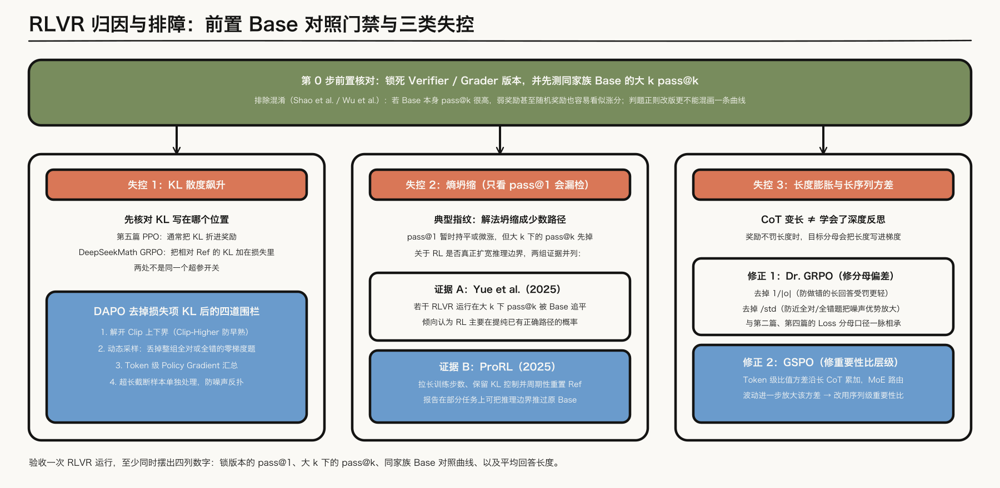
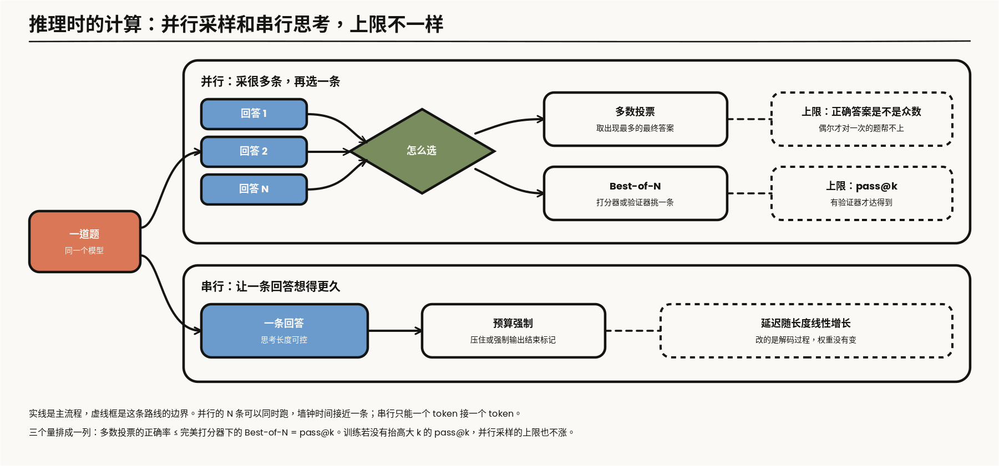

---

layout: post
tags: [LLM, NLP, Training]
title: 大模型是怎么炼成的（六）：可验证奖励、GRPO，以及三种失控
date: 2026-10-23
author: Kyrie Chen
comments: true
toc: true
pinned: false

---

第五篇的奖励是一个学出来的标量。它可以被 hack：分数上涨，人的偏好下降。数学答案对不对、测试通不通过，可以由规则检查。这一篇从这份可验证奖励写起。[Tulu 3](https://arxiv.org/abs/2411.15124) 把这种设定叫做 RLVR。GRPO 是 [DeepSeekMath](https://arxiv.org/abs/2402.03300) 里相对 PPO 的简化，不是「有了验证器就自动有了推理」。

这两个名字经常被当成一件事，公开报告里它们是分开出现的。Tulu 3 的 RLVR 用的是 PPO，Critic 还在。DeepSeekMath 的 GRPO 去掉了 Critic，奖励却来自一个训练出来的 reward model。[DeepSeek-R1](https://arxiv.org/abs/2501.12948) 才把规则奖励和 GRPO 放进同一次训练。所以这一篇始终分三笔账：奖励从哪来，优势怎么估，KL 放在哪。

o1 只作为推理时用更多计算换正确率的现象。它的训练步骤没有公开，这里不写。

> **范围**：结果可验证的推理 RL。对照 GRPO、DeepSeek-R1 的多阶段配方、DAPO 与 GSPO，以及 2025 年对这套训练的三组批评和修正。过程奖励只写到 R1 报告自己放弃它的理由。报告没写的系数不补；文中标明「算术」的数字是从公式直接算出来的，不是某次运行的结果。

---

## 一、验证器换掉的是 RM，不是信用分配

### 1.1 一条回答只有一个比特

结果奖励是稀疏的 0/1。它不再经过 Bradley-Terry，也绕开「RM 分数和真实偏好分叉」。代价是整段长 CoT 只有结尾一个比特，中间步骤的对错没有单独的梯度。第一篇给推理 RL 预留的接口在这里落地：每道 `problem` 绑定明确的 `verifier`/`grader` 版本，训练侧同时落盘 `rollout` 与 `reward` 日志；判题脚本或提取正则一旦改版，前后两批奖励就不能直接拼进同一条曲线。

落盘的一条奖励记录至少要有下面这些字段。取值是示意，字段是后面每一节排障都会用到的：

```json
{
  "problem_id": "math-000417", "group_id": 88213, "sample_idx": 5,
  "policy_version": 1840, "verifier": "math_equiv", "verifier_version": "2.3.1",
  "extract_ok": true, "extracted_answer": "\\frac{1}{2}", "reward": 1.0,
  "n_tokens": 2311, "truncated": false, "logp_old_uri": "rollouts/1840/88213-5.npy"
}
```

`extract_ok` 和 `reward` 分开记，是因为「没提取到答案」和「提取到了但答错」在奖励上都是 0，原因完全不同。`truncated` 和 `n_tokens` 分开记，是因为第四节的超长处理要区分「写完了、很长」和「没写完、被截断」。`policy_version` 是采样这条回答的策略，重要性比的分母来自它。

### 1.2 判题器自己也会判错

规则奖励不会像 RM 那样被策略找到一片高分的无意义区域，但规则本身是一段程序，有它自己的假阳性和假阴性。下面这张表是检查清单，不是某份报告的统计。

| 奖励类型 | 错的被判对 | 对的被判错 | 至少留痕 |
|---|---|---|---|
| 数学最终答案 | 提取到题面里出现过的数；选择题里猜中的选项 | 等价写法不匹配：小数和分数、带不带单位、根式是否化简 | 提取到的字符串、提取是否成功、等价判定用的规则版本 |
| 代码测试 | 测试覆盖不够，只对样例成立的解法通过；对输入做特判 | 超时或内存阈值随机器负载波动；依赖版本变了 | 测试集版本、沙箱镜像、超时配置、是否重试 |
| 格式奖励 | 标签齐全而内容为空 | 多一个换行或空格就不匹配 | 模板版本，和第四篇的 chat template 是同一份 |

三件事值得写进训练配置。第一，假阴性会被策略学成格式偏好：等价写法里只有一种得分，模型就只写那一种，这不等于它学会了化简。第二，判题器升级之后，用新旧两版重判同一批已经落盘的回答，把不一致的比例报出来；不做这一步，奖励曲线上的台阶无法归因。第三，代码题的测试在评测时也是测试。训练奖励用的测试集和评测用的测试集如果是同一份，第一篇的 holdout 就没有了。

### 1.3 过程奖励和搜索为什么被放下

一个比特太稀疏，直接的想法是给中间步骤也打分。[Lightman 等](https://arxiv.org/abs/2305.20050) 用逐步对错训练过程奖励模型，用来重排或引导搜索。DeepSeek-R1 的「不成功的尝试」写了他们为什么没有把 PRM 放进大规模 RL：细粒度步骤很难定义，自动标注不可靠，人工标注扩不了规模；一旦奖励来自模型，就会回到 Gao 等人的 reward hacking，还要再训一次 RM。MCTS 同样被放下：token 的分支比棋盘大，给每个节点设扩展上限又会把搜索困在局部；价值模型直接决定搜索质量，他们没有把 AlphaGo 那条迭代做稳。报告说这些方法不是不可能，只是在他们的实验里，相对开销不值。

R1-Zero 用的是规则：数学看最终答案，代码看测试，另加格式奖励，要求把思考过程放进指定的标签里。不用神经网络的过程奖励。

所以验证器换掉的只是第五篇那个学出来的 RM。「这段推理里哪一步有功」仍然没有答案，只是被摊到了整条回答上。下一节的 GRPO 就是在这个前提下估优势。

---

## 二、GRPO 去掉 Critic，KL 仍在损失里

PPO 用 Critic 把回报变成优势。GRPO 对同一道题采样一组回答，用组内奖励的均值和标准差做优势，Critic 没有了。



*图 1：沿用第五篇图 2 的同一布局。实线是主流程，虚线是回到 Policy 的梯度；中间三格并行位置里，规则 Verifier 替掉显式 RM，Reference 仍在（KL 加在损失里），Critic 那一格留空。*

### 2.1 目标函数

对一道题 $$q$$，用旧策略采 $$G$$ 条回答，第 $$i$$ 条记作 $$o_i$$，长度 $$\lvert o_i\rvert$$，奖励 $$r_i$$。DeepSeekMath 的结果监督版本里，一条回答的所有 token 共用同一个优势：

$$
\hat{A}_i = \frac{r_i - \mathrm{mean}(r_1,\dots,r_G)}{\mathrm{std}(r_1,\dots,r_G)}
$$

重要性比按 token 算：

$$
\rho_{i,t}(\theta) = \frac{\pi_\theta(o_{i,t}\mid q, o_{i,\lt t})}{\pi_{\theta_{\mathrm{old}}}(o_{i,t}\mid q, o_{i,\lt t})}
$$

要最大化的目标是

$$
\mathcal{J}_{\mathrm{GRPO}}(\theta) = \mathbb{E}\Big[\frac{1}{G}\sum_{i=1}^{G}\frac{1}{\lvert o_i\rvert}\sum_{t=1}^{\lvert o_i\rvert}\Big(\min\big(\rho_{i,t}\hat{A}_i,\ \mathrm{clip}(\rho_{i,t},1-\varepsilon,1+\varepsilon)\hat{A}_i\big)-\beta\,\mathbb{D}_{\mathrm{KL}}\big[\pi_\theta\,\Vert\,\pi_{\mathrm{ref}}\big]\Big)\Big]
$$

括号里前一项是 PPO 的裁剪目标，原样保留。和 PPO 相比变了两处：优势不再来自 Critic 和 GAE，来自同一道题的另外 $$G-1$$ 条回答；KL 不再折进奖励，直接写在目标里。

基线为什么可以用组内均值：同一道题的回答共享同一个 prompt，组内均值就是这道题当前正确率的估计，减掉它，剩下的是「这条回答比这道题的平均水平好多少」。它是 Critic 要学的那个状态价值在起点处的一次蒙特卡洛估计，不需要参数，代价是每道题必须采一组，而且组内没有任何 token 级的区分。

DeepSeekMath 那次实验里，奖励来自一个在同一底座上训练的 reward model，每道题采 64 条。也就是说 GRPO 这篇原始论文省掉的是 Critic，第五篇的 RM 还在。把 RM 换成规则，是 R1 的选择。

### 2.2 KL 在损失里，和折进奖励，不是同一个开关

DeepSeekMath 给 KL 用的是一个逐 token 的估计量。记采样到的那个 token 上的概率比为 $$u = \pi_{\mathrm{ref}}/\pi_\theta$$：

$$
\mathbb{D}_{\mathrm{KL}}\big[\pi_\theta\,\Vert\,\pi_{\mathrm{ref}}\big] \approx u - \log u - 1
$$

它对任何 $$u$$ 都非负，只在两个策略给这个 token 相同概率时为零。在 $$\pi_\theta$$ 自己的采样下，它的期望正好是 KL。训练时样本来自旧策略，梯度又只穿过这个式子本身，所以它是一个把策略往 reference 拉的惩罚项，不要把它的数值当成精确的 KL 梯度来读。

第五篇的 PPO-RLHF 通常把 KL 折进奖励。两种写法的梯度走的不是同一条路。折进奖励时，每个 token 的 $$-\beta\log(\pi_\theta/\pi_{\mathrm{ref}})$$ 是一个不带梯度的数，先进回报，经过 Critic 和 GAE 变成优势，再乘到 score function 上；它的方差和 Critic 的拟合质量绑在一起。写进损失时，惩罚项对 $$\pi_\theta$$ 直接求导，不经过优势，也不受组内标准化影响。

DAPO 说「去掉 KL」时，去掉的是 GRPO 损失里的这一项，不是第五篇奖励里的那一项。读一份配置时，先确认它说的 KL 是哪一处。

### 2.3 两个分母

目标函数里有两个跟着样本走的分母：组内标准差，和每条回答自己的长度。[Liu 等](https://arxiv.org/abs/2503.20783) 把它们带来的问题叫做问题难度偏差和回答长度偏差。两处都可以直接从公式算出来。

先看标准差。奖励是 0/1 时，设一组里做对的比例是 $$p$$。用总体标准差，做对的回答优势是 $$\sqrt{(1-p)/p}$$，做错的是 $$-\sqrt{p/(1-p)}$$。$$G=16$$ 时的算术：只有 1 条做对，这一条的优势是 3.87，其余 15 条各是 -0.26；8 条做对时是正负 1；15 条做对时，唯一做错的那条是 -3.87。接近全对或全错的题上，那一两条不合群的回答被放大了近四倍。再看一道题的总量：标准化之后，组内优势的平方和恒等于 $$G$$；不做标准化时是 $$G\,p(1-p)$$，在 $$p=1/2$$ 最大，往两端趋于零。标准化把「几乎已经学会」和「几乎完全不会」的题，抬到和最有信息量的题同样的权重。整组全对或全错时分子就是零，这组题不产生策略梯度，只白白占着 batch。

再看长度。每个 token 上的系数是 $$\hat{A}_i/\lvert o_i\rvert$$。两条都做对的回答，一条 200 token，一条 2000 token，短的那条每个 token 的权重是长的十倍：做对的里面偏向短的。两条都做错的回答，长的那条每个 token 被罚的力度只有十分之一：做错的里面，长的更便宜。合起来，目标函数自己就给「错了就写长一点」留了一条下坡路。

Dr. GRPO 把这两个分母都拿掉：优势只减组内均值，token 上求和而不是按长度平均。同一批张量上，三种归约只差最后一行：

```python
# logp, logp_old, logp_ref: [G, T]，采样到的 token 的对数概率；mask: [G, T]；reward: [G]
adv = (reward - reward.mean()) / (reward.std() + eps)      # GRPO：组内标准化
# Dr. GRPO 的优势只减组内均值，不再除以 std
ratio = (logp - logp_old).exp()
surr = torch.min(ratio * adv[:, None],
                 ratio.clamp(1 - eps_low, 1 + eps_high) * adv[:, None])  # GRPO 时两个界相等
log_u = logp_ref - logp
kl = log_u.exp() - log_u - 1                               # 非负；DAPO 把 beta 设为 0
per_tok = (surr - beta * kl) * mask

loss_grpo = -(per_tok.sum(1) / mask.sum(1)).mean()         # 每条先除以自己的长度
loss_dapo = -per_tok.sum() / mask.sum()                    # 除以这一组的 token 总数
loss_dr   = -per_tok.sum() / (G * max_len)                 # 除以常数，不跟长度走
```

`torch` 的 `.std()` 默认是样本标准差，和上面算术里的总体标准差差一个只依赖 $$G$$ 的常数因子，不改变结论。第二行归约是下一节 DAPO 的写法：组内不再按条平均，但分母仍是这一组的 token 总数，一道题的回答整体变长，它的每个 token 仍然变轻。第三行除以常数，才完全不跟长度走。

这和第二篇的 loss 归一化、第四篇的 mask 分母是同一类问题：分母若跟着样本长度走，日志里的长度变化不一定是「学会了反思」。



*图 2：柱高和曲线是公式的算术，不是某次运行的数据：0/1 奖励、总体标准差、每组 16 条。下排并列三种归约各自除以什么。*

---

## 三、R1 是多阶段，不是一次 GRPO

### 3.1 R1-Zero：一条探路的支线

R1-Zero 没有 SFT 冷启动，直接在 base 上做 RL，奖励只有规则。报告里 AIME 2024 的 pass@1 从 15.6% 升到 71.0%，再加多数投票是 86.7%；训练过程中回答变长，并观察到反思和回溯。第一篇已经写过：这是那次运行的现象，不是保证。报告自己列了它的两个问题：可读性差，中英文混在一起。它没有被当成最终模型。

### 3.2 四个小节，各自在修上一步留下的东西



*图 3：上方是直接在 Base 上做规则 RL 的 R1-Zero 支线；下方是 R1 的正式多阶段交替配方。实线是阶段推进，虚线表示模型产出的轨迹沉淀回第二轮 SFT 资产与后续蒸馏，对应第一篇总图的模块回流。*

论文把正式配方写成四个小节。图 3 把第三小节的「拒绝采样」和「SFT」拆成两格，所以画出来是五格。

| 小节 | 输入 | 做什么 | 修的是什么 |
|---|---|---|---|
| 冷启动 | 几千条可读的长 CoT 样本，经人工后处理 | 在 base 上做 SFT，输出固定成「推理过程 + 总结」 | R1-Zero 的可读性；让 RL 不从零开始找格式 |
| 推理导向的 RL | 数学、代码、逻辑等可判对错的题 | 规则奖励的 RL，另加语言一致性奖励 | 推理能力；中英文混杂 |
| 拒绝采样与 SFT | 上一步 checkpoint 生成的推理数据约 60 万条，加非推理数据约 20 万条 | 只留判对的；过滤语言混杂、过长段落、推理里的代码块；回到 base 上训两个 epoch | 只会做题、不会写作和问答 |
| 全场景 RL | 推理题和一般 prompt 混合 | 推理题沿用规则奖励，一般数据用 reward model | 有用性和安全 |

这张表里有三处容易被「纯 RL」的说法盖掉。

第一，语言一致性奖励是目标语言词的比例。报告的消融说，加上它，性能有轻微下降，换来的是输出更符合人的阅读偏好。这是一次明说了代价的取舍。

第三小节的 SFT 是在 base 上重新训，不是接着 RL 的 checkpoint 往下训。第二步的 RL 模型在这里的身份是数据生成器，交出去的是它的轨迹，不是它的权重。这正是第一篇总图里的回流：一个阶段的产物，成了更早一个阶段的输入。

第三，最后一步的 RL 里，第五篇的 RM 又回来了。一般数据没有标准答案，报告用 reward model 评它：有用性只看最后的总结，不去干预推理过程；安全性看整段输出，包括推理。可验证奖励覆盖不到的地方，仍然是学出来的奖励。

所以公开配方是 SFT、RL、数据回流、再 SFT、再 RL 接起来的。「纯 RL 就够了」对应的是那条没有交付的支线。

---

## 四、DAPO 与 GSPO 改的是哪一项

### 4.1 DAPO：去掉 KL，再加四道围栏

[DAPO](https://arxiv.org/abs/2503.14476) 先把损失里的 KL 去掉。理由是：长 CoT 的推理模型本来就会离初始模型很远，这个约束没有必要。约束拿掉之后，挡住漂移的是另外四项改动。

$$
\mathcal{J}_{\mathrm{DAPO}}(\theta) = \mathbb{E}\Big[\frac{1}{\sum_{i=1}^{G}\lvert o_i\rvert}\sum_{i=1}^{G}\sum_{t=1}^{\lvert o_i\rvert}\min\big(\rho_{i,t}\hat{A}_i,\ \mathrm{clip}(\rho_{i,t},1-\varepsilon_{\mathrm{low}},1+\varepsilon_{\mathrm{high}})\hat{A}_i\big)\Big]
$$

同时要求每一组里做对的条数严格大于 0、严格小于 $$G$$。

**Clip-Higher。** 上下界解开，论文取 $$\varepsilon_{\mathrm{low}}=0.2$$、$$\varepsilon_{\mathrm{high}}=0.28$$。对称裁剪下，一个概率 0.01 的 token 一步最多升到 0.012，概率 0.9 的 token 却几乎不受上界约束。被压住的恰好是低概率的探索 token，策略越训越确定，熵往下掉。放宽上界给它们留出空间；下界不放，避免把低概率 token 直接压到零。

**动态采样。** 上面那条约束的实现方式是多采、过滤：整组全对或全错的题丢掉，直到 batch 里装满有梯度的题。原因在 2.3 节已经算过，这类题的优势全是零。训练越往后全对的题越多，不过滤的话，一个 batch 里真正产生梯度的题越来越少，梯度的方差跟着变大。

**Token 级归约。** 分母从每条回答自己的长度，换成这一组的 token 总数。论文的理由是：按条平均时，长回答里每个 token 的权重被稀释，长而好的推理学不到，长而重复的废话也罚不动。

**超长样本。** 被截断的回答如果直接记成答错，模型会把「推理本身是对的、只是没写完」也当成错误。论文给了两种处理：把截断样本的损失整条 mask 掉；或者在最大长度 $$L_{\max}$$ 之前留一段缓冲 $$L_{\mathrm{cache}}$$，长度 $$\lvert y\rvert$$ 进入缓冲段后加一项线性惩罚，超过上限记为 -1：

$$
R_{\mathrm{length}}(y) = \frac{(L_{\max}-L_{\mathrm{cache}})-\lvert y\rvert}{L_{\mathrm{cache}}},\qquad L_{\max}-L_{\mathrm{cache}} \lt \lvert y\rvert \le L_{\max}
$$

论文报告的结果是：Qwen2.5-32B 底座在 AIME 2024 上到 50 分，对照的 DeepSeek-R1-Zero-Qwen-32B 是 47 分，训练步数是后者的一半。47 分是 R1-Zero 那条支线在 Qwen-32B 上的结果，不是 R1 蒸馏版 Qwen-32B。

### 4.2 GSPO：把重要性比抬到序列级

[GSPO](https://arxiv.org/abs/2507.18071) 改的是重要性比的层级。它的论点是：重要性采样靠的是对同一个分布采很多样本来修正偏差，而 token 级的比值在每个位置只有一个样本，起不到修正作用，只把噪声带进梯度。回答越长，这种噪声累加得越多。

它用整条回答的概率比，再按长度开方，把量级拉回到和单个 token 可比：

$$
s_i(\theta) = \Big(\frac{\pi_\theta(o_i\mid q)}{\pi_{\theta_{\mathrm{old}}}(o_i\mid q)}\Big)^{1/\lvert o_i\rvert}
$$

裁剪和目标都作用在 $$s_i$$ 上，一条回答要么整条被裁，要么整条不被裁。

论文还写了它和 MoE 的关系。MoE 的专家路由在两次参数更新之间会变，同一个 token 在新旧策略下可能走了不同的专家，token 级的比值因此抖得更厉害。之前的做法是把旧策略的路由记下来，在新策略上重放。序列级的比值对单个 token 的路由变化不敏感，这一步可以省掉。第二篇写过 MoE 的梯度落点会随路由变，这里是同一件事在 RL 侧的后果。

### 4.3 四个方法，各自动了哪一项

| 方法 | 优势 | 重要性比 | 长度归约 | 损失里的 KL | 额外处理 |
|---|---|---|---|---|---|
| GRPO | 减组内均值，除以组内标准差 | token 级，对称裁剪 | 每条除以自己的长度 | 有 | 无 |
| Dr. GRPO | 只减组内均值 | token 级，对称裁剪 | 不按长度平均 | 沿用所在实现的设置 | 无 |
| DAPO | 减均值，除以标准差 | token 级，上界放宽 | 除以组内 token 总数 | 去掉 | 动态采样；超长样本 mask 或软惩罚 |
| GSPO | 组内标准化 | 序列级，按长度开方 | 比值在序列级，不再逐 token 加权 | 展示的目标里把 KL 省略了 | MoE 上不再需要路由重放 |

这张表是「改了哪一项」的对照，不是排名。四篇论文的底座、数据和评测都不同，它们之间没有受控的横向比较。

---

## 五、失控、归因，和两组互相不判死的证据



*图 4：顶部门禁要求先锁死 `verifier` 版本并对同家族 Base 做 pass@k 对照，排除高起点底座上的弱奖励假阳性；下方三栏分别给出 KL 飙升、熵坍缩（并列两组公开证据）以及长度膨胀与采样方差的检查项。*

### 5.1 先过门禁：涨分是不是奖励带来的

有一层混淆比三种失控更靠前。[Shao 等](https://arxiv.org/abs/2506.10947)报告，随机甚至错误的奖励也能让部分 Qwen 数学设置涨分；他们追到的原因之一，是这些底座本来就有一种把题目写成代码来推的习惯，RL 把它的出现频率推高了，奖励对不对并不关键。换到别的模型家族，同样的假奖励不起作用。[Wu 等](https://arxiv.org/abs/2508.21188) 把这类现象收成条件：base 在该任务上的 pass@k 已经很高时，弱奖励或假奖励更容易看起来有效；对齐弱的时候，这些做法带不动，标准 RL 仍然有差。

所以一份涨分要先对 base 家族和 pass@k 做对照，再记到奖励设计头上。这和第一篇的说法相同：评估是控制信号，不是事后的总分。门禁有两条，都在动任何旋钮之前：`verifier` 版本锁死；同家族 base 在同一批题上的大 $$k$$ pass@k 已经测过。

### 5.2 排查表：先看哪个信号先动

第二篇的 spike 诊断是先分类、再动旋钮。这里沿用同一个顺序。表里的信号都来自 1.1 节那条奖励记录和训练日志，不需要新的工具。

| 现象 | 先动的信号 | 对照 | 只动这一个旋钮 |
|---|---|---|---|
| KL 飙升 | 逐 token KL 均值；重要性比被裁剪的比例 | 先确认 KL 写在损失里还是奖励里；用上一个 checkpoint 重放同一批题 | 有 KL 项的看系数和 reference；DAPO 路线看裁剪上界 |
| 熵坍缩 | token 熵；一组里不同最终答案的个数；全对或全错的组占比 | 同家族 base 的大 k pass@k | 裁剪上界、动态采样、采样温度，一次一个 |
| 长度膨胀 | 平均长度按做对和做错分开看；截断率 | 同一批 rollout 按 2.3 节三种分母各算一次损失 | 归约口径；超长样本的处理方式 |
| 涨分来源可疑 | base 的 pass@k 本来就高；训练早期就大幅涨分 | 随机奖励、错误奖励；换一个模型家族 | 不动旋钮，先不把涨分记到奖励头上 |
| 奖励曲线出现台阶 | 提取成功率跳变；同一回答重判结果不同 | 新旧判题器重判同一批落盘回答 | 锁版本，把曲线在这里断开 |

KL 飙升时，如果是 DAPO 这类已经去掉 KL 项的配置，调系数没有对象，要看的是裁剪、动态采样和长度处理有没有挡住漂移。熵坍缩时，pass@1 可以暂时还在，先掉的是大 $$k$$ 下的 pass@k 和组内答案的多样性。长度膨胀时，奖励不罚长度，CoT 变长，正确率不一定升；2.3 节已经说明其中一部分是目标函数的分母，不是能力出现的标志。

梯度裁剪和降低学习率在这里和第二篇一样，是围栏，不是诊断。它们能让曲线变平，不能告诉你平下来的是哪一项。

### 5.3 pass@k 的两组证据

pass@k 回答的是：对一道题采 $$k$$ 条，至少一条做对的概率。直接采 $$k$$ 条来数，方差很大。常用的是 [Chen 等](https://arxiv.org/abs/2107.03374) 的无偏估计：每道题采 $$n \ge k$$ 条，其中 $$c$$ 条通过，算「从 $$n$$ 条里任取 $$k$$ 条全错」的概率，再用 1 减掉。

```python
def pass_at_k(n, c, k):
    # n 条采样里 c 条通过；等价于 1 - C(n-c, k) / C(n, k)
    if n - c < k:
        return 1.0
    return 1.0 - np.prod(1.0 - k / np.arange(n - c + 1, n + 1))
```

小 $$k$$ 衡量的是「一次就做对」，大 $$k$$ 衡量的是「这道题在不在模型够得着的范围里」。RL 让 pass@1 上升有两种方式：把本来偶尔能做对的题做得更稳，或者做出本来怎么采都做不对的题。前者只挪动概率，后者才扩大了范围。

[Yue 等](https://arxiv.org/abs/2504.13837) 报告：若干 RLVR 运行之后，小 $$k$$ 下 RL 模型更好，大 $$k$$ 下 base 的 pass@k 追上甚至超过 RL 模型，并据此质疑 RL 是否扩大了推理边界。[ProRL](https://arxiv.org/abs/2505.24864) 用更长的训练、保留 KL 并周期性重置 reference、更多样的任务，声称边界可以被推开。

两组证据并列。它们的训练长度、任务范围和 KL 设置都不同，Yue 等人看到的是常见的较短运行之后的状态，ProRL 改的正好是这几项。这一篇不把其中一组写成定论。对一次自己的运行，能做的是把大 $$k$$ 的 pass@k 和 base 画在同一张图上，而不是只报 pass@1。

---

## 六、推理时的计算是另一笔账

训练若把可搜索的策略放进模型，推理时可以用更多计算换正确率。换法分两类，花的计算不一样，天花板也不一样。

### 6.1 并行：采很多条，再选一条

多数投票和 [self-consistency](https://arxiv.org/abs/2203.11171) 采 $$N$$ 条，取出现最多的最终答案。它要求答案能被提取成可比较的离散值。$$N$$ 增大时，投票结果收敛到这道题上概率最高的那个答案：正确答案是众数，这道题趋向做对；某个错误答案比正确答案更常出现，这道题趋向做错，采得越多错得越稳。所以投票抬的是「对的次数多过任何一种错法」的题，对「偶尔才对一次」的题没有帮助。R1-Zero 在 AIME 2024 上从 71.0% 到 86.7%，就是这一类提升。

Best-of-$$N$$ 是另一种选法：采 $$N$$ 条，用一个打分器挑一条。推理时如果有可执行的验证器，比如代码题带着测试，它的正确率就是 pass@k。没有验证器时，上限是打分器的排序能力，第一节 Lightman 等人的 PRM 本来就是用在这里的。

三个量因此排成一列：多数投票的正确率不超过 Best-of-$$N$$ 在完美打分器下的正确率，后者就是 pass@k。5.3 节的争论在推理侧有直接的后果：如果 RL 只是把概率挪到已经够得着的题上，大 $$k$$ 的 pass@k 不涨，并行采样能换到的上限也不涨。

### 6.2 串行：让一条回答想得更久

另一类是控制单条回答的思考长度。[s1](https://arxiv.org/abs/2501.19393) 的预算强制是纯推理侧的操作：想提前结束时强制输出思考结束的标记；想继续时压住这个标记，并在后面追加一个表示「再想想」的词。它改的是解码过程，模型的权重没有因为这个操作而变。

串行和并行的延迟特征相反。并行的 $$N$$ 条可以同时跑，墙钟时间接近一条；串行的思考只能一个 token 接一个 token，长度翻倍，延迟翻倍。[Snell 等](https://arxiv.org/abs/2408.03314) 的结论是，哪种换法划算取决于题目难度：较容易的题上，推理时的计算可以顶替一部分模型规模；最难的题上，收益很小。

没有公开训练配方的模型，不把它们的推理界面写成训练步骤。一个产品提供「思考强度」的选项，说明的是推理侧有这个旋钮，不说明训练时做了什么。



*图 5：实线是主流程，虚线框是每条路线的上限。并行的几条可以同时跑；串行的思考只能一个 token 接一个 token。*

---

## 七、交出去的是带验证器的策略

验证器换掉的是学出来的 RM，没有换掉长链条里的信用分配。复核一次 RLVR 运行时，先对清四本账：DeepSeekMath 的 GRPO 把相对 reference 的 KL 加在损失里，和第五篇 PPO 折进奖励的不是同一个开关，DAPO 拿掉的也是损失里这一项；优势里的 $$1/\lvert o\rvert$$ 与组内标准差 $$\mathrm{std}$$ 会把长度偏差和难度偏差写进梯度，GSPO 的序列级比值修的则是长序列与 MoE 路由波动累加出的重要性采样方差；看涨分不能只报 pass@1，要把大 $$k$$ 下的 pass@k、回答长度和同家族 base 对照摆在一起，先排除高 pass@k 底座上的弱奖励假阳性，并核对日志里的 `verifier` 版本没有漂移。

下一篇把一次解答换成环境里的一串动作：输入变成第一篇预留的 `environment`/`tool schema` 与版本、受权限边界约束的多轮 `trajectory`，奖励也退到轨迹末端才出现。

---

## 参考资料

- [DeepSeekMath / GRPO](https://arxiv.org/abs/2402.03300)（目标函数、KL 估计量、组内优势）
- [Lightman et al., Let's Verify Step by Step](https://arxiv.org/abs/2305.20050)
- [DeepSeek-R1](https://arxiv.org/abs/2501.12948)（规则奖励、四个训练小节，以及 PRM / MCTS 的不成功尝试）
- [Tulu 3](https://arxiv.org/abs/2411.15124)（RLVR）
- [Liu et al., Understanding R1-Zero-Like Training（Dr. GRPO）](https://arxiv.org/abs/2503.20783)
- [DAPO](https://arxiv.org/abs/2503.14476)
- [GSPO](https://arxiv.org/abs/2507.18071)
- [Yue et al., pass@k 与 base 的比较](https://arxiv.org/abs/2504.13837)
- [ProRL](https://arxiv.org/abs/2505.24864)
- [Shao et al., Spurious Rewards](https://arxiv.org/abs/2506.10947)
- [Wu et al., Mirage or Method?](https://arxiv.org/abs/2508.21188)
- [Chen et al., Codex](https://arxiv.org/abs/2107.03374)（pass@k 的无偏估计）
- [Wang et al., Self-Consistency](https://arxiv.org/abs/2203.11171)
- [Snell et al., Scaling LLM Test-Time Compute Optimally](https://arxiv.org/abs/2408.03314)
- [Muennighoff et al., s1](https://arxiv.org/abs/2501.19393)（预算强制）
