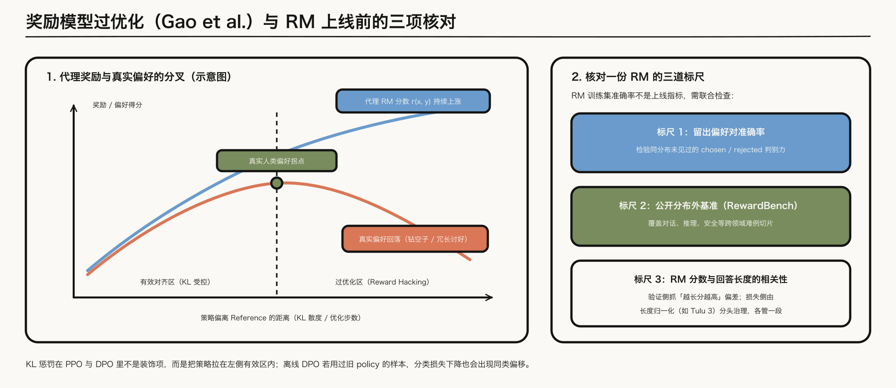
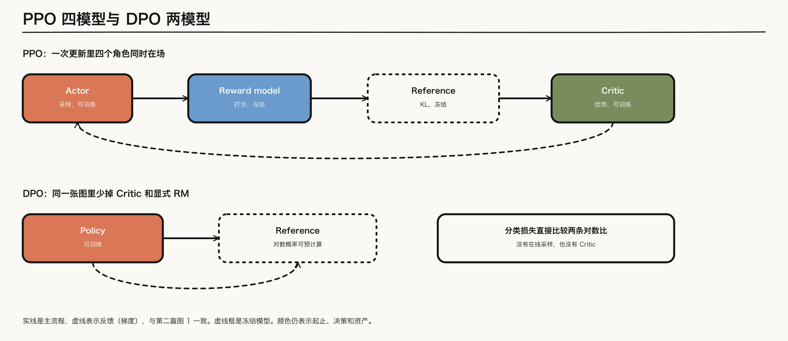
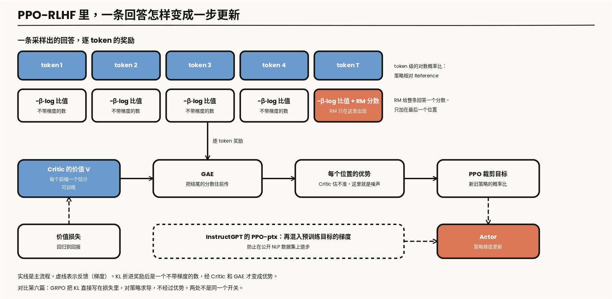
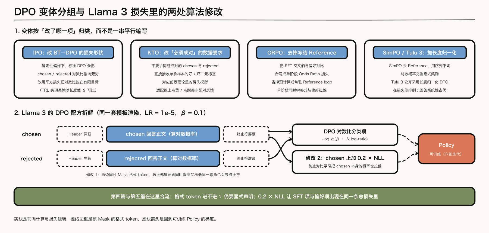
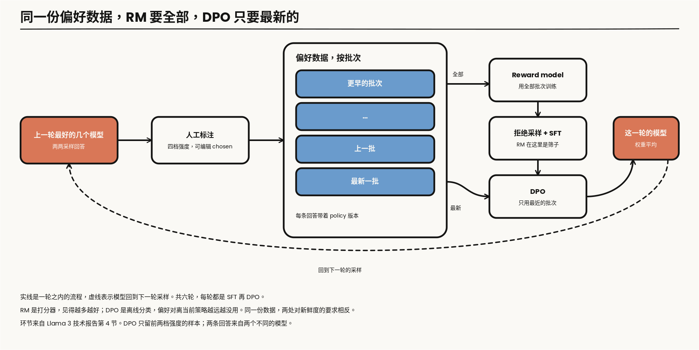

---

layout: post
tags: [LLM, NLP, Training]
title: 大模型是怎么炼成的（五）：偏好对齐里，谁在打分，谁在更新
date: 2026-10-9
author: Kyrie Chen
comments: true
toc: true
pinned: false

---

第四篇的结尾是：偏好优化需要的是同一套模板下的 chosen 与 rejected，或者好/坏标签，以及产生它们时的 policy 版本。那不是 SFT 的损失。这一篇从这份输入写起：先问偏好在假设什么，再问奖励和 KL 分别由哪个模型提供，最后问怎样知道这个奖励没有在奖励长度。

可验证的对错、环境里的轨迹，分别留在后面两篇。

> **范围**：文本模型的偏好优化。对照 [InstructGPT](https://arxiv.org/abs/2203.02155) 的 PPO、[Llama 3](https://arxiv.org/abs/2407.21783) 的 DPO，以及 [Tulu 3](https://arxiv.org/abs/2411.15124) 的长度归一化。报告没写的系数不补；文中标明「算术」的数字是从公式直接算出来的，不是某次运行的结果。

---

## 一、成对偏好假设了一个标量奖励

### 1.1 Bradley-Terry 和 RM 的损失

把「$$y_w$$ 比 $$y_l$$ 更好」写成 Bradley-Terry：

$$
P(y_w \succ y_l \mid x) = \sigma\big(r(x,y_w) - r(x,y_l)\big)
$$

这里的 $$r$$ 是一个标量。训练 reward model 就是对这个概率做最大似然：

$$
\mathcal{L}_{\mathrm{RM}}(\phi) = -\mathbb{E}_{(x,y_w,y_l)}\Big[\log\sigma\big(r_\phi(x,y_w) - r_\phi(x,y_l)\big)\Big]
$$

损失里只有差。给同一个 prompt 下的所有回答加上任意一个只依赖 $$x$$ 的常数，胜率不变，损失也不变。RM 的绝对分数因此没有定义，只有同一个 prompt 内的相对分数有意义。这件事后面会出现三次：PPO 要靠 Critic 把这个漂着的基线吃掉，InstructGPT 给 RM 加了一个偏置，让标注者示范的平均分在 RL 开始之前是 0；DPO 的推导里，配分函数能消掉，靠的也是它。

第四篇留下的接口在这里变成一条偏好记录。取值是示意，字段是后面排障要用的：

```json
{
  "prompt_id": "chat-031877", "template_version": "v3.2",
  "chosen":   {"text_uri": "pref/031877-a.txt", "policy_version": "round4-sft", "n_tokens": 412},
  "rejected": {"text_uri": "pref/031877-b.txt", "policy_version": "round3-dpo", "n_tokens": 187},
  "strength": "better", "edited": false, "annotation_batch": "2026w31",
  "ref_logps": {"reference_version": "round4-sft", "chosen": -402.6, "rejected": -231.9}
}
```

`policy_version` 记在每条回答上，因为一对回答可以来自两个不同的模型。`n_tokens` 两边都记，第一节和第四节的长度检查都从它来。`ref_logps` 是 reference 在两条回答上的对数概率，可以预计算，但它绑定 `reference_version`：换了 reference，这一列作废。

### 1.2 一个标量放不进的东西

Bradley-Terry 假设偏好可传递：若 A 胜 B、B 胜 C，则 A 应胜 C。标注来自很多人，把他们的选择合起来，可以出现 A 胜 B、B 胜 C、C 胜 A。这种循环放不进一个数，模型只能把它压成某个排序，损失停在一个降不下去的地方。RM 的留出准确率有上限，一部分原因在这里，不全是模型容量。

多个候选的排序可以写成 Plackett-Luce，仍是同一个标量奖励的排序模型。InstructGPT 的标注就是排序：每个 prompt 让标注者给若干条回答排名，再拆成两两比较。拆出来的比较对彼此相关，他们把同一个 prompt 的所有比较对放进同一个 batch 元素里训练，而不是打散当成独立样本。

### 1.3 过优化，以及核对一份 RM

[Gao 等](https://arxiv.org/abs/2210.10760)把过优化写成一条曲线。他们用一个更强的 RM 充当「真实偏好」的替身，在它的标签上训练代理 RM，再量策略优化过程中两个分数的走向：代理 RM 上的分数可以随着策略离开初始模型继续涨，替身上的分数先升后降。RM 更大、偏好数据更多时，掉头来得更晚。

这条曲线里混着两件事。一件是 RM 本身的泛化误差：没见过的回答，分数不准。另一件是策略在主动找 RM 打分偏高的区域，优化得越久，找到的越多。前者靠更多数据能缓解，后者只要 RM 是有限的就一直存在，KL 约束管的是它。

所以 RM 的训练准确率不是上线指标。后面用三件事情核对一份 RM：留出偏好对上的准确率，[RewardBench](https://arxiv.org/abs/2403.13787) 这类公开基准，以及分数和回答长度的相关性。长度偏差在验证侧是这张相关性，在损失侧是第三节的长度归一化。两处各管一段。



*图 1：左框示意 Gao 等人的奖励模型过优化曲线——随相对 Reference 的距离拉大，代理 RM 分数继续上升而真实偏好先升后降；右框列出核对一份 RM 的三道独立标尺。*

---

## 二、PPO：四个模型，两条冻结

### 2.1 目标，和 InstructGPT 的三步

KL 约束下的目标是

$$
\max_{\pi}\ \mathbb{E}_{x,\,y\sim\pi}\big[r(x,y)\big] - \beta\,\mathrm{KL}\big(\pi(\cdot\mid x)\,\Vert\,\pi_{\mathrm{ref}}(\cdot\mid x)\big)
$$

InstructGPT 把它拆成三步：SFT、用成对偏好训 RM、再用 PPO 更新策略。PPO 这一步同时在跑四个模型。



*图 2：上排是 PPO，下排是 DPO，同一布局。实线是主流程，虚线表示反馈（梯度），与第二篇图 1 一致；可训练与冻结写在节点文字里。一批 rollout 由 RM、Reference、Critic 分头消费；虚线只画回到 Actor 的策略梯度，Critic 由价值损失单独更新。下排同一列里，打分和估值两格是空的。*

Actor 采样，Reward model 打分，Reference 提供 KL 里的旧策略，Critic 把回报变成优势。Actor 和 Critic 更新，RM 和 Reference 冻结。KL 是约束策略不要离开 SFT 模型，不是损失上的装饰项。

### 2.2 从一条回答到一步更新

RM 给整条回答一个分数，PPO 要的是每个 token 上的优势。中间有三步。

第一步，把 KL 折进奖励。InstructGPT 写的是在每个 token 上加一项相对 SFT 模型的 KL 惩罚。常见的实现是：每个位置的奖励是这个 token 上的对数概率比，RM 的分数只加在最后一个 token 上。

$$
r_t = -\beta\,\log\frac{\pi_\theta(y_t\mid x,y_{\lt t})}{\pi_{\mathrm{ref}}(y_t\mid x,y_{\lt t})} + \mathbb{1}[t=T]\;r_\phi(x,y)
$$

这一项是采样时算好的数，不带梯度。

第二步，Critic 给每个前缀估一个价值 $$V_\psi(s_t)$$，用 GAE 把逐 token 奖励变成优势：

$$
\delta_t = r_t + \gamma V_\psi(s_{t+1}) - V_\psi(s_t)
$$

$$
\hat{A}_t = \sum_{l\ge 0}(\gamma\lambda)^{l}\,\delta_{t+l}
$$

RM 的分数只在结尾出现，前面所有位置的优势都要靠 Critic 把结尾的分数往回传。Critic 估不准，前面的优势就是噪声。1.1 节那个没有定义的基线也在这里被吃掉：$$V_\psi$$ 学到的就是「这个 prompt 下平均能拿多少分」。InstructGPT 的 Critic 是从 RM 的权重初始化的，它一开始就带着这份估计。

第三步，PPO 的裁剪目标。记 $$\rho_t$$ 为新旧策略在这个 token 上的概率比：

$$
\mathcal{J}_{\mathrm{PPO}}(\theta) = \mathbb{E}_t\Big[\min\big(\rho_t\hat{A}_t,\ \mathrm{clip}(\rho_t,1-\varepsilon,1+\varepsilon)\hat{A}_t\big)\Big]
$$

Critic 另有一项回归到回报的价值损失，和这一项分开。

InstructGPT 还报告了一个副作用：只做 PPO，模型在一些公开 NLP 数据集上退步。他们在 PPO 的梯度里混入预训练目标的梯度，把这个版本叫 PPO-ptx。偏好项、KL 项之外，损失里又多了一项语言建模。第三节会看到，Llama 3 在 DPO 里加的 NLL 是同一类补丁。



*图 3：一条回答怎样变成一步更新。实线是主流程，虚线表示反馈（梯度）。KL 折进奖励后是不带梯度的数，RM 的分数只加在最后一个 token 上，要靠 Critic 和 GAE 往前传。*

### 2.3 四个模型的账

四个模型里，Actor 要自回归采样，这是推理的开销；RM 和 Reference 各做一次前向；Actor 和 Critic 各做一次前向和反向，各带一份优化器状态。Critic 可以和 Actor 共享主干，也可以独立，后者是两份完整的训练显存。并行怎么切这些张量，见[《并行策略到底在切什么》](/What-Each-Parallelism-Actually-Shards/)，这里不重算。

系统上更麻烦的是数据是在线的：每一步更新用的样本，都要由当前策略刚刚采出来。采样和训练绑在一个循环里，采样慢，训练就等。这是 Llama 3 后来说 DPO「更省计算」时比较的对象，也是第七篇异步 rollout 要拆开的那个等待。

---

## 三、DPO 消掉的是在线采样和显式 RM

### 3.1 三步推导

2.1 节那个带 KL 约束的目标有闭式的最优解。对每个 prompt，最优策略是 reference 按奖励做指数加权：

$$
\pi^{*}(y\mid x) = \frac{1}{Z(x)}\,\pi_{\mathrm{ref}}(y\mid x)\,\exp\Big(\frac{r(x,y)}{\beta}\Big)
$$

把它反过来解出奖励：

$$
r(x,y) = \beta\log\frac{\pi^{*}(y\mid x)}{\pi_{\mathrm{ref}}(y\mid x)} + \beta\log Z(x)
$$

配分函数 $$Z(x)$$ 要对所有可能的回答求和，算不出来。但它只依赖 $$x$$。代进 Bradley-Terry，两条回答的奖励相减，这一项正好消掉。这就是 1.1 节的平移不变性：BT 本来就不关心只依赖 prompt 的常数。把 $$\pi^{*}$$ 换成要训练的 $$\pi_\theta$$，对偏好数据做最大似然：

$$
\mathcal{L}_{\mathrm{DPO}}(\theta) = -\mathbb{E}_{(x,y_w,y_l)}\Big[\log\sigma\Big(\beta\log\frac{\pi_\theta(y_w\mid x)}{\pi_{\mathrm{ref}}(y_w\mid x)} - \beta\log\frac{\pi_\theta(y_l\mid x)}{\pi_{\mathrm{ref}}(y_l\mid x)}\Big)\Big]
$$

成对偏好变成一个分类损失。RM 不必再单独训练，rollout 也不必在线采。Reference 的对数概率仍要，可以提前算好。图 2 下排只留 Policy 和 Reference，少掉的是 Critic，以及那个显式的 reward model。

推导用了两个假设：偏好服从 Bradley-Terry，策略族能表示那个最优解。$$\beta$$ 在 PPO 里是 KL 的系数，在这里成了分类器的温度，是同一个数。

### 3.2 梯度自带的权重，和它不约束的东西

记隐式奖励 $$\hat{r}_\theta(x,y)=\beta\log\big(\pi_\theta(y\mid x)/\pi_{\mathrm{ref}}(y\mid x)\big)$$。对 $$\theta$$ 求导：

$$
\nabla_\theta\mathcal{L}_{\mathrm{DPO}} = -\beta\,\mathbb{E}\Big[\sigma\big(\hat{r}_\theta(x,y_l)-\hat{r}_\theta(x,y_w)\big)\,\big(\nabla_\theta\log\pi_\theta(y_w\mid x)-\nabla_\theta\log\pi_\theta(y_l\mid x)\big)\Big]
$$

括号里是「抬高 chosen、压低 rejected」。前面那个 sigmoid 是权重：隐式奖励把这一对排错得越厉害，权重越接近 1；已经排对而且拉开了，权重趋于 0。算术：训练刚开始，策略等于 reference，两个隐式奖励都是 0，每一对的权重都是 0.5；差拉到 $$\beta\Delta = 1$$ 时权重降到 0.27，拉到 3 时是 0.05。损失自己会把注意力挪到还没分开的样本上。

这个损失只约束差。chosen 和 rejected 的对数概率可以一起下降，只要 rejected 掉得更快，损失照样在降。[Pal 等](https://arxiv.org/abs/2402.13228)报告了这种情况：两条回答只差几个 token 时尤其容易出现，chosen 的概率在训练中不升反降。概率从这两条回答上流走，流到哪里，损失不管。

Llama 3 的处理是在 chosen 序列上加一项 NLL，系数 0.2，做法参照 [Pang 等](https://arxiv.org/abs/2404.19733)。报告给的理由是稳定训练：保持生成所需的格式，并且防止 chosen 的对数概率下降。于是这一阶段的总损失里，第四篇的 SFT 项和这一篇的偏好项同时在。

[Azar 等](https://arxiv.org/abs/2310.12036)指出另一处裂缝：偏好若是确定性的，Bradley-Terry 的最优解要求奖励差为无穷，DPO 会把 chosen 与 rejected 的对数比一直往外推，KL 约束名存实亡。IPO 用平方损失把这个比拉向一个有限的目标。记 $$h_\theta$$ 为 3.1 节括号里去掉 $$\beta$$ 的那个对数比之差，$$\tau$$ 为正则强度：

$$
\mathcal{L}_{\mathrm{IPO}}(\theta) = \mathbb{E}\Big[\Big(h_\theta(x,y_w,y_l)-\frac{1}{2\tau}\Big)^{2}\Big]
$$

改的是 BT 到 DPO 的那一步，不是又一个采样技巧。

### 3.3 离线偏移

分布偏移留在损失外面。偏好对若来自很旧的 policy，当前模型是在做离线分类：分类损失可以继续降，而当前策略实际会生成的回答，可能一条都不在这份数据覆盖的范围里。RM 至少还能给新回答打一个分，哪怕不准；固定的偏好对连这一步都没有。这就是 Gao 那条曲线在没有 RM 时的对应物。

1.1 节记录里的 `policy_version` 就是用来量这个距离的。偏好对的两端都比当前策略旧好几轮时，分类准确率说明不了当前策略的偏好。第五节的六轮迭代，是 Llama 3 对这件事的回答。

### 3.4 变体：各自改了哪一项

其余变体按「改了哪一项」放在一起。

| 方法 | 数据 | Reference | 改的是哪一项 | 代价 |
|---|---|---|---|---|
| DPO | 成对 | 需要，可预计算 | 基准形式 | 只约束差；序列对数概率是和，带长度 |
| IPO | 成对 | 需要 | logistic 换成平方损失，对数比有有限目标 | 多一个正则强度要定 |
| KTO | 不配对的好/坏标签 | 需要 | 不用成对形式，按得失不对称加权 | 好坏样本的比例和权重要自己平衡 |
| ORPO | 成对 | 不需要 | SFT 的 NLL 加一项 odds ratio，一个阶段做完 | 没有 reference 约束，漂移靠 NLL 项拉住 |
| SimPO | 成对 | 不需要 | 平均对数概率当隐式奖励，另加目标间隔 | 同上；间隔是新的超参 |
| 长度归一化 DPO | 成对 | 需要 | 对数比先除以回答长度 | 差的量级变了，系数不能照搬 |

KTO 对应的是前景理论里的得失：人对损失比对同等的收益更敏感，它把好样本和坏样本分开加权，不要求它们成对。线上的点赞、点踩天然就是这种形态。它不是 DPO 的小改。ORPO 把偏好项写成两条回答的 odds 之比，$$\mathrm{odds}=p/(1-p)$$，和 NLL 加在一起，没有 reference，也没有单独的 SFT 阶段。

SimPO 去掉 reference，用序列上的平均对数概率当隐式奖励，并要求 chosen 比 rejected 高出一个间隔 $$\gamma$$：

$$
\mathcal{L}_{\mathrm{SimPO}}(\theta) = -\mathbb{E}\Big[\log\sigma\Big(\frac{\beta}{\lvert y_w\rvert}\log\pi_\theta(y_w\mid x)-\frac{\beta}{\lvert y_l\rvert}\log\pi_\theta(y_l\mid x)-\gamma\Big)\Big]
$$

它的理由是：生成时用的是每个 token 的概率，训练的隐式奖励却是整条的对数概率之和，两者差一个长度。Tulu 3 公开采用的长度归一化 DPO 保留 reference，只做这一处改动：

$$
\mathcal{L}_{\mathrm{LN\text{-}DPO}}(\theta) = -\mathbb{E}\Big[\log\sigma\Big(\frac{\beta}{\lvert y_w\rvert}\log\frac{\pi_\theta(y_w\mid x)}{\pi_{\mathrm{ref}}(y_w\mid x)}-\frac{\beta}{\lvert y_l\rvert}\log\frac{\pi_\theta(y_l\mid x)}{\pi_{\mathrm{ref}}(y_l\mid x)}\Big)\Big]
$$

除以长度之后，括号里的量从「整条的和」变成「每个 token 的平均」，小了大约一个回答长度的倍数。同样的 $$\beta$$ 乘上去，分类器的温度完全不同。Tulu 3 报告的 $$\beta$$ 是 5，Llama 3 没做归一化，是 0.1。这两个数不在同一个量纲上，不能互相参考。

这张表是「改了哪一项」的对照，不是排名。Tulu 3 在自己的设置里比过几种，选了长度归一化的 DPO；那是它的数据和底座上的结论。

---

## 四、损失里那几行

### 4.1 TRL 的 sigmoid 分支

当前 TRL 在 `loss_type == "sigmoid"`、散度为 reverse KL 时，先分别减去 reference 的对数概率，再把两条比相减。$$\beta$$ 乘在这个差上，然后进 logistic。文件里还有 hinge、IPO 等分支，下面只是 sigmoid 这一支。

```python
chosen_logratios = chosen_logps - ref_chosen_logps
rejected_logratios = rejected_logps - ref_rejected_logps
chosen_scores = chosen_logratios          # reverse_kl 分支
rejected_scores = rejected_logratios
delta_score = chosen_scores - rejected_scores
per_sequence_loss = -F.logsigmoid(self.beta * delta_score)
```

这六行和 3.1 节的公式逐项对应。同一文件里，IPO 分支会把平方损失再除以 completion 的 token 数。注释写明这不是 IPO 论文讨论过的形式，是为了让 $$\beta$$ 在变长回答之间可比。长度从这里又进了一次分母。

### 4.2 序列对数概率是怎么加出来的

`chosen_logps` 是一个数，它是怎么从逐 token 的 logits 加出来的，决定了上面六行算的是什么。下面是这一步的最小写法，`labels` 已经和 `logits` 对齐。

```python
# logits: [B, T, V]；labels: [B, T]，prompt 和 padding 处为 -100；format_mask: [B, T]
tok_logps = logits.log_softmax(-1).gather(2, labels.clamp(min=0)[..., None]).squeeze(-1)
loss_mask = (labels != -100) & ~format_mask      # 只留回答正文
seq_logps = (tok_logps * loss_mask).sum(-1)       # DPO：求和
seq_logps_ln = seq_logps / loss_mask.sum(-1)      # 长度归一化 DPO：再除以正文长度
```

三处会静默出错。prompt 位置必须在 mask 外面：两条回答共享同一个 prompt，它在差里本该消掉，但 policy 和 reference 在 prompt 上的对数概率不同，漏进来就是一个和偏好无关的常数项。padding 同理。第三处是 `ref_chosen_logps` 必须用同一个 mask 算；预计算 reference 的时候用了一版 mask，训练时换了一版，两边加的就不是同一批 token。第四篇的 mask 单测在这里要多一条断言：policy 和 reference 的 `loss_mask` 逐位相等。

求和还是求平均，决定了长度怎样进损失。求和时，长回答的对数比幅度天然更大，一对里哪条更长，直接影响这个差的符号和大小。3.4 节的长度归一化改的就是最后一行。

### 4.3 格式 token 和那项 NLL

chosen 与 rejected 必须是同一套 chat template 渲染的。两条回答的 header 和终止符是同一批 token，留在损失里，模型会同时被要求提高和降低它们的概率。Llama 3 因此在 DPO 损失里 mask 掉这些格式 token，上面代码里的 `format_mask` 就是它。报告写的症状是：这些 token 参与损失时，模型会出现尾部重复，或者突然输出终止符；他们的解释是 DPO 损失的对比性质造成了互相冲突的目标。这和第四篇是同一件事：模板 token 进不进 $$\mathcal{T}$$，要单独声明。但方向和第四篇相反，SFT 里终止符必须进损失，模型才学得会停；DPO 里它要出去。同一个 token，两个阶段的 mask 不一样。

那项系数 0.2 的 NLL 加在 chosen 上，3.2 节已经写过它挡的是什么。



*图 4：上半部分按「相对标准 DPO 改了哪一项」归类四种常见变体；下半部分拆开 Llama 3 的 DPO 损失——同一套模板渲染下虚线框格式 token 被同时屏蔽，chosen 额外加上系数 0.2 的 NLL 项，虚线箭头为回到可训练 Policy 的梯度。*

---

## 五、六轮本身就是迭代

### 5.1 Llama 3 的一轮里发生了什么

Llama 3 最大模型的 DPO 学习率是 $$10^{-5}$$，$$\beta = 0.1$$。后训练共六轮，每轮是 SFT 再 DPO。把一轮拆开，报告写了下面这些环节。

| 环节 | 报告写明的做法 | 它在回答哪个问题 |
|---|---|---|
| 采样 | 每轮部署多个模型做标注，每个 prompt 的两条回答来自两个不同的模型；这些模型的数据配比和对齐配方不同 | 一对回答之间要有真实的能力差异 |
| 标注 | 标注者给偏好强度打四档；可以再编辑 chosen，得到「编辑后 > chosen > rejected」的排序 | 偏好有强弱，不只是胜负 |
| RM | 在预训练 checkpoint 上训练，用到当时全部的偏好数据；只留两条回答差距明显的样本 | RM 要覆盖尽量宽的分布 |
| SFT | 第四篇写过：用 RM 做拒绝采样，留下的回答进 SFT | RM 在这里是筛子，不是 RL 的奖励 |
| DPO | 只用最近几批偏好数据；只留前两档强度的样本 | 偏好对要靠近当前策略 |
| 平均 | 对同一阶段里用不同数据版本或超参得到的模型做权重平均 | 压低单次运行的方差 |

RM 和 DPO 用的数据范围不同，这是整张表里最要紧的一行。RM 用全部历史数据，因为它是一个打分器，见得越多越好。DPO 只用最新的批次，因为它是 3.3 节那个离线分类，数据离当前策略越远越没用。同一份偏好数据，按它要喂给谁，新鲜度的要求相反。1.1 节的 `annotation_batch` 字段就是为这个筛选留的。

偏好数据主要来自上一轮表现最好的几个模型，所以每轮都比一份固定的离线集更靠近当前 policy。这就是 online / iterative DPO，不必另起一个算法名。



*图 5：Llama 3 的一轮。实线是轮内流程，虚线表示这一轮的模型回到下一轮采样。RM 用全部批次的偏好数据，DPO 只用最近的批次。*

表里最后一行的平均和第三篇的 souping 是同一类操作：同一个起点分出去的几次运行，在权重上取平均。它成立的前提也相同。

### 5.2 PPO 被试过，然后放下

他们试过 PPO 这类 on-policy 算法。报告里的结论是：对大规模模型，DPO 需要的计算更少，效果更好，尤其在 IFEval 这类指令遵循的基准上。

这句话比较的是两套系统。2.3 节的四模型循环要在线采样、要 Critic、要把采样和训练绑在一起；DPO 的六轮把「在线」拆成了轮与轮之间的一次批量采样和标注，轮内是纯离线训练。代价是策略和数据之间始终隔着一轮。Llama 3 用轮数和「只用最新批次」来缩这个距离，没有把它消掉。

### 5.3 换掉的是标注者

Constitutional AI 用书面原则让模型生成和修改偏好。它有两段：先让模型按原则批评并改写自己的回答，用改写后的回答做监督微调；再让模型按原则在成对回答里选更好的一条，用这些选择训练偏好模型，再做 RL。对照图 2，四个模型的位置都没变，换掉的是偏好标签的来源：从人，换成了按书面原则判断的模型。这是 RLAIF 的一条路径。

奖励信号在这里仍然来自模型，不来自环境里的验证器。1.3 节的过优化、1.2 节的标量假设，都原样适用，还多了一层：判断者和被训练者如果是同一个家族的模型，它的偏差会被自己学回去。第八篇写 judge 的自我增强偏差，是同一件事在评估侧的样子。规则能判对错的题目，留到下一篇。

---

## 六、排查：先看哪个信号

偏好优化的故障和第二篇的 spike 不一样，损失曲线通常很好看。下面这张表是把前面几节的机制倒过来读得到的检查顺序，信号都来自 1.1 节的记录和训练日志。

| 现象 | 先看的信号 | 对照 | 只动这一个旋钮 |
|---|---|---|---|
| 分类损失在降，人工胜率不动 | 偏好对两端的 `policy_version` 离当前策略几轮 | 用当前策略重新采一小批，标注后看准确率 | 换更新的偏好批次，不是加训练步数 |
| chosen 的对数概率在降 | chosen 和 rejected 的对数概率分开画，不只画差 | 两条回答的编辑距离；很近的对单独统计 | chosen 上的 NLL 项 |
| 回答越来越长 | RM 分数与长度的相关；偏好对里 chosen 比 rejected 长的比例 | 长度配平的子集上重测胜率 | 损失是否长度归一化；归一化后重定系数 |
| 尾部重复，或突然输出终止符 | 格式 token 是否在损失里 | 4.2 节的 mask 断言 | `format_mask` |
| RM 分数涨，人工评估掉 | 策略相对 reference 的 KL | 留出偏好集、RewardBench 上的 RM 准确率 | KL 系数；或者停在更早的 checkpoint |
| 换了 reference 之后损失跳变 | 预计算的 `ref_logps` 对应的版本 | 抽样重算 reference 对数概率 | 重算，不是调学习率 |

第三行里「chosen 比 rejected 长的比例」值得在训练之前就算出来。偏好数据里如果好回答系统性地更长，不做归一化的损失学到的第一件事就是写长，这和 RM 的长度偏差是同一个来源，只是没有经过 RM。

---

## 七、交出去的是带偏好的策略，还不是可验证的推理

把这一轮对齐压回三组可核对的对账单：

- **偏好假设与离线偏移**：Bradley-Terry 假定可传递标量奖励，确定性偏好下推到 DPO 会把对数比推向无穷（IPO 用平方损失拉住）；离线偏好对要查产生它们时的 `policy` 版本，留出集准确率之外同时核对 RewardBench。
- **谁在场、KL 放在哪**：PPO 同时挂四个模型，Actor 与 Critic 更新，RM 与 Reference 冻结，KL 折进奖励；DPO 省掉在线采样与显式 RM，仍需 Reference 的对数概率，格式 token 进不进损失集合 $$\mathcal{T}$$ 要单独声明，并可像 Llama 3 那样在 chosen 上加系数 0.2 的 NLL。
- **长度偏差分两头查**：验证侧查 RM 分数与回答长度的相关性，损失侧查有没有做长度归一化。

当对错能由明确规则判定时，学出来的 RM 就不再是必要的中间层；下一篇接收的输入是第一篇预留的 `problem`、`verifier`/`grader` 版本，以及同题采样出的 `rollout` 与 `reward` 日志。

---

## 参考资料

- [Ouyang et al., InstructGPT](https://arxiv.org/abs/2203.02155)（三步流程、逐 token KL 惩罚、PPO-ptx）
- [Schulman et al., PPO](https://arxiv.org/abs/1707.06347) / [GAE](https://arxiv.org/abs/1506.02438)
- [Gao et al., Scaling Laws for Reward Model Overoptimization](https://arxiv.org/abs/2210.10760)
- [Rafailov et al., DPO](https://arxiv.org/abs/2305.18290)（闭式解、配分函数相消、梯度权重）
- [Azar et al., IPO](https://arxiv.org/abs/2310.12036)
- [Ethayarajh et al., KTO](https://arxiv.org/abs/2402.01306)
- [Hong et al., ORPO](https://arxiv.org/abs/2403.07691) / [Meng et al., SimPO](https://arxiv.org/abs/2405.14734)
- [Pal et al., DPO-Positive](https://arxiv.org/abs/2402.13228)（chosen 对数概率下降）
- [Pang et al., Iterative Reasoning Preference Optimization](https://arxiv.org/abs/2404.19733)（DPO 加 NLL 项）
- [Lambert et al., RewardBench](https://arxiv.org/abs/2403.13787)
- [Llama 3 Herd of Models](https://arxiv.org/abs/2407.21783)（4.1.4：$$\beta$$、格式 token mask、NLL 系数 0.2；4.2：偏好数据与六轮）
- [Tulu 3](https://arxiv.org/abs/2411.15124)（长度归一化 DPO）
- [Bai et al., Constitutional AI](https://arxiv.org/abs/2212.08073)
