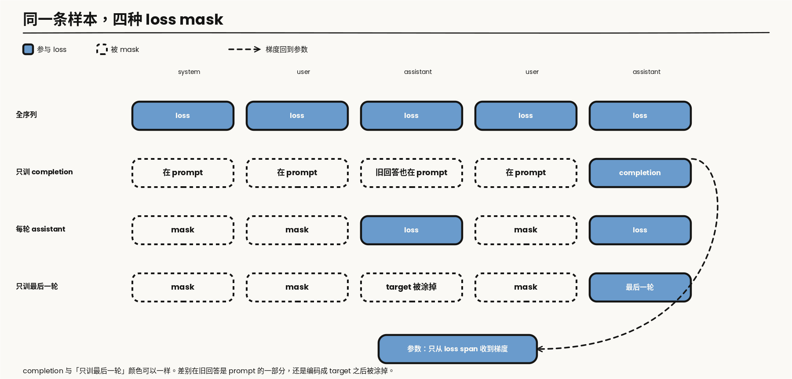

---

layout: post
tags: [LLM, NLP, Training]
title: 大模型是怎么炼成的（四）：SFT 的边界是 loss 铺在哪些 token 上
date: 2026-11-10
author: Kyrie Chen
comments: true
toc: true
pinned: false

---

问「法国的首都是哪里」，续写「德国的首都是哪里」，对只做过预训练的模型是合理的。它见过成排的问题。SFT 要改的是这个条件，不是再换一批更干净的网页。

第三篇的原话是：只要 loss 仍铺在全部 token 上，监督位置就还没变；一旦某段数据只训 response，阶段名即使仍叫退火，语义上已经是 SFT。MiniCPM 把 SFT 风格数据放进 decay，OLMo 2 的 Dolmino 里有 FLAN，两份报告都没写明这些样本是整段算 loss，还是只算 response。这一篇把这个「没写明」变成可以问出口的问题。阶段边界由 mask 的位置定义，不由学习率日程或阶段名定义。

第一篇已经预留了 `messages`、role 和 loss mask。这里用它们，不重新介绍数据湖。`-100` 只是 PyTorch 交叉熵的 ignore index，不是 SFT 的数学定义。loss 怎么平均，第二篇已经写过 token-mean、sequence-mean 和梯度累积，这里只引用。

> **范围**：文本指令微调。对照 [Llama 3](https://arxiv.org/abs/2407.21783) 的 SFT、[Tulu 3](https://arxiv.org/abs/2411.15124) 的公开配方，以及 [DeepSeek-V3](https://arxiv.org/abs/2412.19437) 报告里写明的 SFT 设置。报告没写的学习率、epoch、LoRA rank 不补。工具调用只写到 SFT 要学会的格式。

---

## 一、监督位置才是目标函数的变化

SFT 仍然是条件语言建模。给定渲染后的序列 $$x$$，损失还是

$$
\mathcal{L} = -\frac{1}{\lvert\mathcal{T}\rvert}\sum_{t \in \mathcal{T}} \log p(x_t \mid x_{\lt t})
$$

和第二篇的差别只在集合 $$\mathcal{T}$$：预训练里它几乎是全部 token，SFT 里它是 mask 留下来的那些位置。

四种合法策略都存在，不能默认成「只训回答」：

| 策略 | 进入 loss 的 span | 什么时候用 |
|---|---|---|
| 全序列 | system、user、assistant、工具文本 | 模板本身也要学；或 user 内容来自模型，需要被记住 |
| 只训 completion | 样本被存成 prompt + completion 时的 completion | 旧回答被算进 prompt，不再产生梯度 |
| 每一轮 assistant | 每一轮 assistant 的 target | 多轮里每一轮回答都要学，user 和 system 不学 |
| 只训最后一轮 | 最后一轮 assistant | 历史只作条件，避免反复拟合早期回答 |

选择取决于三件事：模板要不要学，user 内容是不是模型自己生成的，以及是否担心模型把 prompt 复述回去。



*图 1：同一条 system / user / assistant 样本。蓝色实心是参与 loss 的 span（token 资产），虚线边框是被 mask 的 span。虚线箭头是从参与 loss 的位置回到参数的梯度，沿用系列图例的反馈含义，和第二篇图 1 一致。「只训 completion」和「只训最后一轮」的差别在旧回答是留在 prompt 里，还是先编成 target 再被涂掉。*

---

## 二、Chat template 是训练分布的一部分

`messages` 进模型之前要被渲染成带特殊 token 的字符串。mask 的边界就是这次渲染结果里的 token 边界。模板、停止符和 mask 必须出自同一次渲染。训练用一套模板、推理用另一套，模型看到的是另一个分布，loss 不会报这个错。

特殊 token 还要落到词表上。它们如果已经在预训练词表里，SFT 只是让它们出现在新位置；如果是这时才加进去的，embedding 是新增的行，梯度只从见过这些 token 的样本来。Llama 3 的对话标记写在它的 128K 词表和 chat template 里。这里不比较哪家模板更好，只要求渲染结果决定哪些 token 存在、mask 切在哪。

工具调用在这一篇里只是一种 role：`tool` 或函数返回写成一段文本，mask 决定模型是在学「何时发起调用」，还是也在学工具返回的原文。环境里的多轮信用分配不在这里。

---

## 三、数据从哪来，以及什么算一份合格样本

三条来源并列，不是一条进化史。

人工撰写的公开极端是 [LIMA](https://arxiv.org/abs/2305.11206)：大约 1000 条仔细写过的样本，用来说明少量指令数据就能改变模型行为。Tulu 3 和 Llama 3 走的是另一笔预算。Tulu 3 的 SFT 混合、代码和超参是公开的：8B 学习率 $$5\times 10^{-6}$$，70B 为 $$2\times 10^{-6}$$，两个 epoch，有效 batch 128，序列长度 4096。他们试过 rejection sampling，在自己的设置里收益相对算力很小，所以没有放进最终配方。

Llama 3 把 rejection sampling 放进每一轮后训练。每个由人工标注收集来的 prompt 从当时的 chat policy 采 $$K$$ 条输出，$$K$$ 通常在 10 到 30 之间，用 reward model 留下一条，再和对其他来源的数据一起做 SFT。损失是 target token 上的交叉熵，prompt token 被 mask。最大模型的学习率是 $$10^{-5}$$，大约 8.5K 到 9K step。后训练做了六轮，每轮重新收集 SFT 数据和偏好标注。

DeepSeek-V3 的指令数据是 150 万条，覆盖多个领域，各领域的构造方式不同。SFT 在 base 上训两个 epoch，学习率从 $$5\times 10^{-6}$$ 余弦降到 $$10^{-6}$$。多条样本会打进同一条序列，并用 sample masking 让它们互相看不见。这是第一篇 4.14 节里 block-diagonal attention 的后训练版本：打包提高利用率，注意力边界和 loss mask 是两件都要断言的事。

一份能进训练的样本至少要回答三件事：role 是什么，哪一段参与 loss，生成它的模型和 prompt 版本是什么。最后一项是第一篇的 lineage。没有它，后面的偏好数据和蒸馏就不知道这条回答从哪来。

---

## 四、Loss masking 的代码，和它的分母

图 1 上被 mask 的 span，在代码里就是 label 变成 ignore index 的位置。两段都只留这一步。

TRL 当前的 `DataCollatorForLanguageModeling` 先把 `input_ids` 抄成 labels。样本若带 `completion_mask`，0 的位置被设成 `-100`，对应图 1 的「只训 completion」。若带 `assistant_masks`，0 的位置同样被设成 `-100`，对应「每一轮 assistant」。padding 的 label 也是 `-100`，那是补齐，不是策略。

```python
labels = input_ids.clone()
if completion_mask is not None:          # 1 = completion，0 = prompt
    labels[completion_mask == 0] = -100
if assistant_masks is not None:          # 1 = assistant span
    labels[assistant_masks == 0] = -100
```

LLaMA-Factory 在多轮编码时做同一件事。`IGNORE_INDEX` 就是 `-100`。`train_on_prompt` 为真时，source 和 target 都进 loss，对应「全序列」。否则 source 整段被忽略，target 保留，对应「每一轮 assistant」。`mask_history` 会把轮次倒序，使 `turn_idx == 0` 成为最后一轮，更早的 target 也被忽略。

```python
IGNORE_INDEX = -100
if train_on_prompt:
    source_label = source_ids
else:
    source_label = [IGNORE_INDEX] * source_len
if mask_history and turn_idx != 0:       # 倒序后，0 是最后一轮
    target_label = [IGNORE_INDEX] * target_len
else:
    target_label = target_ids
```

mask 会让每条样本的有效 token 数差很多。sequence-mean 先在序列内平均，短回答的每个 token 梯度更大。梯度累积时如果每个 micro-batch 先 mean 再相加，有效 token 少的那一份会被再次放大。第二篇的写法在这里仍然适用：把各 micro-batch 的 token loss 之和累加起来，最后除以全局有效 token 数。分母 $$\lvert\mathcal{T}\rvert$$ 要和 mask 一起写进训练配置，不能只写学习率。

单测是第一篇 QA gate 里「packed sequence mask 单测」在 SFT 侧的兑现。渲染一条多轮样本，断言哪些位置是 ignore index、哪些参与 loss。模板或框架升级之后重跑。开了 packing，还要同时断言样本之间的 attention 边界，口径回到第一篇 4.14 节。label 整体错一位、模板分隔符被算进 loss、上一轮 user 被标成可训，loss 曲线都可以照常下降。长上下文全参 SFT 里，loss 正常而模型仍然是坏的，[《512K 上下文的全参 SFT》](/512K-Long-Context-SFT-Postmortem/)已经记过现场；mask 错了是同一类问题的短序列版本。

---

## 五、Full FT 和 LoRA 改的不是同一个东西

Full FT 更新全部权重。LoRA 在选定的线性层旁边加低秩增量，底座可以冻结。梯度仍然只从 $$\mathcal{T}$$ 来，但写回的参数集合不同。Llama 3 和 Tulu 3 公开的 SFT 设置是全参微调，两份报告都没有给出一套 SFT 用的 LoRA rank。没有这个数字，就不写 rank。

可回退性不一样。LoRA 可以卸掉增量，回到底座；Full FT 要靠 checkpoint。显存也不一样，但长上下文下的激活和 logits 仍然可能先于参数把卡打满，那是并行那篇文章和 512K 那篇的账，不在这里重算。

SFT 数据过窄时，通用能力会掉。检查用第一篇冻结评测集里的通用切片。第三篇领域续训一节的两个数在这里同样适用：续训后减去续训前的 backward transfer，以及在同一批通用 token 上相对 SFT 起点的 KL。掉多少再决定要不要把通用对话加回混合，而不是等榜单出来再猜。

---

## 六、交出去的是 instruct model

SFT 结束时，模型会按模板回答，还没有经过偏好优化。四条判断：

1. SFT 仍是条件语言建模，变的是哪些位置进入损失。阶段边界由 mask 定义，不由阶段名定义。
2. mask 要和模板、多轮角色一起定，不能默认成「只训回答」。loss 的分母和 mask 一起声明。
3. 样本没有 role、mask 和生成 lineage，就不能进训练。
4. Full FT 和 LoRA 的差别是参数更新范围，不是数据配方。

偏好优化需要的是同一套模板下的 chosen 与 rejected，或者好/坏标签，以及产生它们时的 policy 版本。那是下一篇的输入，不是这一篇的损失。

---

## 参考资料

- [Llama 3 Herd of Models](https://arxiv.org/abs/2407.21783)（SFT 对 target token 的交叉熵、rejection sampling、学习率与 step）
- [Tulu 3](https://arxiv.org/abs/2411.15124)（公开 SFT 混合与超参；rejection sampling 未进入最终配方）
- [DeepSeek-V3 Technical Report](https://arxiv.org/abs/2412.19437)（150 万条指令数据、两个 epoch、packing 与 sample masking）
- [Zhou et al., LIMA](https://arxiv.org/abs/2305.11206)
- [Hu et al., LoRA](https://arxiv.org/abs/2106.09685)
- TRL `DataCollatorForLanguageModeling`；LLaMA-Factory `SupervisedDatasetProcessor`（`train_on_prompt` / `mask_history`）
