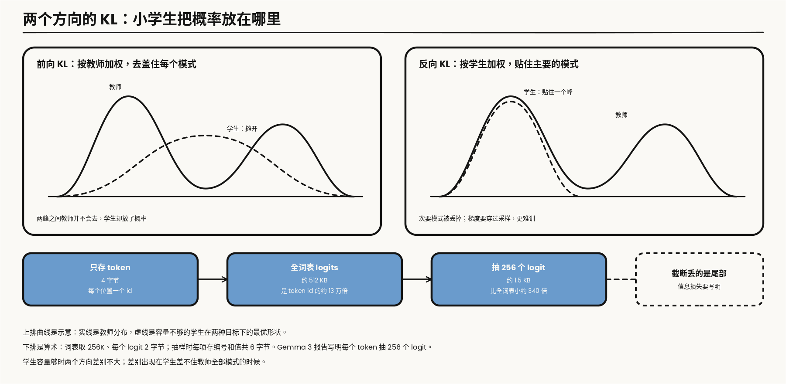
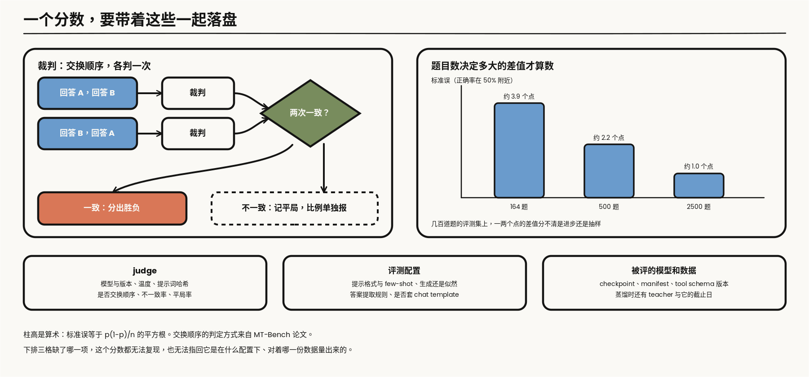

---

layout: post
tags: [LLM, NLP, Training]
title: 大模型是怎么炼成的（八）：蒸馏的三条选择，以及评估怎样回到数据
date: 2026-11-11
author: Kyrie Chen
comments: true
toc: true
pinned: false

---

前七篇产出的是一个大的策略。把它变成能部署的模型，以及判断这一整条流水线有没有用，是两件不同的事。放在同一篇里，是因为蒸馏样本本身就是一份带 lineage 的数据，而评估的失败要能指回这份数据，而不是停在一个总分上。

第一篇已经写过：[DeepSeek-R1](https://arxiv.org/abs/2501.12948) 的公开实验里，推理轨迹蒸馏优于直接对相应小模型做同类 RL。那是一组具体结果，不能写成「蒸馏永远胜过 RL」。

> **范围**：黑盒样本、白盒 logits、on-policy 蒸馏，以及 judge 偏差和会过期的榜。散度方向、样本从谁来、看不看 logits，分成三句，不并成一个「蒸馏」开关。文中标明「算术」的数字是从定义直接算出来的；第四节的三个案例里，哪一个来自真实记录、哪两个是演练，各自写明。


*图 1：实线是主流程，虚线表示反馈，与第二篇图 1 一致。蒸馏损失产生的梯度指向可训练的 Student；Student 的分项评估不合成单一总分，失败信号沿下方虚线指回第一篇的数据契约与 manifest。*

---

## 一、三句分开的工程选择

### 1.1 散度的方向

记教师分布为 $$p$$，学生为 $$q_\theta$$。在一个位置上，两个方向的 KL 是

$$
\mathrm{KL}(p\,\Vert\,q_\theta) = \sum_{v} p(v)\,\log\frac{p(v)}{q_\theta(v)}
$$

$$
\mathrm{KL}(q_\theta\,\Vert\,p) = \sum_{v} q_\theta(v)\,\log\frac{q_\theta(v)}{p(v)}
$$

差别在求和用谁加权。前向按教师加权：凡是教师给了概率的 token，学生给得太少都要受罚，学生被拉去盖住教师的各个模式。它不罚的是另一头，学生把概率放在教师认为不可能的地方，这一项的权重是 $$p(v)$$，接近零。反向按学生加权：学生放了概率而教师没放的地方受重罚，学生被推着贴住教师的主要模式，教师的次要模式丢掉了也不要紧。

对 one-hot 标签，前向 KL 就是交叉熵，SFT 是它的特例。它的梯度也是最简单的一种。对学生在这个位置上的 logits $$z$$ 求导：

$$
\nabla_{z}\,\mathrm{KL}(p\,\Vert\,q_\theta) = q_\theta - p
$$

每个 token 上的梯度就是两个概率之差，教师的分布直接当目标用，不需要采样。这是白盒蒸馏默认用前向 KL 的工程原因。

蒸馏里常见的温度是同一个式子上的旋钮：把教师和学生的 logits 都除以 $$\tau$$ 再取 softmax。$$\tau$$ 大于 1 时教师的分布被拉平，尾部那些「几乎不选但不是完全不可能」的 token 在目标里占的比重变大；$$\tau$$ 等于 1 时就是教师的原始分布。[Hinton 等](https://arxiv.org/abs/1503.02531) 把尾部的这部分信息叫 dark knowledge。对语言模型，词表有十几万到几十万项，尾部极长，温度抬高之后学生要拟合的是一大片本来接近零的概率，1.3 节的截断和抽样在处理同一个尾部。

学生容量够、教师分布集中时，两个方向差别不大。学生比教师小很多时差别才出来：它盖不住教师的全部模式，前向 KL 逼它把概率摊开，摊到教师的几个模式之间，那些地方教师自己并不会去。[MiniLLM](https://arxiv.org/abs/2306.08543) 把标准蒸馏里的前向 KL 换成反向 KL，针对的就是生成模型上这种「把低概率区也学进来」的覆盖。

反向 KL 有它自己的麻烦。期望是对学生自己的采样取的，梯度要穿过采样，这是一个策略梯度问题，方差大。MiniLLM 的贡献有一半在怎样把这个优化做稳，论文给了几项降方差的处理。选反向 KL，买的是更干净的模式，付的是一个更难训的目标。

### 1.2 样本从谁来

第二句是样本从谁来。黑盒 SFT 用教师采样，学生在教师的轨迹上做最大似然，推理时却从自己的分布往下走。学生一旦走出一个教师从没写过的前缀，后面该怎么接，训练里没有见过。这是模仿学习里的老问题：训练时的条件来自教师，推理时的条件来自自己。

[GKD](https://arxiv.org/abs/2306.13649) 从学生自己的分布采样，再在这些 on-policy 样本上向教师对齐。和「背教师样本」的差别是样本来自学生。

```python
for batch in loader:                              # batch 里有 prompt，也有固定的参考输出
    if random.random() < lam:                     # lam：用学生自己采样的比例
        with torch.no_grad():
            seqs = student.generate(batch.prompts)   # 采样只提供前缀，不传梯度
    else:
        seqs = batch.sequences
    with torch.no_grad():
        t_logits = teacher(seqs).logits           # 教师在同一批前缀上的逐位置分布
    s_logits = student(seqs).logits
    loss = divergence(t_logits, s_logits, seqs.mask)   # 前向、反向或 JSD
    loss.backward(); opt.step(); opt.zero_grad()
```

三处要看清。采样在 `no_grad` 里，梯度不穿过采样这一步，这是它比 1.1 节的反向 KL 好训的原因。教师必须能对任意前缀给出分布，所以它得是本地可前向的模型，API 不行。每一步都多一次学生的生成和一次教师的前向，这是 on-policy 的价钱。

它和第六篇的在线 RL 长得像，都是学生采样、外部给信号。区别在信号：这里是教师在每个位置上的完整分布，那里是验证器在结尾给的一个比特。

GKD 把散度也留成了可选项：前向 KL、反向 KL，或者两者之间的 Jensen-Shannon 散度。论文在不同任务上比过，没有一种在所有任务上最好；哪一种合适，取决于任务更看重覆盖还是更看重单条输出的质量。所以 1.1 节和这一节是两个独立的旋钮，GKD 的名字里那个 generalized 指的就是把它们放进同一个框架。

### 1.3 看不看 logits

第三句是看不看 logits。只有文本样本时，学生在每个位置只看到教师选中的那一个 token。白盒蒸馏对齐的是教师在这个位置上的整个分布：除了选中的 token，还有它在其余候选之间的取舍。

[Gemma 2](https://arxiv.org/abs/2408.00118) 的 2B 和 9B 用知识蒸馏代替 next-token 的 one-hot，教师在每个 token 上的分布替换掉那个 one-hot；报告也写了在学生自己的分布上继续蒸馏，引用的就是 GKD 和 MiniLLM。报告里还有一个数字说明它的定位：2B 模型的训练 token 数远多于按 scaling law 算出的最优值，蒸馏在这里是用更丰富的监督信号去模拟「训练得更久」，不只是压缩一个大模型。[Gemma 3](https://arxiv.org/abs/2503.19786) 写明每个 token 按教师概率抽取 256 个 logit，学生在这组样本上学习教师分布。两份报告都是 logit 蒸馏，抽样方式并不相同。

为什么要抽样，是一笔存储的算术。词表取 256K，每个 logit 用 2 字节，一个位置上的完整分布是 512 KB；存 token id 只要 4 字节。前者是后者的约 13 万倍。按这个大小，一百万个 token 的全词表 logits 是约 512 GB。只留 256 项，每项存一个编号和一个值，共 6 字节，一个位置约 1.5 KB，比全词表小约 340 倍。

所以白盒蒸馏在工程上只有两条路：教师在线前向，不落盘；或者落盘一个截断或抽样过的分布。截断丢掉的是尾部的概率质量，这部分信息损失要写明，不能当成和全词表等价。两份 Gemma 报告没有写教师的 logits 是在线算的还是预先存的，这里不替它们补。

白盒还有一个前提：教师和学生的词表要能对齐。词表不同时，问题有两层。

第一层是格子对不上：教师在 token A 上的概率，在学生那边没有对应的 token。第二层更麻烦，位置也对不上：同一段文字，两个 tokenizer 切出的 token 数不同，教师的第 $$t$$ 个位置和学生的第 $$t$$ 个位置预测的不是同一段文字。逐位置的 KL 在这里没有定义。

能做的只有两种。退回黑盒，用文本当中介。或者只在两边恰好切在同一处的位置上做一层有损的映射；它丢掉了对不齐的位置，也丢掉了映射不过去的概率质量，同样要写明损失。所以白盒蒸馏多发生在共用 tokenizer 的教师和学生之间；跨家族的蒸馏，比如 2.1 节里 R1 蒸到 Qwen 和 Llama 底座，公开的做法是黑盒。



*图 2：上排曲线是示意：实线是教师分布，虚线是容量不够的学生在两种目标下的形状。下排是存储的算术：词表取 256K，每个 logit 2 字节。*


*图 3：把笼统的「蒸馏」拆回三列分开的选择。散度方向决定覆盖空隙还是贴住主峰，样本从谁来决定在哪个分布上对齐，监督粒度区分纯文本 one-hot、全词表分布与按概率抽取的 logits。三列可以同时用，Gemma 2 就同时用了后两列。*

### 1.4 三句合起来

| 选择 | 取值 | 需要什么 | 代价 |
|---|---|---|---|
| 散度方向 | 前向 KL | 教师的分布，或教师的样本 | 小学生会把概率摊到教师的模式之间 |
| | 反向 KL | 教师能给任意序列打分 | 梯度穿过采样，方差大 |
| 样本来源 | 教师采样 | 一份固定数据集 | 训练和推理的前缀分布不一致 |
| | 学生采样 | 教师本地可前向 | 每步多一次生成和一次教师前向 |
| 监督粒度 | 文本 | 教师的输入输出，API 即可 | 每个位置只有一个 token 的信息 |
| | logits | 本地教师；词表可对齐 | 存储或在线前向；截断有信息损失 |

三项是独立的。常说的「黑盒蒸馏」是教师采样加文本，方向上等价于前向 KL 在 one-hot 上的特例。「白盒」只说了第三项，前两项还要另外声明。

表里没有的第四个变量是教师和学生差多大。直觉上教师越强越好，[Mirzadeh 等](https://arxiv.org/abs/1902.03393) 在图像分类上报告的却是：学生固定时，教师大到一定程度之后，蒸出来的学生反而变差；他们的解释是学生的容量跟不上教师的分布，并用一个中等大小的模型在中间接力。这个结果来自小得多的模型和另一类任务，不能直接搬到语言模型上。它留下的问题在这里仍然成立：教师的分布里有多少是学生表示得了的。1.1 节的反向 KL 和 1.3 节的截断，是从目标函数和监督粒度两头在回答同一个问题。

---

## 二、推理轨迹的蒸馏，和它的长度

### 2.1 R1 的那组实验说了什么

DeepSeek-R1 的蒸馏是 1.4 节表里最便宜的一种组合：教师采样，文本监督。约 80 万条由 R1 生成的样本，在开源的 Qwen 和 Llama 底座上做 SFT，没有 RL 阶段。

报告里拿来和 RL 比的是一组实验：同一个 Qwen-32B 底座，一边做大规模的 RL 训练，一边用 R1 的输出做蒸馏。RL 那一边训练了一万多步，结果和 QwQ-32B-Preview 相当；蒸馏那一边在各项基准上都明显更好。报告由此给了两个结论：把强模型蒸到小模型效果很好，而小模型自己做大规模 RL 需要巨大的算力，还未必追得上蒸馏；蒸馏既省又有效，但要越过现有的智能边界，仍然需要更强的底座和更大规模的 RL。

这两句要连着读。蒸馏的上限是教师，它搬运能力，不产生新的能力。第六篇 5.3 节里 Yue 等人的工作从另一个方向说了相近的事：RL 更多是在挪动底座已有的概率，蒸馏才带进新的解法。两处的实验设置不同，结论的方向一致，都只在各自的设置里成立。

所以这组结果是「一个底座、一个教师、一份预算」下的比较，不是关于两类方法的定理。第一篇把它写成「具体实验结果」，这里沿用。

### 2.2 长度会跟着数据走

教师的长思维链一旦被当成 SFT 样本，学生继承的不只是解题步骤，还有那份长度。第六篇里长度膨胀来自奖励的分母；这里它从奖励函数搬到了数据。部署预算若远短于教师轨迹，学生会把超长推理一起学走。

所以蒸馏数据的长度分布和 teacher、prompt、checkpoint 一起写进 manifest。这是第一篇的 lineage，不是多出来的一个字段。没有这列，后面看到回答变长，无法分辨是学生学会了检查，还是只是在模仿教师的长度。

一份蒸馏数据集的 manifest 至少要有这些。取值是示意：

```json
{
  "distill_set": "r-traj-v4", "teacher": "policy-1843", "teacher_template": "v3.2",
  "prompt_set": "reasoning-mix-0911", "sampling": {"temperature": 0.6, "top_p": 0.95},
  "filter": {"verifier": "math_equiv@2.3.1", "kept": 0.71},
  "n_tokens": {"p50": 1840, "p90": 6120, "p99": 14900},
  "truncated_ratio": 0.031, "has_terminator_ratio": 0.969,
  "student_max_len": 8192, "over_student_max_len_ratio": 0.064
}
```

### 2.3 截断是另一种 mask 错误

最后三个字段管的是同一件事。教师的回答超过学生的训练长度时，样本会被截断，截断的样本没有终止符。

这就回到了第四篇 2.2 节表里的第一行。学生在这些样本上从没被要求预测终止符，它学到的是「写到这个长度还不用停」。截断的比例只有百分之几，后果却集中在最长的那批推理上：这正是模型最容易停不下来的地方。

处理的办法有两种，选哪种要写进 manifest。一种是丢掉超长的样本，学生看到的长度分布被削掉一截，能力上也少学了最难的那些题。另一种是保留但把截断样本的损失 mask 掉，不让它们教坏终止符，第六篇 DAPO 对超长样本的第一种处理就是这个思路。两种都比不处理好，不处理是默认值。

`filter.kept` 记的是教师样本通过验证的比例。只留判对的样本是常规做法，它同时改了长度分布：难题上教师错得多，被筛掉的也多，留下的样本偏向容易的题。这个偏移要对着 `n_tokens` 一起看。

### 2.4 教师带来的不只是能力

蒸馏把教师的输出当成数据，教师身上的三样东西会跟着进来。下面是按机制推出来的检查项，不是某份报告的结论。

**教师见过的题。** 教师的训练数据里如果有某个 benchmark 的题目，它在这些题上的回答会更接近标准答案，学生在教师的输出上训练，间接学到了同一批题。学生自己的训练数据里查不到这些题的原文，第一篇的 n-gram 去污染对它无效。能查的是 3.3 节的时间切分：学生在教师训练截止日之前的题上是否异常地好。

**教师的口头禅。** 第四篇 3.3 节写过合成回答带着生成模型的习惯。蒸馏数据全部来自一个教师时，这个问题最重：固定的开场、固定的总结句式、固定的列表格式。它不影响任务正确率，影响的是 3.2 节的偏好评测。

**教师当裁判。** 用教师去评它蒸出来的学生，是自我增强偏差最直接的形态：学生的输出风格本来就是照着教师学的。蒸馏项目里，裁判要换成和教师不同家族的模型，或者用不经过裁判的客观指标。

三样都要靠 manifest 里的 `teacher` 字段才查得到。学生的评测报告因此要带上教师是谁，以及教师的训练截止日。

### 2.5 推理段进不进损失

蒸馏推理轨迹时，一条样本里有两段：推理过程，和最后的回答。第四篇的四种 mask 在这里多出一个维度。

推理段进损失，学生学的是「怎样推」，推理时会自己产出这一段。2.2 节的长度问题就是从这里来的。

推理段不进损失、只作条件，学生学的是「给定一段推理，怎样写出回答」。推理时没有人替它写这段推理，条件就缺了。所以要让学生自己会推理，推理段必须在损失里；想控制长度，动的是数据的长度分布，不是 mask。

第三种做法是只用教师的最终回答，把推理段整个丢掉。它便宜，回答也短。代价是学生得到的监督只剩结尾那一段，教师在推理里展开的中间步骤没有传过去。R1 的蒸馏保留了推理过程，蒸出来的模型也输出推理段。

选哪一种要写进 manifest，和 `teacher_template` 放在一起。推理段的起止标记是模板的一部分；学生的模板里没有这对标记，就谈不上进不进损失。

---

## 三、评估拆开报，并且会过期

### 3.1 三层不能合成一个数

能力、偏好和污染不能合成一个总分。按第一篇预留的冻结 `holdout` 拆开报：base 上的受控曲线、偏好胜率、agent 的任务成功率，各自回答不同的问题。把它们平均掉，失败就无法指回是数据、奖励还是 `judge`。

| 层 | 回答的问题 | 前面哪一篇定义了它 | 最常见的失真 |
|---|---|---|---|
| 能力 | 冻结的任务切片上做对多少 | 第一篇的 holdout；第三篇的 backward transfer | 题目进了训练数据 |
| 偏好 | 两个回答里人更喜欢哪个 | 第五篇的偏好模型 | 裁判的偏差；长度 |
| 可靠性 | 同一个任务反复做，成功几次 | 第七篇的冻结环境 | 环境或 schema 变了 |

三层各有各的失真来源，修法也不同。合成一个总分之后，哪一层动了看不出来，三种失真也混在了一起。

### 3.2 裁判的三种偏差，和一份去偏协议

用模型当裁判时，偏差是评测配置的一部分。[Zheng 等](https://arxiv.org/abs/2306.05685) 在 MT-Bench 和 Chatbot Arena 上写了三种：位置偏差，交换两个回答的顺序会改变胜负；冗长偏差，更长的回答更容易被判赢；自我增强，裁判更偏好和自己同一家族的模型。judge 的版本、温度和选项顺序因此要和分数一起记录。

论文对位置偏差的处理很直接：每一对回答按两种顺序各判一次，两次结论一致才算分出胜负，不一致记为平局。写成代码只有几行：

```python
def judged_pair(judge, prompt, a, b):
    first = judge(prompt, a, b)       # 返回 "first" / "second" / "tie"
    second = judge(prompt, b, a)      # 交换顺序再判一次
    if first == "first" and second == "second": return "a"
    if first == "second" and second == "first": return "b"
    return "tie"                       # 两次不一致，或本来就是平局
```

`tie` 里混着两种情况：裁判认为两个回答一样好，和裁判只是在跟着位置走。把两次不一致的比例单独报出来，它是这个裁判在这批题上的噪声水平。不一致率很高时，胜率的差值没有意义。

另外两种偏差没有这么干净的修法。冗长偏差的检查和第五篇第六节是同一个：胜率按回答长度分层，或者在长度相近的子集上重算。自我增强的检查是换一个不同家族的裁判，看排名变不变；被评的模型里有裁判的同族时，这一条必须做。

一份裁判评测的记录至少要有这些字段，和分数一起落盘：`judge_model` 与版本、`temperature`、评分提示词的哈希、是否做了顺序交换、两次判定的不一致率、平局率、参与比较的回答的长度分位数。缺了哪一项，这个分数都无法复现。

人来投票的榜也有模型假设。Chatbot Arena 把成对的投票汇总成每个模型的一个分数，用的是 Elo 或者 Bradley-Terry，和第五篇第一节训练 reward model 的是同一个模型。那里写过的两条限制原样适用：偏好被假设成可传递的，一个标量装不下循环；分数只有相对意义，榜上的数值随参赛模型的集合变化。还有一条是榜特有的：投票的 prompt 来自愿意来投票的用户，它量的是这群人在这类问题上的偏好，不是你的用户在你的任务上的偏好。

### 3.3 静态榜会过期

静态榜还会过期。题目若出现在训练语料里，涨分可以来自记住。[LiveCodeBench](https://arxiv.org/abs/2403.07974) 按题目发布时间切分，用来把训练截止日之后的题和更早的题分开：一个模型在截止日之前的题上明显好于之后的题，这个落差本身就是污染的证据。[LiveBench](https://arxiv.org/abs/2406.19314) 同样靠持续更换题目来限制污染，并且用客观的标准答案评分，不经过裁判模型。一个不再更新的榜上的涨分，先对题目日期和训练 cutoff，再记到算法上。

这一步要和第一篇 4.10 节的去污染一起用，两者查的不是同一种泄漏。n-gram 和语义去重查的是「这道题的文本在不在训练数据里」。时间切分查的是「模型的表现有没有随题目日期出现断崖」，它不需要知道训练数据里有什么。第三篇的退火升配和第四篇的指令数据，都是 benchmark 邻近数据最容易进来的地方；那里每加一个数据源就要重跑去污染，这里用时间切分做事后的独立验证。


*图 4：左上锁定模型裁判的三种固有偏差，右上用训练语料截止日切开污染旧题与动态新题，下方虚线把分项异常逆向指回第一篇预留的 manifest、`tool schema` 版本与模型 checkpoint。*

### 3.4 分数要带着它的方差

还有一件事三层都适用：同一个 checkpoint、同一份评测，跑两次的结果不一样。采样温度、题目顺序、裁判的随机性都会带来波动。两个模型差 1 个点，而同一个模型重跑的波动是 1.5 个点时，这个差值不能用来做决定。

第一篇把「重复运行方差」列进了评估要审计的项目。落到操作上是两件事：每个要比较的数都至少跑几次，报均值和范围；题目数少的切片，按题目做自助重采样给一个区间。第七篇的 $$\mathrm{pass}^{k}$$ 是把这件事直接做成了指标。

题目抽样带来的那部分波动可以直接算。$$n$$ 道题、正确率 $$\hat{p}$$ 时，标准误是

$$
\mathrm{SE} = \sqrt{\frac{\hat{p}\,(1-\hat{p})}{n}}
$$

算术：正确率在 50% 附近，164 道题的标准误约 3.9 个点，500 道题约 2.2 个点，要压到 1 个点需要约 2500 道题。两个模型在同一批题上比较时，用配对的方式看更准：统计「A 对 B 错」和「A 错 B 对」各有多少道，两个模型都对或都错的题不提供信息。很多常用的评测集只有几百道题，在上面报出的一两个点的提升，单凭这一次评测分不清是进步还是抽样。

这也是切片不能切得太细的原因。按领域、语言、难度层层切下去，每一格只剩几十道题，每一格的标准误都在 5 个点以上。切片要细到能定位问题，又要大到差值有意义，两头都要看一眼上面这个式子。

### 3.5 评测配置也是 lineage

同一个 checkpoint 在同一个 benchmark 上的分数，会随评测脚本变。会改变分数的配置至少有这些：提示词的格式和 few-shot 的条数；是让模型生成答案再提取，还是直接比较各选项的对数似然；答案提取的规则，第六篇 1.2 节判题器的假阳性和假阴性在评测侧原样存在；采样温度和最大生成长度；有没有套 chat template。

最后一项对 base 模型和 instruct 模型的方向相反。base 模型没学过模板，套上模板是分布外；instruct 模型不套模板，也是分布外。比较 SFT 前后的两个 checkpoint 时，各自要用各自训练时的格式。这和「只改一个因素」不矛盾：要保持不变的是任务，不是输入的字符串。

所以评测记录里除了分数，还要有评测脚本的版本和这几项配置。第四节的追责能走通，靠的是每一个分数都能回答「是在什么配置下量出来的」。



*图 5：一个分数要带着的东西。左上是交换顺序的裁判协议，右上的柱高是标准误的算术，下排是要和分数一起记录的三组字段。*

---

## 四、失败要能指回第一篇的契约

一次评测失败，要能回答三件事：哪一份 manifest，哪一个 tool schema 版本，哪一个 teacher 或 policy checkpoint。答不上来，这个分数不能用来改数据配比，也不能用来决定下一次蒸馏采谁的样本。

下面三个案例把这句话走一遍。第一个来自真实记录，后两个是按前面各篇的机制构造的演练，用来说明字段怎么用，不是发生过的事故，里面也没有数字。

### 4.1 评测掉了，训练曲线没有任何异常

这一条是真的，现场写在[《512K 上下文的全参 SFT》](/512K-Long-Context-SFT-Postmortem/)里。专家并行改完之后，每个 rank 只持有一部分专家，这些参数又被分片逻辑沿第一维切了一刀。形状检查全程通过，训练 loss 正常下降。评估路径用的是完整的专家表，失配在那里才露出来：修复前后，评估指标从 0.827 回到 0.972。

追责的路径是：评测分数异常，训练曲线正常，于是先排除数据和目标函数，去查「训练时的模型」和「评测时的模型」是不是同一个。答案是不是。能这样查，是因为有一份独立于训练的评测，以及一个可以对照的 base。loss 只说明计算图内部自洽，这句话在第四篇的 mask、第五篇的格式 token 上各出现过一次，这里是它的系统版本。

### 4.2 演练：蒸馏后的小模型停不下来

现象是学生在长推理题上一直写到长度上限。按字段往回查：先看蒸馏集 manifest 里的 `truncated_ratio` 和 `over_student_max_len_ratio`，教师的长样本有多少被截断了；再看 `has_terminator_ratio`，这些样本有没有终止符；然后回到第四篇的 mask 单测，终止符的 label 是不是进了损失；最后才是第一篇的 packing 与分片 QA，样本在落盘时有没有被切断。

四步里前三步都是查表，不需要重训。如果 manifest 里没有记长度和截断，这条路在第一步就断了，剩下的办法只有重新生成数据再看。

### 4.3 演练：静态榜大涨，新题上没动

现象是某个数学榜上的分数明显上涨，换到发布日期在训练截止日之后的题上，涨幅消失。按字段往回查：先用 3.3 节的时间切分确认落差存在；再查这一版和上一版之间新加了哪些数据源，第三篇的退火池和第四篇的指令混合是首要嫌疑；然后看这些数据源在第一篇 sidecar 里的去污染记录，是加入时跑过，还是沿用了更早的结果；最后对榜上的题目做一次 n-gram 和语义检索，找出具体是哪些样本。

这条路走得通的前提是两个：每个数据源进入混合的时间有记录，去污染的结果是按数据源和评测集版本存的。第一篇把这些都写成了 sidecar 的字段。

### 4.4 没有 lineage 的分数，改不动流水线

三个案例的结构相同：分数给出现象，字段给出路径，路径的终点是某一份数据或某一个配置。字段缺一环，路径就断在那里。

这就是第一篇把评估写成控制信号的那一端。系列从数据契约出发，经过预训练、中期训练、SFT、偏好、可验证奖励和轨迹，再在这里接回去：没有 lineage 的分数，改不动流水线。

---

## 参考资料

- [Gu et al., MiniLLM](https://arxiv.org/abs/2306.08543)（反向 KL）
- [Hinton et al., Distilling the Knowledge in a Neural Network](https://arxiv.org/abs/1503.02531)（温度与软标签）
- [Mirzadeh et al., Improved Knowledge Distillation via Teacher Assistant](https://arxiv.org/abs/1902.03393)（教师与学生的容量差距）
- [Agarwal et al., GKD](https://arxiv.org/abs/2306.13649)（从学生分布采样）
- [Gemma 2](https://arxiv.org/abs/2408.00118)（教师分布替换 one-hot；并在学生分布上蒸馏）
- [Gemma 3](https://arxiv.org/abs/2503.19786)（每个 token 抽取 256 个 logit）
- [DeepSeek-R1](https://arxiv.org/abs/2501.12948)（蒸馏与小模型 RL 的对比实验）
- [Zheng et al., MT-Bench 与 Chatbot Arena](https://arxiv.org/abs/2306.05685)（三种裁判偏差；交换顺序的一致性判定）
- [Jain et al., LiveCodeBench](https://arxiv.org/abs/2403.07974)
- [White et al., LiveBench](https://arxiv.org/abs/2406.19314)
