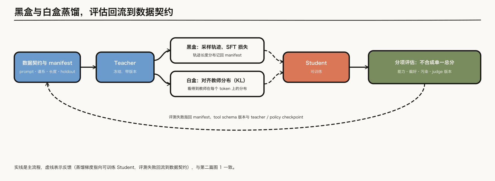
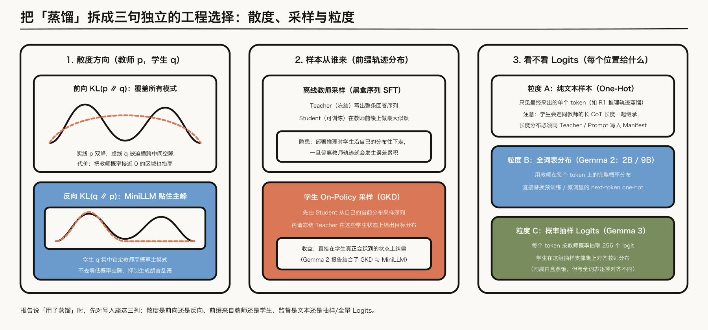
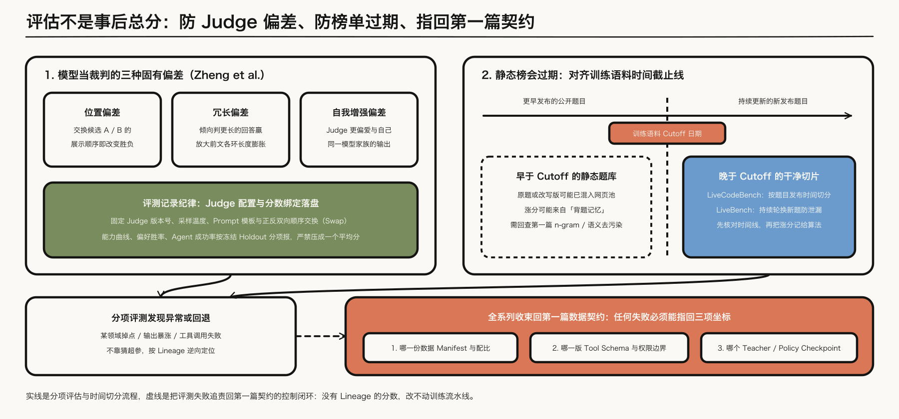

---

layout: post
tags: [LLM, NLP, Training]
title: 大模型是怎么炼成的（八）：蒸馏的三条选择，以及评估怎样回到数据
date: 2026-11-11
author: Kyrie Chen
comments: true
toc: true
pinned: false

---

前七篇产出的是一个大的策略。把它变成能部署的模型，以及判断这一整条流水线有没有用，是两件不同的事。放在同一篇里，是因为蒸馏样本本身就是一份带 lineage 的数据，而评估的失败要能指回这份数据，而不是停在一个总分上。

第一篇已经写过：[DeepSeek-R1](https://arxiv.org/abs/2501.12948) 在若干小模型设置里，推理轨迹蒸馏优于直接对相应小模型做同类 RL。那是一组具体结果，不能写成「蒸馏永远胜过 RL」。

> **范围**：黑盒样本、白盒 logits、on-policy 蒸馏，以及 judge 偏差和会过期的榜。散度方向、样本从谁来、看不看 logits，分成三句，不并成一个「蒸馏」开关。

*图 1：实线是主流程，虚线表示反馈，与第二篇图 1 一致。蒸馏损失产生的梯度指向可训练的 Student；Student 的分项评估不合成单一总分，失败信号沿下方虚线指回第一篇的数据契约与 manifest。*

---

## 一、三句分开的工程选择

记教师分布为 $$p$$，学生为 $$q$$。前向 $$\mathrm{KL}(p\|q)$$ 让学生去盖住教师的各个模式，教师概率接近零的区域也会被抬起来。反向 $$\mathrm{KL}(q\|p)$$ 让学生贴住教师的主要模式，不去填那些空隙。[MiniLLM](https://arxiv.org/abs/2306.08543) 把标准蒸馏里的前向 KL 换成反向 KL，针对的就是生成模型上这种「把低概率区也学进来」的覆盖。

第二句是样本从谁来。黑盒 SFT 用教师采样，学生在教师的轨迹上做最大似然，推理时却从自己的分布往下走。[GKD](https://arxiv.org/abs/2306.13649) 从学生自己的分布采样，再在这些 on-policy 样本上向教师对齐。和「背教师样本」的差别是样本来自学生。

第三句是看不看 logits。只有文本样本时，学生看不到教师在该 token 上的分布。白盒蒸馏对齐的是这个分布。[Gemma 2](https://arxiv.org/abs/2408.00118) 的 2B 和 9B 用知识蒸馏代替 next-token 的 one-hot，教师在每个 token 上的分布替换掉那个 one-hot；报告也写了在学生自己的分布上继续蒸馏，引用的就是 GKD 和 MiniLLM。[Gemma 3](https://arxiv.org/abs/2503.19786) 写明每个 token 按教师概率抽取 256 个 logit，学生在这组样本上学习教师分布。两份报告都是 logit 蒸馏，抽样方式并不相同。

*图 2：把笼统的「蒸馏」拆回三列分开的选择。散度方向决定覆盖空隙还是贴住主峰，样本从谁来决定在哪个分布上对齐，监督粒度区分纯文本 one-hot、全词表分布与按概率抽取的 logits。三列可以同时用，Gemma 2 就同时用了后两列。*

---

## 二、长度分布要进 manifest

教师的长思维链一旦被当成 SFT 样本，学生继承的不只是解题步骤，还有那份长度。第六篇里长度膨胀来自奖励的分母；这里它从奖励函数搬到了数据。部署预算若远短于教师轨迹，学生会把超长推理一起学走。

所以蒸馏数据的长度分布和 teacher、prompt、checkpoint 一起写进 manifest。这是第一篇的 lineage，不是多出来的一个字段。没有这列，后面看到回答变长，无法分辨是学生学会了检查，还是只是在模仿教师的长度。

---

## 三、评估拆开报，并且会过期

能力、偏好和污染不能合成一个总分。按第一篇预留的冻结 `holdout` 拆开报：base 上的受控曲线、偏好胜率、agent 的任务成功率，各自回答不同的问题。把它们平均掉，失败就无法指回是数据、奖励还是 `judge`。

用模型当裁判时，偏差是评测配置的一部分。[Zheng 等](https://arxiv.org/abs/2306.05685) 在 MT-Bench 和 Chatbot Arena 上写了三种：位置偏差，交换两个回答的顺序会改变胜负；冗长偏差，更长的回答更容易被判赢；自我增强，裁判更偏好和自己同一家族的模型。judge 的版本、温度和选项顺序因此要和分数一起记录。

静态榜还会过期。题目若出现在训练语料里，涨分可以来自记住。[LiveCodeBench](https://arxiv.org/abs/2403.07974) 按题目发布时间切分，用来把训练截止日之后的题和更早的题分开。[LiveBench](https://arxiv.org/abs/2406.19314) 同样靠持续更换题目来限制污染。一个不再更新的榜上的涨分，先对题目日期和训练 cutoff，再记到算法上。

*图 3：左上锁定模型裁判的三种固有偏差，右上用训练语料截止日切开污染旧题与动态新题，下方虚线把分项异常逆向指回第一篇预留的 manifest、`tool schema` 版本与模型 checkpoint。*

---

## 四、失败要能指回第一篇的契约

一次评测失败，要能回答三件事：哪一份 manifest，哪一个 tool schema 版本，哪一个 teacher 或 policy checkpoint。答不上来，这个分数不能用来改数据配比，也不能用来决定下一次蒸馏采谁的样本。

这就是第一篇把评估写成控制信号的那一端。系列从数据契约出发，经过预训练、中期训练、SFT、偏好、可验证奖励和轨迹，再在这里接回去：没有 lineage 的分数，改不动流水线。

---

## 参考资料

- [Gu et al., MiniLLM](https://arxiv.org/abs/2306.08543)（反向 KL）
- [Agarwal et al., GKD](https://arxiv.org/abs/2306.13649)（从学生分布采样）
- [Gemma 2](https://arxiv.org/abs/2408.00118)（教师分布替换 one-hot；并在学生分布上蒸馏）
- [Gemma 3](https://arxiv.org/abs/2503.19786)（每个 token 抽取 256 个 logit）
- [DeepSeek-R1](https://arxiv.org/abs/2501.12948)
- [Zheng et al., MT-Bench 与 Chatbot Arena](https://arxiv.org/abs/2306.05685)
- [Jain et al., LiveCodeBench](https://arxiv.org/abs/2403.07974)
- [White et al., LiveBench](https://arxiv.org/abs/2406.19314)
