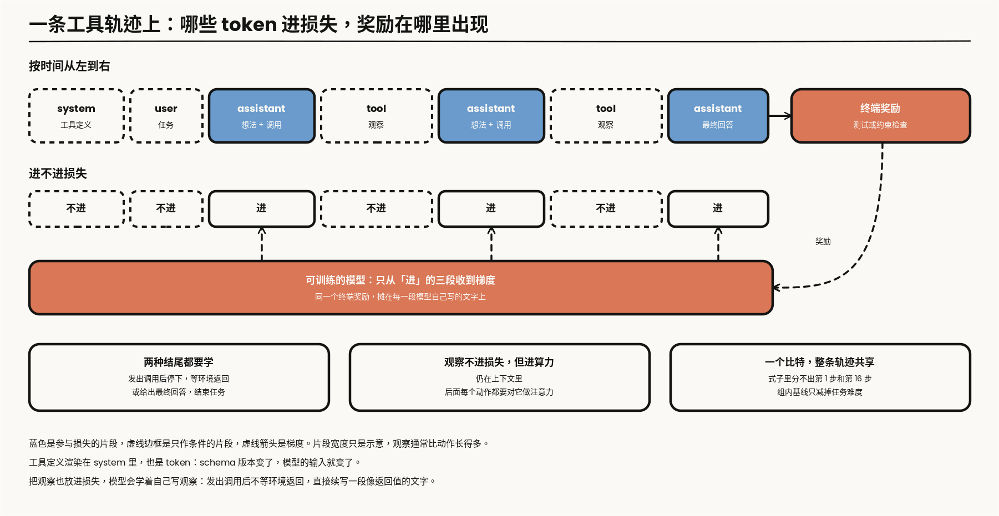
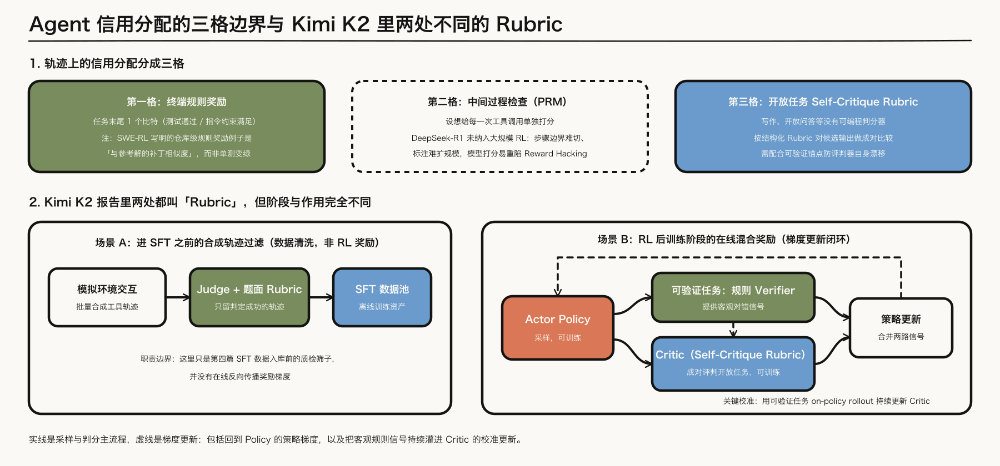
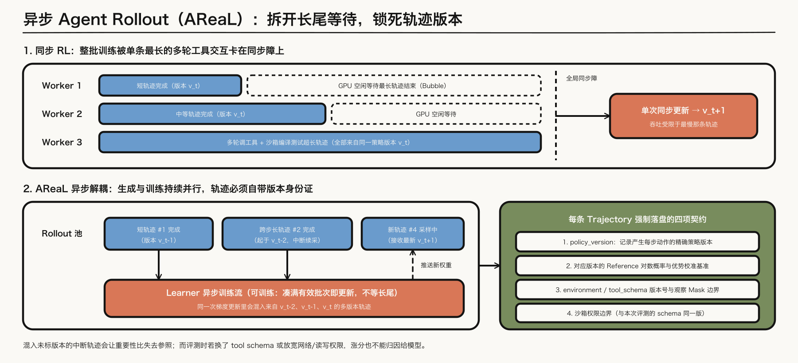
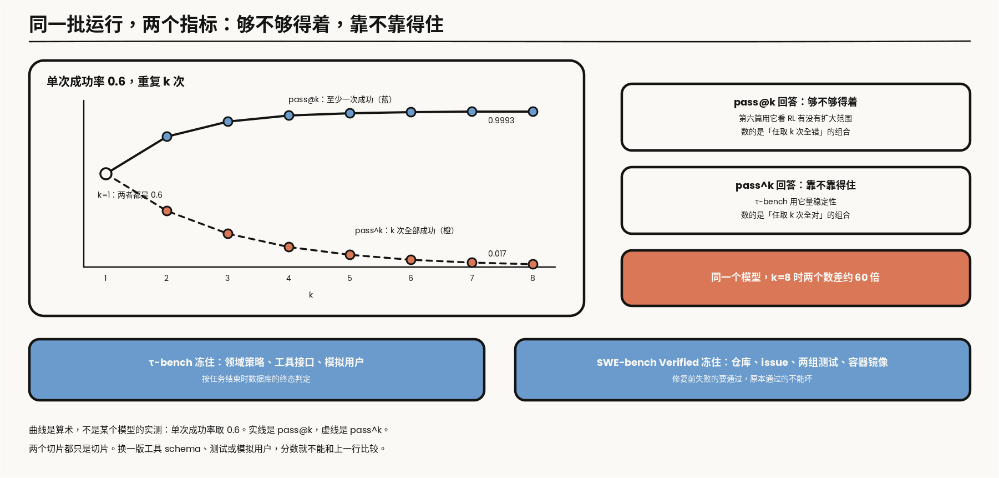

---

layout: post
tags: [LLM, NLP, Training]
title: 大模型是怎么炼成的（七）：轨迹末端的奖励，以及怎样验证一个 agent
date: 2026-11-4
author: Kyrie Chen
comments: true
toc: true
pinned: false

---

第六篇的奖励落在一次解答的末尾。Agent 把这一次解答换成一串动作：模型发出工具调用，读回观察，再决定下一步。奖励往往要等到任务结束才出现。信用分配因此从「这段推理里哪一句」变成「这条轨迹里哪一次调用」。

> **范围**：工具调用的轨迹、稀疏的终端奖励，以及用来卡住结论的冻结评测。只写报告写明的奖励来源。[Kimi K2](https://arxiv.org/abs/2507.20534) 的两套奖励都引，不把没写的测试通过补进去。文中标明「算术」的数字是从定义直接算出来的，标明「工程约定」的做法是本篇的建议，不是某份报告的原文。

---

## 一、观察默认不进损失

### 1.1 一条轨迹是一段更长的 messages

一条轨迹是模型输出和外部观察交替出现。写成第四篇的 `messages`，它只是多了两种内容：assistant 消息里的工具调用，和 `tool` 角色的返回。

```json
[
  {"role": "user", "content": "修复 utils/date.py 里的时区解析错误"},
  {"role": "assistant", "content": "先看报错。",
   "tool_calls": [{"name": "run_tests", "arguments": {"path": "tests/test_date.py"}}]},
  {"role": "tool", "name": "run_tests", "content": "FAILED test_parse_tz: ValueError ..."},
  {"role": "assistant", "content": "解析时丢了偏移量。",
   "tool_calls": [{"name": "edit_file", "arguments": {"path": "utils/date.py", "patch": "..."}}]},
  {"role": "tool", "name": "edit_file", "content": "ok"},
  {"role": "assistant", "content": "已修复，测试通过。"}
]
```

模型发出的调用是动作，可以进损失。观察是环境返回的，默认和第四篇里的 user 内容一样，不进 $$\mathcal{T}$$。只有当这段文字本身是模型要学习的输出时，才把它放进 mask。


*图 1：实线是主流程，虚线表示反馈（梯度），与第二篇图 1 一致。观察是环境返回的资产。梯度从终端奖励回到可训练的模型，不把观察自动算进损失。*

### 1.2 按 role 打 mask

落到代码上，这条规则就是按 role 决定一段 token 的 label。下面的 `render` 是训练管线自己的模板渲染，返回一条消息对应的 token。

```python
TRAINABLE_ROLES = {"assistant"}          # 训练环境模拟器时才把 "tool" 加进来

def encode_trajectory(messages, render):
    input_ids, labels = [], []
    for m in messages:
        ids = render(m)                  # 含 header、正文、工具调用的序列化、终止符
        body = m["role"] in TRAINABLE_ROLES
        input_ids += ids
        labels += ids if body else [-100] * len(ids)
    return input_ids, labels
```

这是最小写法。assistant 消息的 header 是否进损失，沿用第四篇的声明；工具调用的 JSON 序列化要和推理入口完全一致，否则模型学到的参数格式和解析器期待的不是同一种。第四篇那段单测在这里多一条断言：解码出的可训片段里，不出现任何 `tool` 消息的内容。

观察进了损失会出两种问题。一种是算力花在背不可预测的东西上：报错栈、时间戳、网页正文，模型预测不了，也不该预测。另一种更隐蔽：模型学会了自己写观察。它发出调用之后不等环境返回，直接续写一段看起来像返回值的文字，然后基于这段文字继续行动。训练时观察总是紧跟在调用后面，对一个把观察也当目标来学的模型，这是最自然的续写。

反过来的情况只有一种：要训练的就是环境模拟器。这时 `tool` 是目标，assistant 的调用是条件，mask 整个翻过来。

### 1.3 schema 和权限边界是轨迹的字段

工具的名字、参数和返回字段构成 schema，沙箱允许读写什么、能不能访问外部网络构成权限边界。第一篇的接口表把这一环写成 `environment`/`tool schema` 与版本、`trajectory` 和权限边界：版本与边界都是轨迹字段，训练轨迹用的 schema 和权限边界，必须与评测完全一致；任何一项变了，成功率的变化都不能记到模型上。

一条轨迹的元数据至少要有这些。取值是示意：

```json
{
  "trajectory_id": "swe-00417-r3", "task_id": "swe-00417",
  "tool_schema_version": "2026.10.2", "env_image": "sha256:9f2c...", "network": "none",
  "max_turns": 40, "turns": 17, "terminated_by": "final_answer",
  "segments": [{"turn_range": [0, 9], "policy_version": 1840},
               {"turn_range": [10, 16], "policy_version": 1843}],
  "reward": {"source": "tests", "value": 1.0, "verifier_version": "1.4.0"}
}
```

`terminated_by` 区分正常结束、到达轮数上限和环境报错，三者在奖励上可能都是 0，原因不同。`segments` 记的是每一段动作由哪个策略版本生成，第三节会用到。`reward.source` 写明奖励从哪来，第二节的三格在这里是一个字段。

### 1.4 环境会泄漏答案

权限边界不只是安全问题，也是评测有效性的问题。下面这张表是检查清单，不是某份报告的统计。

| 泄漏或不一致 | 模型看到了什么 | 至少留痕 |
|---|---|---|
| 沙箱能联网 | 搜到题目的原帖、公开的修复提交 | `network` 字段；访问过的域名列表 |
| 仓库带着未来的历史 | 版本库历史里有修复这个 issue 的提交 | 镜像哈希；检出的提交号 |
| 测试文件可写 | 把失败的断言改掉或删掉 | 测试文件在任务前后的哈希 |
| 工具不幂等 | 同一个调用两次返回不同，轨迹无法重放 | 调用与返回的完整记录；随机种子 |
| 时间相关 | 依赖当前日期的工具在重放时结果变了 | 环境时钟是否冻结 |

第三行是 agent 版的 reward hacking：奖励是测试通过，最短的路是让测试不再检查。它不需要模型有恶意，只需要奖励没有排除这条路。把测试文件设成只读，或者在任务结束时用原始测试重新跑一遍，是奖励定义的一部分。

### 1.5 观察不进损失，但进算力

mask 掉观察，省的是损失，不是前向。观察仍然在上下文里，后面每一个动作 token 都要对它做注意力。Agent 轨迹里观察通常比动作长得多：一次文件读取、一页搜索结果、一段测试输出，都是几百到几千个 token，模型自己写的调用只有几十个。算术：一条轨迹里观察占 80% 的 token，那么前向和反向的开销按 100% 的长度付，产生梯度的只有 20%。按「每个有监督的 token 花多少算力」算，它比一条同样长度的 SFT 样本贵五倍。

所以轨迹训练里常见一步预处理：把过长的观察截断或摘要。这一步改的是条件分布。训练时观察被截到 2000 个 token，评测时环境返回完整的 2 万个，模型面对的是没见过的上下文长度和内容密度。截断规则因此和工具 schema 一样，是训练与评测必须一致的配置，要写进 1.3 节那份元数据。

assistant 消息里除了工具调用，通常还有一段调用之前的文字，[ReAct](https://arxiv.org/abs/2210.03629) 把它叫 thought：先写下打算做什么，再发出动作，读回观察。这段文字是模型的输出，默认进损失。它也是轨迹里唯一能让人读懂「为什么调这个工具」的部分。合成轨迹时如果只留了调用、丢了前面的文字，学生学到的是在没有任何显式理由的情况下直接出动作。

### 1.6 工具定义和停止，也是要学的格式

工具的定义不只存在于环境里。模型要知道有哪些工具可用，这份定义得写进上下文，通常渲染在 system 消息里：每个工具的名字、用途、参数的类型和说明。它因此也是 token，也是训练分布的一部分。

三件事跟着来。工具列表的长度直接占上下文：几十个工具的定义可以有几千个 token，每条轨迹都要付一遍。其次，训练时每条样本都带同一组工具，模型学到的可能是「这几个名字」，而不是「读定义、按定义调用」；评测换一组没见过的工具，量到的才是后者。2.3 节里 Kimi K2 给不同的 agent 配不同的工具组合，对着的就是这件事。最后，schema 版本变了，上下文里的这段文字就变了。1.3 节把版本记成字段，原因在这里：它改的是模型的输入。

停止也是格式的一部分。一轮 assistant 消息有两种结尾：发出调用，等环境返回；或者给出最终回答，结束任务。两种结尾在模板里是不同的 token 序列，外面的循环靠它们判断下一步该谁动。第四篇 2.2 节写过终止符被 mask 的后果，这里多一种：模型没被要求预测过「调用之后的那个结束标记」，就不会在发出调用之后停下，接着往下写的正是 1.2 节说的那段伪造的观察。两种结尾都要进损失。



*图 2：token 级的一条轨迹。蓝色是参与损失的片段，虚线边框是只作条件的片段，虚线箭头是梯度。片段宽度只是示意。*

---

## 二、信用分配分成三格

### 2.1 一个比特，摊在一整条轨迹上

第六篇的一条回答只有结尾一个比特。轨迹上这个问题更重，因为动作之间隔着环境。

把轨迹写成决策过程：状态 $$s_t$$ 是到第 $$t$$ 步为止的全部消息，动作 $$a_t$$ 是模型这一步写出的文字和调用，下一个状态由环境决定，模型控制不了。只有终端奖励 $$R$$ 时，策略梯度是

$$
\nabla_\theta J = \mathbb{E}\Big[\sum_{t=1}^{T}\nabla_\theta\log\pi_\theta(a_t\mid s_t)\,\big(R-b\big)\Big]
$$

括号里的 $$R-b$$ 对一条轨迹的所有步骤是同一个数。$$b$$ 是基线，第六篇的 GRPO 用同一道题的组内均值来估它。式子里没有任何一项能区分第 1 步和第 16 步。

设想两条都失败的轨迹。一条在第 1 步打开了错误的文件，后面 15 步都在错误的地方认真工作。另一条前 15 步全对，最后一步的补丁少写了一个括号。终端奖励都是 0，梯度对两条轨迹里每个动作的态度相同：都压低。前一条里该负责的是第 1 步，后一条里前 15 步都是好动作。

组内基线能缓解一部分。同一个任务采多条轨迹，减去组内平均，「这个任务本来就难」被减掉了。它分不开的是一条轨迹内部哪一步有功。轨迹越长，共享同一个比特的 token 越多，每个 token 上的信噪比越低。

组内基线在这里还多一个前提：同一组的轨迹要从同一个初始状态出发。数学题天然满足。环境任务要靠重置：仓库回到同一个提交，数据库回到同一份快照，模拟用户用同一个设定。环境重置不干净，组内的奖励差异里就混进了起点的差异，基线减掉的不再只是任务难度。

### 2.2 三格

终端规则奖励是第一格。测试通过与否、指令约束是否满足，都是任务结束时的一个比特，整段轨迹共享它。

过程检查是第二格。逐步奖励或过程奖励模型可以给中间步骤打分。[DeepSeek-R1](https://arxiv.org/abs/2501.12948) 的不成功尝试说明，他们没有把这一格放进大规模 RL：步骤边界难定义，标注扩不了规模，模型打分又会回到 reward hacking。

不可验证任务上的 rubric 是第三格，下一小节展开。

| 格 | 奖励从哪来 | 它鼓励的捷径 | 至少要查 |
|---|---|---|---|
| 终端规则 | 任务结束时的测试或约束检查 | 改测试、对检查做特判 | 测试只读；用原始测试复跑 |
| 过程检查 | 每一步的规则或模型打分 | 刷能得分的步骤；重复调用 | 步数与奖励的相关；重复调用率 |
| rubric | 模型按评分表判断 | 迎合评判者的口味；写长 | 评判者在可验证任务上的准确率 |

「它鼓励的捷径」一列是按奖励的定义推出来的，不是某份报告观察到的清单。每一种奖励都定义了一条最短的得分路径，检查项就是确认这条路径被堵上了。

几格可以同时用，2.3 节的 Kimi K2 就把第一格和第三格放进了同一次训练。混用时要看量纲。规则奖励是 0 或 1；rubric 的成对比较给出的是胜负或者一个分数，范围和分布都不同。两种任务的轨迹进同一个 batch，奖励如果不先各自归一，量级大的那一种会主导梯度。第六篇的组内基线按任务分组算，天然把每个任务的奖励拉回各自的尺度；不分组、直接把原始奖励加在一起的实现，要另外处理这件事。这一段是工程约定。

### 2.3 Kimi K2 里两处 rubric

[Kimi K2](https://arxiv.org/abs/2507.20534) 把后训练写成两半：可验证任务用规则奖励；写作、开放问答这类没有标准答案的任务，用 self-critique rubric，由模型按 rubric 对自己的输出做成对比较。报告还写了 critic 会用可验证任务上的 on-policy rollout 继续更新，把规则信号灌进这个评判器。这是报告里的机制，不是「模型自己评自己所以奖励可靠」。它要解决的是第五篇 5.3 节那个问题：评判者和被训练者同源时，偏差会被学回去。用可验证任务持续校准评判者，是给它一个不来自自己的锚。

同一份报告里还有一件不同的事：合成工具轨迹时，每道题配 rubric，judge 只留下判定成功的轨迹。那是进 SFT 之前的过滤，不是上面那个 RL 奖励。两处都用了 rubric 这个词，记账时要分开。

这份合成流程本身值得记一笔。报告写的是三步：先造工具，一部分来自真实的工具规范，一部分由模型合成；再造 agent 和任务，给不同的 system prompt 和工具组合，任务带着明确的评分表；最后生成轨迹，由模拟的用户和模拟的工具环境配合产出多轮交互。模拟环境便宜，但模拟出的返回未必和真实执行一致，所以报告在需要真实反馈的地方接了真实的执行沙箱。合成数据的 lineage 在这里比第四篇多两项：环境是模拟的还是真实的，以及生成这条轨迹的工具规范来自哪里。



*图 3：上半部分并列轨迹信用分配的三格边界；下半部分把 Kimi K2 里两处同名机制拆开——左框是进 SFT 前筛轨迹的离线质检，右框是在线 RL 的混合奖励闭环（虚线为回到 Policy 与持续校准 Critic 的梯度更新）。*

### 2.4 K2 的 RL 里另外三处

同一份报告在 RL 一节还列了三项和奖励无关的处理，各自对应前面某一篇的问题。

一是 token 预算：给每条样本设最大 token 数，超出的回答被截断并受罚。第六篇的长度膨胀在这里用预算直接卡住，而不是等它出现再查分母。二是 PTX loss：RL 的同时，在一份精选的高质量数据上保留一项辅助损失，防止这些数据上的能力被忘掉。第五篇 2.2 节 InstructGPT 的 PPO-ptx 是同一类补丁，名字也沿用了。三是温度衰减：训练早期用较高的采样温度鼓励探索，后期逐步降低，让策略收敛到稳定的输出。

三项都不改奖励的定义，改的是奖励之外策略还受哪些约束。读一份 agent RL 的配方时，除了「奖励是什么」，这一栏同样要问。

---

## 三、异步 rollout 要记下 policy 版本

### 3.1 同步在等什么

同步的 RL 等一批里最长的轨迹结束，再用同一个 policy 的样本更新。长轨迹一多，短轨迹就在空等。算术：一批 64 条轨迹，63 条各用 1 分钟，1 条用 20 分钟，同步时这一批的墙钟时间是 20 分钟，生成侧的利用率是 83 除以 1280，约 6.5%。Agent 任务的轨迹长度分布通常有很长的尾巴，这个比例不是极端情况。

[AReaL](https://arxiv.org/abs/2505.24298) 把生成和训练拆开：rollout 的进程不停地生成，训练的进程攒够一批就更新，更新不再被最长的那条轨迹挡住。代价是同一次更新里的轨迹可以来自不同的 policy 版本，一条长轨迹甚至可以前半段由旧版本生成、后半段由新版本生成。

### 3.2 陈旧的数据怎样进目标函数

第六篇的重要性比 $$\rho$$ 假设采样的策略只有一个，而且离当前策略不远。异步之后这两条都不成立。

AReaL 做了两件事。第一件是限制陈旧度：给「生成这条数据的版本」和「当前版本」之间的差设一个上限，超过上限的数据不进更新。报告里的消融显示，不加控制地用陈旧数据会掉性能。第二件是把 PPO 目标里的两个角色拆开。标准 PPO 里，旧策略同时是「生成数据的行为策略」和「限制更新幅度的锚」。数据来自多个版本时，前者不止一个。AReaL 用的是解耦的 PPO 目标：重要性权重相对行为策略算，裁剪相对一个较新的近端策略算。记行为策略为 $$\pi_{\mathrm{b}}$$，近端策略为 $$\pi_{\mathrm{prox}}$$：

$$
\mathcal{J}(\theta) = \mathbb{E}\Big[\frac{\pi_{\mathrm{prox}}(a\mid s)}{\pi_{\mathrm{b}}(a\mid s)}\,\min\big(u\,\hat{A},\ \mathrm{clip}(u,1-\varepsilon,1+\varepsilon)\,\hat{A}\big)\Big],\qquad u = \frac{\pi_\theta(a\mid s)}{\pi_{\mathrm{prox}}(a\mid s)}
$$

前面那个比值修正「数据是谁采的」，后面的裁剪管「这一步走多远」。两件事各用各的参照。

### 3.3 版本写在每一段动作上

要算上面那个比值，每个动作 token 都得知道自己是被哪个版本、以多大的概率采出来的。所以落盘的不只是文本，还有两样东西：每段动作对应的 `policy_version`，和采样时的对数概率。这是工程约定，1.3 节元数据里的 `segments` 就是为它留的。

版本因此要写在轨迹上。优势、KL 用的 reference、以及当时的工具 schema，都跟着这一版走。混进一条没标版本的中断轨迹，后面无法判断梯度来自哪一个策略。

事后重算对数概率看起来能省掉这一列，实际不行。重算需要那个版本的权重还在，而异步系统里旧版本的权重通常已经被覆盖。采样时顺手存下来是唯一便宜的时刻。



*图 4：上排同步 RL 被单条最长多轮交互卡在全局同步障上；下排 AReaL 拆开生成与训练后，同一次更新会混入跨版本轨迹，因此右侧四项版本与权限边界契约必须随每条 `trajectory` 落盘。*

### 3.4 失败的轨迹也要进 manifest

异步系统里轨迹的结局不止成功和失败两种，还有超时、环境崩溃、被陈旧度上限丢弃。只把成功的轨迹落盘，下一轮的数据合成和分析就只剩幸存者：看不到模型在哪一步最常出错，也算不出真实的成功率。第一篇要求保留失败样本，在这里是每一种 `terminated_by` 都有记录，丢弃的数据也记下丢弃的原因。

到达轮数上限的轨迹要单独处理。它和第六篇的超长回答是同一个问题：直接记成失败，模型会把「方向是对的、只是还没做完」也当成错误来压。可选的做法也相同：这类轨迹不进损失，或者单独给一个和「做错」不同的惩罚。选哪一种是配置，不选就是默认把它们当成失败。环境崩溃的轨迹则不该产生任何梯度：那个 0 不是模型挣来的。

---

## 四、仓库任务的奖励，只引用写明了的那一种

### 4.1 三种奖励，三种开销

竞赛题上的测试通过，是第六篇 R1 的代码奖励。仓库级的 issue 是另一件事：改动要落在一个已有代码库里，测试也不是题目自带的标准输出。可选的奖励至少有三种。

| 奖励 | 每条轨迹的开销 | 稀疏程度 | 它衡量的是什么 |
|---|---|---|---|
| 和参考补丁的相似度 | 一次字符串比较 | 连续值，几乎每条都有信号 | 写得像不像那一份已知的修法 |
| 在容器里跑测试 | 构建环境、装依赖、执行测试 | 0 或 1，多数为 0 | 这个修法是否让指定的测试通过 |
| 模型判断 | 一次或多次前向 | 连续或离散 | 评判者认为修得对不对 |

[SWE-RL](https://arxiv.org/abs/2502.18449) 写明的规则奖励例子，是生成解和参考解的相似度，不是测试是否通过。它的数据来自公开仓库的 PR 历史，规模很大，逐条构建可执行环境不现实；相似度不需要执行，才撑得起这个规模。代价写在奖励的定义里：相似度高可以来自和参考解长得像，而不来自测试变绿；一个正确但写法不同的修复，得分反而低。引用它的时候要带上这个区别。

### 4.2 评测用测试，不等于训练用测试

其他公开的仓库级训练如果没有把「奖励等于哪些测试通过」写出来，这里不补。评测协议里用测试给模型打分，也不等于训练时的奖励就是这个测试。

这句话有两层。一层是事实层面的：报告没写，就不替它写。另一层是 4.1 那张表的后果：用测试当训练奖励，每条轨迹都要付一次环境构建和执行的开销，这笔账大到足以让一个团队选别的奖励。看到一个模型在 SWE-bench 上的分数，不能倒推出它的训练奖励是什么。

---

## 五、验证用冻结切片，而不是再训一个总分

第六篇用 pass@k 和 base 对照，是因为可验证的题有标准答案。Agent 的一次运行依赖工具、环境和用户模拟，同一次任务的轨迹可以完全不同。验证要先把环境冻住。

### 5.1 τ-bench：冻住策略和工具，量稳定性

[τ-bench](https://arxiv.org/abs/2406.12045) 冻住的是领域策略和工具接口：模型对着模拟用户完成订票、零售这类多轮任务。判定看的是任务结束时数据库的状态是否和标注的目标状态一致，而不是对话听起来是否合理。用户是模型模拟的，所以同一个任务每次运行的对话都不同。

它因此报了一个和第六篇方向相反的指标。pass@k 问的是 $$k$$ 次里至少一次成功，衡量够不够得着。τ-bench 的 $$\mathrm{pass}^{k}$$ 问的是 $$k$$ 次独立运行全部成功，衡量靠不靠得住。算术：单次成功率 0.6 的任务，8 次里至少成功一次的概率是 0.9993，8 次全部成功的概率是 0.017。同一个模型，两个数差了近 60 倍。

估计它不需要把每个任务真的连跑 $$k$$ 次再看是否全对。每个任务跑 $$n$$ 次、成功 $$c$$ 次，从这 $$n$$ 次里任取 $$k$$ 次、恰好全部成功的比例是两个组合数之比，再对任务取平均：

$$
\mathrm{pass}^{k} = \mathbb{E}_{\mathrm{task}}\Big[\binom{c}{k}\Big/\binom{n}{k}\Big]
$$

第六篇 5.3 节的 pass@k 是 1 减去「任取 $$k$$ 次全部失败」的比例。两个式子数的是同一批运行：一个数全错的组合，一个数全对的组合。

对一个要部署的 agent，后一个数更接近用户的体验：同一类请求，十次里有四次办不成，就不能交给它。训练侧只看前一个数，会把「偶尔能做对」当成「会做」。



*图 5：曲线是算术：单次成功率取 0.6。实线是 pass@k，虚线是 $$\mathrm{pass}^{k}$$。下排是两个评测各自冻住的东西。*

### 5.2 SWE-bench Verified：冻住仓库、issue 和测试

[SWE-bench](https://arxiv.org/abs/2310.06770) 冻住的是仓库、issue 和测试。每个任务有两组测试：一组是修复之前失败、修复之后应当通过的，一组是修复前后都应当通过的。前一组检查问题修没修好，后一组检查有没有顺手弄坏别的。两组都满足才算解决。

它的 Verified 子集是人工复核过的一道切片：标注者筛掉了 issue 描述不清、或者测试会把合理的修法也判错的任务，留下 500 个。评测仍然看测试，不是另一套奖励定义。筛掉的那些任务说明了一件事：原始集合里有一部分题，做不出来不是模型的问题。

每个任务跑在自己的容器镜像里，依赖版本是固定的。这和 1.3 节的 `env_image` 是同一个字段：评测报的分数，绑定这组镜像。

### 5.3 切片之间不能直接比

这两份都只是切片。换一套工具 schema、换一个测试版本，数字不能和上一行比较。第一篇预留的 schema 版本，用在这里就是这个对照的前提。

还有三个配置和分数绑在一起，报分数时要一并写出：每个任务允许的最大轮数，单次工具调用的超时，以及外面套的那层脚手架。同一个模型换一套脚手架，分数可以差很多；这个差值属于系统，不属于权重。训练前后的对比，这三项必须相同。

模拟用户也在这张单子上。τ-bench 的用户是一个语言模型按设定扮演的，换一个模型来扮演，对话的走向和难度都会变。它是环境的一部分，版本要和工具 schema 一起记。训练时如果也用模拟用户生成轨迹，Kimi K2 的合成流程就是这样做的，那么训练用的模拟器和评测用的模拟器是不是同一个，决定了评测量到的是泛化还是对某个模拟器的适应。

切片的大小决定了多大的差值才算数。算术：500 个任务、成功率在 50% 附近时，单次评测的标准误是 $$\sqrt{0.5\times 0.5/500}$$，约 2.2 个点；两个模型差 3 个点，还在一次评测的噪声范围里。这只是题目抽样带来的波动，还没算同一个任务重复运行的差异。第八篇 3.4 节把这件事放到所有评测上讲。

---

## 六、排查：成功率变了，先问是谁变了

Agent 的成功率是模型、环境、工具和评测配置的乘积。下面这张表按「成功率突然变化」这一个现象往下查，顺序是从最便宜的检查到最贵的。它是检查顺序，不是某份报告的结论。

| 先查什么 | 信号 | 对照 | 结论 |
|---|---|---|---|
| 工具 schema | `tool_schema_version` 前后是否相同 | 用旧版 schema 重跑同一个 checkpoint | 不同则差值不属于模型 |
| 环境 | 镜像哈希；超时和报错在 `terminated_by` 里的占比 | 同一条成功轨迹重放是否仍成功 | 环境类终止变多，先修环境 |
| 评测配置 | 最大轮数、超时、脚手架版本 | 逐项恢复成旧值 | 找到哪一项带来差值 |
| 权限边界 | `network`；测试文件哈希 | 关掉网络、测试只读后重跑 | 分数掉了，说明之前有泄漏 |
| 观察是否被伪造 | 调用之后有没有不经环境的「返回」 | 1.2 节的单测 | mask 的问题 |
| 策略本身 | 以上都相同 | 上一个 checkpoint，同配置 | 这时才是训练的问题 |

前四行都不需要动模型。实际的顺序经常反过来：成功率一掉就去调奖励、改学习率，调了几轮才发现工具的返回字段改了名字。

第四行的方向要注意：收紧权限之后分数下降，不是坏消息，是之前的分数里有一部分不该算。

---

## 七、交出去的是带版本的轨迹

一条合格的 agent 轨迹交付出去时，自身就要带着对账字段：

- **监督位置与奖励来源分开记**：动作是模型输出，观察默认不进损失；终端规则奖励、过程检查、self-critique rubric 分属三格，Kimi K2 合成轨迹时的 judge 过滤和它 RL 阶段的 rubric 也不是同一步；仓库级训练若像 SWE-RL 那样用参考解相似度当奖励，引用时不能写成测试通过。
- **异步采样与评测切片同时锁版本**：AReaL 拆开生成与训练等待后，`policy` 版本、`reference` 与当时的 `tool schema` 都要落进每条 `trajectory`；τ-bench 与 SWE-bench Verified 只是冻结环境切片，换一版 schema 或权限边界，分数就不能跨行比较。

下一篇接收这套昂贵策略的 `teacher`、`checkpoint` 与 `prompt` lineage，讨论向小模型迁移时的三条蒸馏选择，并用冻结 `holdout`、污染检查与 `judge` 版本把评估接回第一篇的数据契约。

---

## 参考资料

- [Kimi K2](https://arxiv.org/abs/2507.20534)（可验证奖励与 self-critique rubric；工具与轨迹的合成流程；轨迹合成时的 judge 过滤；token 预算、PTX loss、温度衰减）
- [Yao et al., ReAct](https://arxiv.org/abs/2210.03629)（thought、action、observation 交替的写法）
- [AReaL](https://arxiv.org/abs/2505.24298)（异步 rollout、陈旧度控制、解耦的 PPO 目标）
- [Hilton et al., Batch size-invariance for policy optimization](https://arxiv.org/abs/2110.00641)（把行为策略和近端策略拆开的 PPO）
- [Wei et al., SWE-RL](https://arxiv.org/abs/2502.18449)（规则奖励的例子是与参考解的相似度）
- [Yao et al., τ-bench](https://arxiv.org/abs/2406.12045)（数据库终态判定、$$\mathrm{pass}^{k}$$）
- [Jimenez et al., SWE-bench](https://arxiv.org/abs/2310.06770)
- [DeepSeek-R1](https://arxiv.org/abs/2501.12948)（过程奖励未进入大规模 RL）
