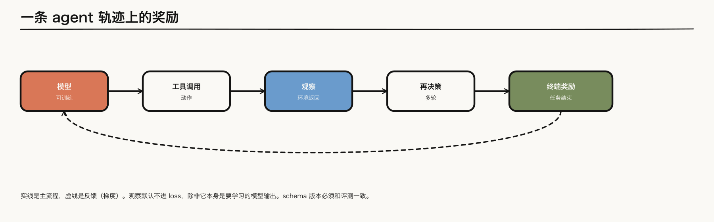

---

layout: post
tags: [LLM, NLP, Training]
title: 大模型是怎么炼成的（七）：轨迹末端的奖励，以及怎样验证一个 agent
date: 2026-11-4
author: Kyrie Chen
comments: true
toc: true
pinned: false

---

第六篇的奖励落在一次解答的末尾。Agent 把这一次解答换成一串动作：模型发出工具调用，读回观察，再决定下一步。奖励往往要等到任务结束才出现。信用分配因此从「这段推理里哪一句」变成「这条轨迹里哪一次调用」。

> **范围**：工具调用的轨迹、稀疏的终端奖励，以及用来卡住结论的冻结评测。只写报告写明的奖励来源。[Kimi K2](https://arxiv.org/abs/2507.20534) 的两套奖励都引，不把没写的测试通过补进去。

---

## 一、观察默认不进损失

一条轨迹是模型输出和外部观察交替出现。模型发出的调用是动作，可以进损失。观察是环境返回的，默认和第四篇里的 user 内容一样，不进 $$\mathcal{T}$$。只有当这段文字本身是模型要学习的输出时，才把它放进 mask。

工具的名字、参数和返回字段构成 schema。第一篇的接口表把 agent 的输入写成 environment / tool schema 与版本。版本是样本字段：训练轨迹用的 schema，和后面评测用的 schema，必须是同一版。版本变了，成功率的变化不能记到模型上。

*图 1：实线是主流程，虚线表示反馈（梯度），与第二篇图 1 一致。观察是环境返回的资产。梯度从终端奖励回到可训练的模型，不把观察自动算进损失。*

---

## 二、信用分配分成三格

终端规则奖励是第一格。测试通过与否、指令约束是否满足，都是任务结束时的一个比特，整段轨迹共享它。第六篇已经写过这种稀疏性：中间步骤没有单独的梯度。

过程检查是第二格。逐步奖励或过程奖励模型可以给中间步骤打分。[DeepSeek-R1](https://arxiv.org/abs/2501.12948) 的不成功尝试说明，他们没有把这一格放进大规模 RL：步骤边界难定义，标注扩不了规模，模型打分又会回到 reward hacking。这里不把第二格写成默认。

不可验证任务上的 rubric 是第三格。[Kimi K2](https://arxiv.org/abs/2507.20534) 把后训练写成两半：可验证任务用规则奖励；写作、开放问答这类没有标准答案的任务，用 self-critique rubric，由模型按 rubric 对自己的输出做成对比较。报告还写了 critic 会用可验证任务上的 on-policy rollout 继续更新，把规则信号灌进这个评判器。这是报告里的机制，不是「模型自己评自己所以奖励可靠」。

同一份报告里还有一件不同的事：合成工具轨迹时，每道题配 rubric，judge 只留下判定成功的轨迹。那是进 SFT 之前的过滤，不是上面那个 RL 奖励。两处都用了 rubric 这个词，记账时要分开。

---

## 三、异步 rollout 要记下 policy 版本

同步的 RL 等一批里最长的轨迹结束，再用同一个 policy 的样本更新。长轨迹一多，短轨迹就在空等。[AReaL](https://arxiv.org/abs/2505.24298) 把生成和训练拆开：更新不再被这条最长轨迹挡住，同一次更新里的轨迹可以来自不同的 policy 版本。

版本因此要写在轨迹上。优势、KL 用的 reference、以及当时的工具 schema，都跟着这一版走。混进一条没标版本的中断轨迹，后面无法判断梯度来自哪一个策略。

---

## 四、仓库任务的奖励，只引用写明了的那一种

竞赛题上的测试通过，是第六篇 R1 的代码奖励。仓库级的 issue 是另一件事：改动要落在一个已有代码库里，测试也不是题目自带的标准输出。

[SWE-RL](https://arxiv.org/abs/2502.18449) 写明的规则奖励例子，是生成解和参考解的相似度，不是测试是否通过。相似度高可以来自和参考解长得像，而不来自测试变绿。引用它的时候要带上这个区别。

其他公开的仓库级训练如果没有把「奖励等于哪些测试通过」写出来，这里不补。评测协议里用测试给模型打分，也不等于训练时的奖励就是这个测试。

---

## 五、验证用冻结切片，而不是再训一个总分

第六篇用 pass@k 和 base 对照，是因为可验证的题有标准答案。Agent 的一次运行依赖工具、环境和用户模拟，同一次任务的轨迹可以完全不同。验证要先把环境冻住。

[τ-bench](https://arxiv.org/abs/2406.12045) 冻住的是领域策略和工具接口：模型对着模拟用户完成订票、零售这类多轮任务，成功率按任务是否满足策略来算。[SWE-bench](https://arxiv.org/abs/2310.06770) 冻住的是仓库、issue 和测试。它的 Verified 子集是人工复核过的一道切片，评测仍然看测试，不是另一套奖励定义。

这两份都只是切片。换一套工具 schema、换一个测试版本，数字不能和上一行比较。第一篇预留的 schema 版本，用在这里就是这个对照的前提。

---

## 六、交出去的是带版本的轨迹

1. 奖励默认在轨迹末端。观察进不进损失，和动作是不是模型输出，要分开写。
2. 规则奖励、过程奖励、self-critique rubric 是三格。K2 的轨迹过滤和它的 RL rubric 也不是同一步。
3. 异步 rollout 的 policy 版本是样本字段。AReaL 拆开的是生成和训练的等待，不是把版本抹掉。
4. τ-bench 和 SWE-bench Verified 是冻结切片。schema 版本必须和训练一致。

下一篇把这个贵的策略迁到更小的模型上，并把评估接回第一篇的数据契约。

---

## 参考资料

- [Kimi K2](https://arxiv.org/abs/2507.20534)（可验证奖励与 self-critique rubric；轨迹合成时的 judge 过滤）
- [AReaL](https://arxiv.org/abs/2505.24298)
- [Wei et al., SWE-RL](https://arxiv.org/abs/2502.18449)（规则奖励的例子是与参考解的相似度）
- [Yao et al., τ-bench](https://arxiv.org/abs/2406.12045)
- [Jimenez et al., SWE-bench](https://arxiv.org/abs/2310.06770)
- [DeepSeek-R1](https://arxiv.org/abs/2501.12948)（过程奖励未进入大规模 RL）
