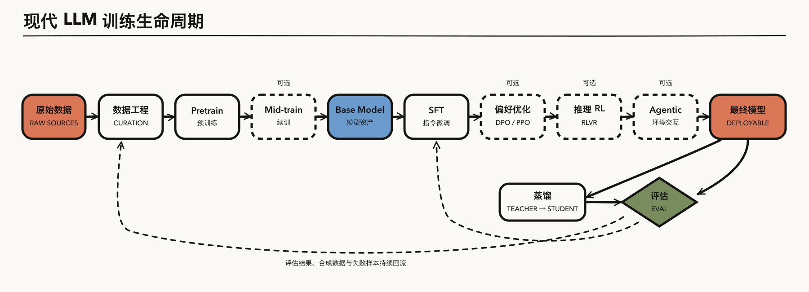
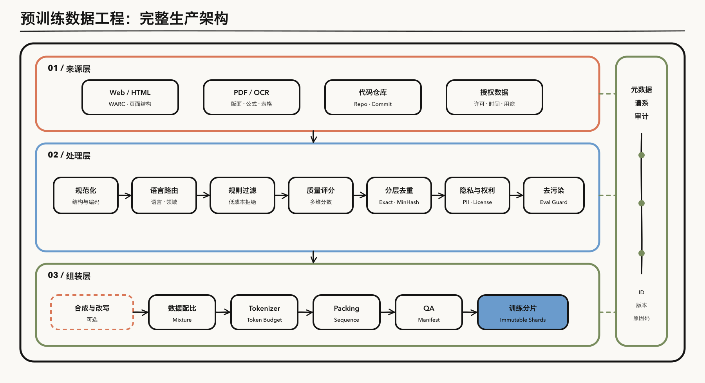
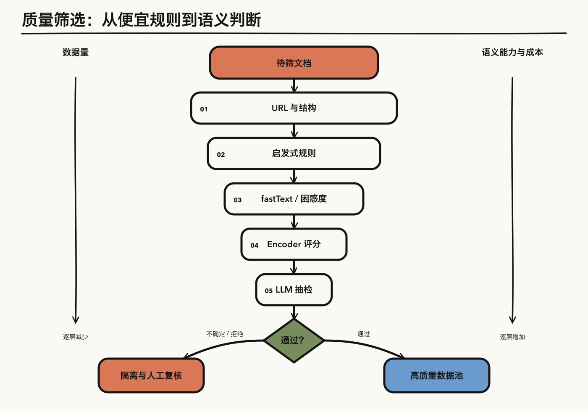
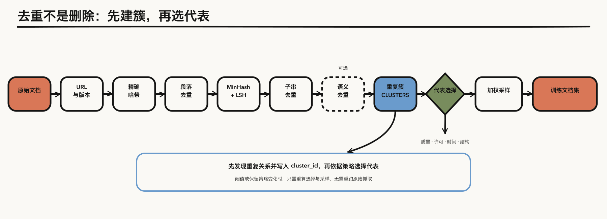

大模型训练并不是从第一次 `optimizer.step()` 才开始。正式 batch 进入 GPU 之前，团队已经要回答一组会贯穿整个生命周期的问题：模型最终服务什么能力，训练和推理预算是多少，哪些数据可以使用，评测集如何冻结，tokenizer、样本边界和训练分片如何定义，以及每项数据决策凭什么被接受。

这些问题不能只看 Pretrain 来回答。一个大模型从网页、代码仓库和论文，走到对话、代码、推理和工具调用，中间已经不再只是「Pretrain + RLHF」，而是一组相互回流的模块：**数据准备 → Pretrain → Mid-training → SFT → 偏好优化 → 推理 RL（RLVR）→ Agentic 训练 → 蒸馏与评估**。后面的训练目标，会反过来决定前面应该保留什么数据、元数据和评测接口。

因此，本系列第一篇先做一次 **开训评审（training readiness review）**：先看完整训练地图，理解后续阶段会向上游提出什么要求；再把视角拉回第一个 training step 之前，展开目标定义、数据治理、tokenizer、packing、训练分片和 QA。全文沿着同一条路径，从全局约束逐步收束到训练程序可以直接消费的输入。

本系列会围绕 Llama 3、DeepSeek-V3/R1、Tulu 等公开程度较高的系统，回答三类问题：每个阶段解决什么问题、核心目标和算法是什么、工程上如何验证它确实有效。涉及实操时，只展示最关键的 1～2 段代码；完整脚本另放仓库。

| 篇目 | 主题 | 核心问题与招牌内容 |
|---|---|---|
| ①（本篇） | 训练全景 + 开训准备 | 从目标与冻结评测集，到来源治理、tokenizer 和训练分片 |
| ② | Pretrain | Scaling Laws、Dense/MoE、精度与调度；**Loss Spike 排查实录** |
| ③ | Mid-training | 高质量数据升配、领域续训、长上下文扩展；LR 与数据配比双轴图 |
| ④ | SFT | 指令数据、chat template、full FT/LoRA；**Loss Masking 代码实战** |
| ⑤ | 偏好对齐 | RM/PPO、DPO/SimPO/KTO；**PPO 四模型交互图**与 DPO 核心代码 |
| ⑥ | 推理 RL（RLVR） | Verifier、GRPO/DAPO、test-time scaling；**KL、熵与长度失控排查** |
| ⑦ | Agentic 训练 | 工具调用 SFT、多轮环境 RL、credit assignment、异步 rollout |
| ⑧ | 蒸馏与评估 | 黑盒/白盒蒸馏、judge 偏差、污染与动态评测；训练—评估闭环 |

> **范围说明**：本文讨论的「开训准备」以文本 LLM 的通用预训练为主，覆盖截至 2026 年中的代表性公开论文、数据集与生产实践。模型架构、优化器和数值稳定性只介绍它们对前置准备提出的约束，具体训练留到第二篇；多模态数据、SFT、偏好与 RL 数据的专门治理留到后续文章。

---

## 一、从终局倒推：训练系统的全景与前置约束

*图 1：现代大模型训练生命周期。橙色表示起止节点，蓝色表示模型资产，绿色表示评估决策；虚线边框表示可选阶段，虚线连接表示反馈回流。*

全系列使用同一套视觉语法：**象牙白节点表示核心处理，橙色表示流程起止，蓝色表示数据、存储或模型资产，绿色表示决策；实线箭头表示主流程，虚线边框或连线表示可选阶段与反馈**。涉及 PPO/GRPO 等多模型交互时，再用节点内的状态标签明确「可训练」与「冻结」，避免让颜色同时承担两套含义。第五篇与第六篇会采用相同布局，直接显示 GRPO 主要省掉的是 learned critic，而不是笼统地说「少两个模型」。

这里刻意说「模块」，而不是八个必经的串行阶段：并非每个模型都经过每一环，SFT、偏好优化和 RL 也经常交替多轮；评估结果、模型生成数据和线上失败案例还会回流到更早的环节。对本篇来说，看全图不是为了提前讲完后七篇，而是为了确定开训前必须锁定哪些边界。下面四点都会直接落到后文的数据预算、版本、评测集和实验设计上。

**第一，Pretrain 通常是单次正式训练中最大的训练算力项，但「90%」不是普适常数。** [DeepSeek-V3 报告](https://arxiv.org/abs/2412.19437)列出的最终训练账本是：预训练 266.4 万、上下文扩展 11.9 万、后训练 0.5 万 H800 GPU 小时，合计 278.8 万；按这套口径，pretrain 与 context extension 占绝大多数。但它不包含所有失败实验、数据处理、人工标注，也不等于在线 RL 的 rollout 推理成本。因此，开训前要分别核算正式训练 token、代理实验、数据处理和后续 rollout，不能用一个固定占比反推全部预算。

**第二，能力上限与用户体验不能简单二分。** Pretrain 决定大部分知识、语言和表征能力，post-training 改变能力的可调用性、行为分布和安全边界；推理 RL 还可能实质性提高某些可验证任务的能力。更准确的说法是：它们优化不同分布上的目标，而不是一个只管「上限」、另一个只管「性格」。这要求项目在准备阶段就把 base 能力、行为目标和安全目标拆成不同评测切片，而不是等模型训完再找一个总分解释一切。

**第三，Mid-training 不是统一定义的标准阶段。** 本系列把它操作性地定义为：主干通用预训练之后、典型 post-training 之前，仍使用语言建模目标进行的继续训练，包括退火期高质量混合、领域继续预训练和长上下文扩展。不同论文可能称它 annealing、continued pretraining、context extension 或第二阶段预训练。既然阶段边界会变，数据系统就必须保留来源、领域、质量和长度标签，支持同一原料在不同 curriculum 中重新配比。

**第四，评估不是终点，而是开训准备的控制信号。** 数据质量分类器、混合权重和合成策略如果没有冻结评测集、污染检查与受控训练实验，就只是审美判断。训练项目真正的闭环是「提出数据假设 → 代理实验 → 规模复核 → 失败切片 → 修改数据」。所以冻结评测集不是训练后的验收动作，而是数据选择开始前就要完成的前置工作。

---

## 二、从后续训练倒推：开训前要预留什么

站在训练算法的视角，下面是七个模块的速览；站在本篇的视角，它们更像七组上游需求。每种目标都会要求不同的数据结构、版本信息和评估信号。先把这些接口看清楚，后面才知道为什么数据准备不能只是一串网页过滤器。

### 2.1 Pretrain：规模化的下一个 token 预测

自回归预训练在上下文 $$x_{\lt t}$$ 下预测 $$x_t$$，最小化 token 级负对数似然。Scaling Laws 用小规模实验估计参数量、有效数据量与算力之间的关系；[Chinchilla](https://arxiv.org/abs/2203.15556) 给出 compute-optimal 视角，后来的超量训练与数据受限研究则说明：最优点还取决于推理预算、数据质量和可重复数据量。

架构上常见 Dense（如 [Llama 3](https://arxiv.org/abs/2407.21783)）和 MoE（如 DeepSeek-V3）两条路线；注意力实现包括 MHA、GQA 和 MLA。第二篇会把单个 training step 的 data/gradient flow、LR schedule、BF16/FP8 与 loss spike 诊断放在同一张图里。案例数字也会明确 tokenizer 口径：Llama 3 405B 报告约 15.6T 训练 token；DeepSeek-V3 报告 14.8T token。

### 2.2 Mid-training：高杠杆，但不是魔法窗口

Mid-training 常做三类事：在训练后段提高数学、代码与精选网页的采样权重；用领域数据继续预训练；通过 RoPE 参数与分阶段序列长度扩展上下文。LR 退火与换数据常同时发生，因此不能仅凭一次结果断言提升来自「低 LR 更容易记住好数据」；需要固定 token、调度与初始化做消融。

代表实践包括 [OLMo 2](https://arxiv.org/abs/2501.00656) 的 Dolmino mix、[MiniCPM](https://arxiv.org/abs/2404.06395) 的 WSD/退火实验、Llama 3 的长上下文训练。第三篇会重点讨论能力收益、遗忘、数据重复和上下文长度之间的因果拆分。

### 2.3 SFT：教模型条件化地完成任务

SFT 在指令—回答、多轮对话或工具轨迹上继续最大似然训练。它不一定只对 response 计算 loss：可选 full-sequence、completion-only、所有 assistant turn 或只训最终 assistant turn；选择取决于模板是否要学习、user 内容是否来自模型、以及是否担心复述 prompt。工程上通常把不参与 loss 的 label 设为 `-100`，这是 PyTorch 交叉熵的 ignore index 约定，不是 SFT 的数学定义。

第四篇会对比少而精与规模化指令数据、蒸馏与 rejection sampling、full FT 与 LoRA，并展示 TRL/LLaMA-Factory 中 mask 的真实构造。

### 2.4 偏好对齐：RM/PPO 与直接偏好优化

经典 RLHF 先从偏好对训练 reward model，再用 PPO 更新 policy，并用 reference policy 的 KL 约束漂移。[DPO](https://arxiv.org/abs/2305.18290)在特定偏好模型假设下，把优化写成 chosen/rejected 相对 reference 的分类损失：省掉显式 RM 训练和在线 rollout，但训练时仍需 policy 与 reference 的 log probability（reference 结果可预计算）。SimPO、IPO、ORPO 等改变目标或参考项；[KTO](https://arxiv.org/abs/2402.01306)使用二元好/坏反馈，最好视为相邻的 preference optimization 方法，而不是简单的 DPO 小改版。

### 2.5 推理 RL（RLVR）：奖励可验证的长程推理

RLVR 用答案匹配、单元测试、形式证明检查器等 verifier 提供奖励。[GRPO](https://arxiv.org/abs/2402.03300)的核心简化是以同题多条 rollout 的组内相对奖励构造 advantage，省掉 learned value/critic；它是否保留 reference model 取决于是否计算 KL。[DAPO](https://arxiv.org/abs/2503.14476)不只是「去 KL」，还组合了动态采样、非对称 clipping、token-level policy gradient 与超长样本处理等工程设计。

[DeepSeek-R1](https://arxiv.org/abs/2501.12948)报告观察到反思、回溯等行为，但「涌现」是对实验现象的描述，不是所有模型和奖励设置都能复现的保证。第六篇会把 reward hacking、熵坍缩、长度膨胀和 KL 监控放进一套排障树。

### 2.6 Agentic 训练：在环境中学习多轮决策

Agentic 训练把一次回答扩展为 model ↔ environment 的 trajectory：模型调用搜索、浏览器、代码沙箱或业务 API，根据 observation 继续行动，最终以任务成功率、测试用例或过程检查器给奖励。难点包括环境可复现性、稀疏奖励的 credit assignment、长轨迹 token 归因、异步 rollout 的版本滞后，以及工具本身造成的数据泄漏。

### 2.7 蒸馏与评估：迁移能力，也检验因果

黑盒蒸馏用 teacher 生成训练样本，白盒蒸馏匹配 logits 或中间分布。[DeepSeek-R1](https://arxiv.org/abs/2501.12948)的公开实验显示，在其若干小模型设置中，推理轨迹蒸馏优于直接对相应小模型做同类 RL；这是一组具体实验结果，不能泛化成「蒸馏永远胜过 RL」。评估则贯穿每一阶段：base 模型看受控能力曲线，post-training 看任务与偏好，agent 看端到端成功率，同时审计 judge 偏差、训练—测试污染和重复运行方差。

把这七个模块放回同一条生命周期，可以得到一张更具体的「前置接口表」：

| 后续模块 | 开训前需要预留的输入与接口 |
|---|---|
| Pretrain | tokenizer、数据 mixture、序列边界、训练与验证切片 |
| Mid-training | 来源/领域/质量/长度标签、阶段化 checkpoint、可重配数据池 |
| SFT | `messages`/chat template、role 与 loss mask、生成 lineage |
| 偏好优化 | chosen/rejected 或二元反馈、policy/reference 版本 |
| 推理 RL | problem、verifier/grader 版本、rollout 与 reward 日志 |
| Agentic 训练 | environment/tool schema 与版本、trajectory、权限边界 |
| 蒸馏与评估 | teacher/checkpoint/prompt lineage、holdout、污染与 judge 版本 |

本篇聚焦 Pretrain 一行以及所有阶段共用的控制面：目标、权利、谱系、评测和版本；后训练专用数据留到对应篇目。接下来把总图的起点放大，回答这些接口如何在第一个 batch 进入 GPU 之前落地。

---

## 三、真正的第一步：把训练目标翻译成数据系统

训练全景给出了约束，接下来要把这些约束变成可以执行和验收的系统。数据工程负责把能力目标、预算和权利边界，翻译为可追踪的数据版本、冻结评测集、tokenizer、mixture 与训练 manifest。它最终交付的不是一个装满文本的目录，而是一套可以被训练程序稳定消费、被实验结果反向审计的资产。

### 3.1 开训准备为什么不是一串 filter

数据管线优化的对象至少有六个，而且彼此冲突：

1. **能力收益**：在目标 token 和算力预算下提高验证损失与下游能力；
2. **覆盖与多样性**：保留语言、领域、文体、长尾知识和不同观点；
3. **唯一性与隐私**：减少重复、记忆和敏感信息暴露；
4. **合法与可追溯**：记录来源、时间、许可/政策、退出与删除链路；
5. **可复现与可运维**：能恢复中断、重放任一版本、解释每条样本为何保留；
6. **吞吐与总成本**：数据处理、分类器推理、tokenize、存储和训练加载都在预算内。

因此「质量」不是单一标量。教育价值分类器可能提升 MMLU，却压缩叙事、口语和文化多样性；全局去重提高 unique tokens，也可能取消高质量内容原本的自然上采样。成熟系统会**保留多维 score 与原因标签，在 mixture 阶段决策**，而不是早早把世界压成一个布尔值。

### 3.2 从清洗脚本到可验证的数据系统

这套交付物不是一次设计出来的。公开研究大体经历了从规则清洗、多源治理，到可学习的数据选择和完整谱系的演进。按它们解决的问题排列，比按年份罗列更容易看清今天的数据管线为什么必须是一套系统。

| 路线 | 代表工作 | 留下的关键方法 |
|---|---|---|
| 规则清洗与语言建模 | [C4/T5](https://arxiv.org/abs/1910.10683)、[CCNet](https://arxiv.org/abs/1911.00359)、[Gopher/MassiveText](https://arxiv.org/abs/2112.11446) | 语言识别、Wikipedia-like perplexity、长度/符号/重复规则 |
| 大规模多源开放语料 | [The Pile](https://arxiv.org/abs/2101.00027)、[ROOTS](https://arxiv.org/abs/2303.03915)、[Dolma](https://arxiv.org/abs/2402.00159) | 来源配比、文档化、治理、分层消融 |
| Web 精炼与去重 | [RefinedWeb](https://arxiv.org/abs/2306.01116)、[FineWeb](https://arxiv.org/abs/2406.17557) | WARC 正文抽取、MinHash、按步骤训练代理模型 |
| 竞赛式数据选择 | [DataComp-LM/DCLM](https://arxiv.org/abs/2406.11794) | 固定原始池、算力与 53 项评估，比较可复现的 curation 配方 |
| 学习式质量评分 | [Ask-LLM](https://arxiv.org/abs/2402.09668)、[QuRating](https://arxiv.org/abs/2402.09739)、FineWeb-Edu、Nemotron-CC | LLM 标注→小分类器蒸馏、多维评分、质量与多样性平衡 |
| 数据选择与配比优化 | [DSIR](https://arxiv.org/abs/2302.03169)、[DoReMi](https://arxiv.org/abs/2305.10429)、[DoGE](https://arxiv.org/abs/2310.15393)、[RegMix](https://arxiv.org/abs/2407.01492) | 分布匹配、group DRO、双层优化、代理模型回归 |
| 合成与改写 | [Phi-1](https://arxiv.org/abs/2306.11644)、[WRAP](https://arxiv.org/abs/2401.16380)、[Cosmopedia](https://huggingface.co/blog/cosmopedia)、[Nemotron-CC](https://arxiv.org/abs/2412.02595) | 教科书合成、源约束改写、任务化重表达 |
| 解析器与数据保真 | [AICC/MinerU-HTML](https://arxiv.org/abs/2511.16397)、[Beyond a Single Extractor](https://arxiv.org/abs/2602.19548) | 保护表格/公式/代码，模型解析器，多抽取器 union |
| 多语言与全生命周期开放 | [FineWeb2](https://arxiv.org/abs/2506.20920)、[OLMo 3](https://arxiv.org/abs/2512.13961) | 语言特定处理、数据谱系、完整 model flow |

这条演进线的方向不是「模型过滤取代所有规则」，而是：**原始数据与标签分离、便宜到昂贵的级联、来源专用分支、受控训练实验，以及可撤销的数据决策。**

### 3.3 从原始来源到训练样本的总装图

把这些方法组合到同一个生产环境，可以得到下面这张参考 DAG：来源层保留原始事实，处理层产生内容与标签，组装层再根据训练目标作版本化选择。

*图 2：预训练数据工程的三层生产架构。橙、蓝、绿边框分别区分来源、处理和组装层；右侧元数据与谱系是贯穿所有阶段的控制面。*

顺序不是绝对的。例如 exact dedup 很便宜，可在模型打分前完成；全局 MinHash 要不要提前，取决于它能省多少推理成本、是否会破坏质量选代表；PII 有时必须在任何外部模型评分前先脱敏。正确做法是把依赖关系写成 DAG，并用成本与政策决定拓扑顺序。

---

## 四、从原始来源到训练分片：十四个准备模块

下面十四个模块不是必须线性执行的固定配方，而是一次开训评审需要回答的十四类问题。具体拓扑取决于处理成本、政策边界和数据依赖；重要的是每项决策都有版本、证据和可回退路径。

只有一小时的话，先读 4.1、4.7、4.8 和 4.12：目标与评测契约、质量评分、去重、配比。其余几节是这些决策的输入和约束。FineWeb 的 token 账和 GPU 小时集中在第五节，这里只写方法。

### 4.1 目标、数据契约与冻结评测集

先写清目标模型的语言、领域、上下文长度、token 预算、许可边界和评测集，再下载数据。否则「高质量」无从定义，配比优化也会把噪声当信号。

每条文档至少需要以下数据契约：`content_id`、`source_id`、URL/仓库/文件标识、crawl 或版本时间、MIME、语言及置信度、许可/权利状态、parser 版本、质量向量、policy flags、duplicate cluster、父文档与生成 lineage。原文放 immutable raw lake；分数与决策放可版本化 sidecar。这样阈值改变时只重算选择，不必重新抓取和解析。

评测集要在数据选择前冻结并版本化，至少包含：通用能力、目标领域、语言、长尾、安全、记忆/隐私和人工抽样。按来源/时间/重复簇划分 holdout；否则同一模板或转载文章会横跨训练与验证。

### 4.2 获取、来源登记与权利治理

| 来源 | 优势 | 特有处理 | 主要风险 |
|---|---|---|---|
| Common Crawl WARC | 规模和覆盖最大，保留 HTML | 正文抽取、模板与 spam、快照版本 | 网页可访问不等于拥有训练权；条款、司法辖区与退出要求 |
| Curated web/百科/问答 | 信号密度高 | 保留 revision、作者与许可 | 过采样导致风格单一、benchmark 重叠 |
| 代码与 Software Heritage | 代码、历史和许可元数据丰富 | repo 级解析、生成/vendor 文件、secret 扫描 | 许可兼容、凭据、训练/评测仓库泄漏 |
| PDF/论文/专利 | STEM 与长文价值高 | OCR、版面、公式/表格、引用顺序 | OCR 噪声、版权、脚注与双栏错序 |
| 书籍/新闻/授权数据 | 长篇连贯性和编辑质量 | 格式专用解析、版本管理 | 权利与地域限制 |
| 人工/合作伙伴数据 | 可控且目标明确 | consent、用途限制、审计 | 规模小、成本高、敏感信息 |

[Common Crawl](https://commoncrawl.org/overview) 提供 WARC（原始响应）、WAT（元数据）和 WET（预抽文本）。FineWeb 的受控实验表明，在其设置中从 WARC 用 trafilatura 重新抽取优于直接使用 WET；这不是说 WET 永远不可用，而是抽取选择必须以目标内容和训练实验验证。

工程上把许可、robots/退出状态、地域与用途限制作为数据字段，而不是散落在脚本里的 URL 黑名单。退出或删除请求产生 tombstone，通过 stable ID 和 lineage 传播到派生文本、合成版本和训练 manifest。[Common Crawl 使用条款](https://commoncrawl.org/terms-of-use)本身也明确提醒归档内容仍可能受原网站条款和权利约束；实际项目应由法律与隐私团队制定政策，本文不构成法律意见。

### 4.3 完整性检查与文本规范化

这一层常被漏掉，却决定了所有 hash、长度阈值与 tokenizer 统计是否稳定。

- 验证压缩包、checksum、HTTP 状态、MIME 与编码，隔离损坏/截断文档；
- 解码 HTML entity，移除不可见控制符和异常 NUL，统一换行与空白；
- Unicode 通常采用 NFC；不要无条件 NFKC，因为它会折叠数学符号、全角字符和某些语言差异；
- 同时保留 raw text 与 canonical text：前者用于审计/重新解析，后者用于 hash 与规则；
- 规范化 URL（host 大小写、默认端口、fragment、追踪参数）但保留原 URL；
- 代码、Markdown、LaTeX、表格和缩进使用各自的规范化策略，不能套网页纯文本规则。

所有 stage 写 manifest：输入/输出版本、代码与容器版本、配置 hash、随机种子、文档/字节/token 数、每种 reason code 的保留率及分布漂移。处理任务要幂等、可分片、可恢复。

### 4.4 来源专用抽取：HTML、PDF 与代码不能共用一把刀

**HTML 抽取方案**：

| 方案 | 优点 | 缺点 | 适合场景 |
|---|---|---|---|
| WET | 无需自行解析、启动快 | boilerplate 与结构保真不可控 | 原型或计算极受限 |
| trafilatura | 正文精度高、FineWeb 验证充分 | 偏保守，可能丢列表/代码/表格 | 通用网页高精度路线 |
| jusText | 较高召回、规则透明 | 需要后续更强过滤 | token 数量受限的长周期训练 |
| resiliparse | 快、资源效率高 | 仍是通用启发式抽取 | DCLM 式大规模处理 |
| 多抽取器 union/路由 | 增加覆盖，结构页面可择优 | 去重、质量归因与成本更复杂 | 内容异质、强调 code/table 的管线 |
| 模型解析器 | 能识别语义块并转 Markdown | GPU/推理成本、模型偏差 | 高价值 STEM 或结构化页面 |

[Nemotron-CC](https://arxiv.org/abs/2412.02595)报告其 jusText 配置比 trafilatura 获得约 57.5% 更多被分类为高质量的 token，选择的是高召回路线。相反 FineWeb 选择更保守的 trafilatura。[Beyond a Single Extractor](https://arxiv.org/abs/2602.19548)进一步发现，多抽取器结果取 union 可让 DCLM-Baseline 的 token yield 最多提高 71%，且标准任务不降；表格和代码任务对抽取器差异尤其敏感。[AICC](https://arxiv.org/abs/2511.16397)则用 0.6B 模型做 HTML 序列标注和 Markdown 恢复，在其约 62B-token 对照中相对 trafilatura 版本平均高 1.08 个百分点。

PDF 应先检测 born-digital 还是扫描件：优先版面感知文本解析，失败再 OCR；恢复双栏阅读顺序、标题层级、公式、表格与参考文献，并保留页码/bounding box 方便追溯。代码则按仓库而非孤立文件处理：识别语言与依赖，过滤 vendor、minified、generated、二进制和数据文件，扫描 secret，并以 repository/commit 为切分与去重单位。[The Stack v2](https://arxiv.org/abs/2402.19173)基于 Software Heritage 的持久标识与多种仓库附属内容，是这条分支的重要参考。

### 4.5 语言、领域与文档类型识别

fastText `lid.176` 速度快，适合大规模第一层；CLD3/pycld2 可作独立信号；[GlotLID](https://arxiv.org/abs/2310.16248)覆盖 1,665 种语言，适合长尾多语言管线。最新的 [CommonLID](https://arxiv.org/abs/2601.18026)提示：在干净 benchmark 上的 LID 准确率可能高估真实网页表现。

关键工程选择不是「哪个模型最高分」，而是：

- 文档级 + 段落级联合判断，避免多语言、引用、代码和公式把整篇误分；
- 按语言校准阈值，不使用一个全局 confidence；
- 低置信文档路由到 mixed/unknown 池，不立即删除；
- 语言之后再跑语言特定的停用词、标点、字符比例和质量模型；
- 同时预测 domain/doc type（论坛、论文、教程、商品页、代码文档），为后续规则和混合提供条件。

FineWeb 英文管线的 fastText 阈值是 0.65（见第五节）。公式密集、短文本与 code-switching 应单独抽样画混淆矩阵，再定语言级阈值。

### 4.6 便宜规则：负责明显坏，不负责定义所有好

规则层的意义是用极低成本移除确定性噪声，为昂贵模型减负。常见信号包括：

- URL/domain policy 与成人、恶意、内容农场信号；
- 文档、行、词的最小/最大长度；
- alphabetic、数字、符号、emoji、异常 Unicode 和 stopword 比例；
- 句末标点、平均词长、超长词、bullet/ellipsis 比例；
- 重复行、重复段、top n-gram 覆盖率、模板密度；
- lorem ipsum、cookie/banner、SEO 关键词堆砌、机器乱码；
- 代码/数学专用的可解析性、注释比例、测试/文档与 minified 检测。

C4、Gopher/MassiveText 和 Dolma 提供了成熟规则集，但不能原样复制。[C4 的后续审计](https://arxiv.org/abs/2104.08758)显示，blocklist 过滤会不成比例地移除关于少数群体的文本；英语句末标点规则用于中文、代码或表格也会大规模误杀。规则必须输出 `reason_code` 与原始数值，按语言、来源、时间、domain 分层看 retention rate，并人工抽查边界样本。

FineWeb 没有照搬 C4 的句末标点规则：那一条单独就会删掉约 30% token。他们改用分布差异挑出的三条规则，删除比例的拆分见第五节。启发式规则的角色是高精度拒绝和特征生产，不是单独承担全部质量判断。

### 4.7 学习式质量评分：先定义 rubric，再选模型

*图 3：质量过滤应按单位成本级联。越靠下语义能力越强、单文档成本越高，只让少量困难样本进入昂贵阶段。*

| 路线 | 优点 | 局限 | 典型用途 |
|---|---|---|---|
| KenLM/perplexity | 极便宜、无 GPU | 倾向「像参考语料」，不等于事实或教育价值 | CCNet 式 Wikipedia-likeness |
| fastText/线性模型 | 吞吐高、易解释和部署 | 依赖浅层词汇/风格特征，容易学到捷径 | DCLM 全量筛选 |
| 小型 encoder 分类/回归 | 能理解上下文，质量更细 | GPU 成本与长度截断 | FineWeb-Edu 式 teacher→student |
| 多分类器集成 | 提高覆盖，减少单一品味 | 校准和冲突处理更复杂 | Nemotron-CC 分桶 |
| LLM 直接评分/成对比较 | rubric 灵活，可解释 | 贵、位置/长度/模型偏差 | 标注种子、灰区复核 |

DCLM 的一个关键结果是：用 OpenHermes 2.5 与高分 ELI5 等指令式文本作正例、随机网页作负例训练 fastText，比传统「像 Wikipedia」正例更适合它的评测目标。FineWeb-Edu 的方法是先让 teacher 模型按 0～5 的教育价值 rubric 打种子，再训一个便宜分类器去扫全量；标注量、打分成本和留下的 token 数见第五节。

[QuRating](https://arxiv.org/abs/2402.09739)把写作、专业知识、事实信息、教育价值分开，以 LLM pairwise judgment 训练 QuRater 并标注 260B 语料；其结果表明质量与多样性要同时优化，按连续 score 软采样可能优于硬阈值。

推荐实现是级联：规则 → fastText/perplexity → encoder → LLM 只审查抽样和不确定区。保留 `quality_vector` 而非单分数，例如 `{readability, educational, factual_density, style, spam, toxicity, domain}`；用 reliability diagram 校准分数，并审查 classifier 对语言、长度、来源的选择偏差。

### 4.8 去重：按粒度分层，先建簇再选代表

*图 4：去重的正确抽象是先发现重复关系并建立簇，再按质量、许可、时间和结构选择代表，最后决定采样权重。*

| 层级 | 方案 | 优点 | 缺点/风险 |
|---|---|---|---|
| URL/版本 | canonical URL、版本和 redirect | 最便宜，保留时间关系 | 不同 URL 转载检测不到 |
| 精确文档 | canonical text hash | 快、确定、适合前置 | 轻微编辑即可绕过 |
| 段落/行 | hash 或 Bloom filter | 清模板与重复段落 | 误删免责声明、引用与必要上下文 |
| 模糊文档 | MinHash + LSH | 可扩展、公开管线中最常见 | 阈值/分片敏感，只看词面集合 |
| 精确子串 | suffix array 等 | 找跨文档长片段 | 全局内存/IO 成本高 |
| 语义重复 | embedding + ANN/聚类 | 能找改写近义样本 | 成本高、易损多样性，边界难解释 |

MinHash 把文档表示为归一化 n-gram/shingle 集合，用多个随机 hash 的最小值近似 Jaccard。若签名被切成 $$b$$ 个 band、每 band $$r$$ 行，Jaccard 为 $$s$$ 的文档成为候选对的概率为：

$$
P(\text{candidate}) = 1 - (1-s^r)^b
$$

FineWeb 采用 5-gram、112 个 hash、14×8 band 的配置，并最终选择每个 crawl snapshot 内独立去重：其全局按时间去重实验只留下约 4T token，而且早期 crawl 的残余质量更差。这个结果说明代表保留策略与数据时间分布会改变训练效果，不是「全局越彻底越好」。另一方面，长周期训练会更缺 unique token；Nemotron-CC 因此组合 exact、全局 MinHash 和 substring dedup。两种目标不同，不能互相推出矛盾结论。

[Lee et al.](https://arxiv.org/abs/2107.06499)显示训练数据重复会增加逐字记忆，去重可减少生成训练片段；[SemDeDup](https://arxiv.org/abs/2303.09540)与 [D4](https://arxiv.org/abs/2308.12284)进一步研究 embedding 空间中的语义冗余与多样化，但这类方法更贵，也可能把少数观点当冗余。

工程上不要在发现重复时立刻「保留第一个」。先写 `cluster_id`，再按质量、许可、来源可信度、结构完整性、时间和长度选代表；必要时保留多版本并调整采样权重。Bloom filter 适合流式 membership test，但有假阳性、不能直接恢复重复簇且结果依赖输入顺序。所有去重都应在 train/eval split 前共享 cluster 信息，防止簇跨 split。

### 4.9 隐私、安全、毒性与权利是四个不同问题

**PII** 可以从高精度 regex（email、IP、电话、密钥模式）开始，再用 NER 或上下文模型识别人名、地址与敏感组合。Dolma 的公开策略对少量 email/IP/电话做 mask、过多则移除；Dolma 3 进一步用 LLM 制定上下文规则，再蒸馏到较小模型，以区分论文作者等公开信息和真正风险内容。代码分支还要扫描 API key、token、私钥与凭据历史。

**安全/毒性** 不应与低质量合并。毒性分类器对方言、身份讨论、医学和法律文本可能有系统偏差；更稳妥的做法是分别记录 explicit content、hate、harassment、self-harm、malware 等标签，再按模型用途和训练阶段设阈值。保留经审查的安全知识池，避免模型因完全没见过风险内容而无法识别它。

**权利与来源策略** 处理许可、用途限制、退出与删除；**隐私策略** 处理个人可识别性和可提取风险。两者会重叠但不能互相替代。对 policy-fail 样本使用隔离区和 tombstone，不让它继续进入合成与缓存。Carlini 等关于训练数据提取的研究（[2021](https://arxiv.org/abs/2012.07805)、[2022](https://arxiv.org/abs/2202.07646)）说明，重复和异常序列会显著放大记忆风险；过滤、去重、访问控制和训练后红队要共同工作。

### 4.10 去污染：保护评估，不只是跑一次 13-gram

没有普适的 n-gram 长度。[GPT-3](https://arxiv.org/abs/2005.14165) 的训练集过滤使用 13-gram；其面向非合成任务的事后分析按数据集使用 8～13 gram，少数合成任务另设更短的 $$N$$。Llama 3 的分析使用 8-gram。tokenizer、语言和文档长度不同，阈值也应不同。[PALOMA](https://arxiv.org/abs/2312.10523)使用段落级匹配与 Bloom filter，并对短段落另作处理；[污染综述](https://arxiv.org/abs/2406.04244)系统总结了精确、词面与语义检测的盲点。

推荐分层：

1. 对标准化文本、题干、答案、few-shot 示例做 exact hash；
2. token/character n-gram + Bloom/倒排索引找长重叠；
3. BM25 找局部复制，embedding 找翻译/改写候选；
4. 数学检查题干、答案和解题模板，代码检查仓库、测试和 AST/标识符；
5. 人工复核相似候选，记录 overlap 类型与阈值；
6. 在每次加入新来源、翻译、合成或改写数据后重跑，而不是只在最终做一次。

将疑似污染放 quarantine 而非永久删除，因为常识性短语和公共代码接口会产生假阳性。能力报告同时给出 contaminated/clean split、时间切片和动态或私有评测，避免一个检测器决定结论。

### 4.11 合成、改写、翻译与结构化增强

合成数据至少分五类：

| 类型 | 做法 | 优势 | 风险 |
|---|---|---|---|
| 从零生成 | 给主题、受众和体裁，生成教材/练习 | 可精准补能力与难度 | 幻觉、覆盖受 teacher 知识限制 |
| 源约束改写 | 给原文，清洗或改成百科/问答/教程 | 保留知识广度、改善形式 | teacher 风格同质化、事实漂移 |
| 信息抽取/任务化 | 从文档生成 QA、摘要、知识列表、证明 | 同一知识产生多种监督结构 | 重复放大、答案泄漏 |
| 翻译/跨语言迁移 | 高资源语言到低资源语言 | 补长尾语言与平行信号 | 翻译腔、文化替代、名称错误 |
| 蒸馏轨迹 | teacher 生成推理/代码/工具轨迹 | 传递任务策略 | 错误链条、不可验证步骤、teacher imprint |

Phi-1 并非「只靠合成数据」：其报告组合约 6B 筛选后的代码相关文本和约 1B synthetic textbook/exercise token。[Cosmopedia](https://huggingface.co/blog/cosmopedia)公开版本包含超过 3,000 万文件、约 25B token，由 Mixtral-8x7B 生成；官方也明确提示合成内容可能包含幻觉。[WRAP](https://arxiv.org/abs/2401.16380)以不同风格改写 C4，并报告在其设置中约 3× 的学习效率提升。Nemotron-CC 的 6.3T token 中约 1.9T 为合成数据，低质量内容做 Wikipedia-style rewrite，高质量内容做 QA/知识提取等多视角增强。

每条合成样本必须保留 `parent_id`、teacher/checkpoint、prompt/template、sampling 参数、seed 和 verifier 结果；对源文做 factual entailment/实体数字一致性检查，对代码运行测试，对数学验证最终答案；之后重新过 PII、安全、污染、exact/semantic dedup。抽样检查模板泄漏、固定开场、长度分布和 teacher 特有措辞。真实数据与合成数据混合通常比封闭递归生成更稳健；不要让下一代模型只学习上一代模型的分布。

### 4.12 数据选择、配比、课程与重复

Llama 3 报告的预训练混合约为 50% general knowledge、25% math/reasoning、17% code、8% multilingual。它是 Llama 3 在其目标和数据池上的结果，不是「42% 数学代码适合所有模型」的行业定律。

| 方法 | 信号与优化方式 | 优点 | 局限 |
|---|---|---|---|
| 人工比例/temperature sampling | 来源先验、规模与经验 | 简单稳定、易加入政策约束 | 交互难预测，迁移性弱 |
| DSIR | 让候选 n-gram 分布匹配目标分布 | 便宜、无需训练大模型 | 目标集选择决定偏好 |
| DoReMi | proxy model + group DRO 学 domain 权重 | 可在固定 domain 上自动调权 | 依赖 reference 与 proxy transfer |
| DoGE | 以目标域泛化做双层优化 | 目标明确 | 优化与计算更复杂 |
| RegMix | 多个微型训练实验拟合 mixture→metric 回归 | 可搜索大量组合、成本相对低 | 小模型排序可能翻转 |
| Online mixing/[Skill-It](https://arxiv.org/abs/2307.14430) | 训练中按 loss/skill 动态更新 | 能适应学习进度 | 系统更复杂、可复现性下降 |
| [CLIMB](https://arxiv.org/abs/2504.13161) | embedding 聚类发现隐式 domain 后搜索 | 不要求人工域标签 | 聚类语义和最终能力未必一致 |

实用流程是：先用人工/政策约束给可行域；再用 DSIR/DoReMi/RegMix 等产生候选；用相同架构、token、超参和多个 seed 的小模型比较；最后在较大 checkpoint 的 continued training 上复核。代理实验并非永远可靠：[DataDecide](https://arxiv.org/abs/2504.11393)在 25 个 corpus、多个尺度和 seed 上发现，小模型/连续指标能以很低成本预测不少比较，但预测能力依任务和尺度变化，不能只跑一个 150M 模型就宣布大模型最优配比。

多 epoch 也不是「四遍以内等同新数据」的定律。[Scaling Data-Constrained Language Models](https://arxiv.org/abs/2305.16264)在最高 9B 参数、900B training tokens 的实验范围内发现，固定算力时最多约 4 epoch 的重复对 loss 影响很小，之后重复 token 的边际价值衰减；后续研究指出可重复程度还依赖数据集大小和分布。工程上为每个来源记录 effective epochs、重复簇曝光次数与 curriculum，而不是只看全局 token 数。

### 4.13 Tokenizer：决定 token 预算、吞吐和语言公平

常见选择是 BPE、[SentencePiece](https://arxiv.org/abs/1808.06226) BPE/Unigram 或 byte-level BPE，并配置 byte fallback 和 special tokens。词表变大通常减少序列 token 数、改善代码和多语言压缩，但会扩大 embedding/LM head、logits 计算和稀有 token 学习难度。Llama 3 使用 128K 词表：[Meta 初始发布说明](https://ai.meta.com/blog/meta-llama-3/)称其相对 Llama 2 最多减少 15% token；后续 Herd 论文则在一组英文样本上报告从 3.17 提升到 3.94 characters/token。两者的样本与指标口径不同，不应合并成一个普适压缩率。

Tokenizer 不必机械地在「最终完整混合」上训练，而应在**反映目标 mixture 的分层代表样本**上训练；最终比例尚未确定时允许迭代。审计指标包括每种语言/领域的 bytes-per-token、字符/token、UNK/byte fallback 率、数字/公式/代码边界、词表利用率、压缩率与 loader 吞吐。研究表明 tokenizer 选择会改变性能与训练/推理成本，英语中心词表会显著提高部分语言的 token 成本（[Tokenizer Choice](https://arxiv.org/abs/2310.08754)、[Getting the Most out of your Tokenizer](https://arxiv.org/abs/2402.01035)）。

先冻结 tokenizer 版本，再以该 tokenizer 重算所有 token 数、长度阈值、mixture 预算与污染 n-gram；不同论文的「T tokens」若 tokenizer 不同，不能直接等量比较。

### 4.14 序列构造、shuffle、落盘与 QA

Tokenizer 后还不是训练数据。需要决定：

- **文档拼接**：多个短文以 EOS 拼接；可允许跨文档 attention，或用 block-diagonal mask 禁止跨文档注意力（Llama 3 报告采用后者）；
- **长文切分**：截断、滑窗重叠、结构感知 chunk，或保留整篇供长上下文阶段使用；始终保留 doc/chunk ID；
- **代码增强**：可加入 FIM（fill-in-the-middle）变换，但要独立记录转换和比例；
- **packing**：追求高 token utilization，同时正确处理 position、loss mask 与跨文档边界；
- **shuffle**：不一定必须在 tokenization 前完成。可以文档级预打乱，也可以 token 化后用确定性全局索引/两级 shuffle；目标是避免同站点、同来源、同质量桶长时间连续，并能精确恢复样本顺序；
- **存储**：文档湖常用 JSONL/Parquet，训练侧用带 offset/index 的二进制 shard、WebDataset/tar 或框架原生格式；shard 大小按对象存储、重试成本与顺序读吞吐压测决定。

发布训练前设置 QA gate：schema/checksum、空文档与解码错误、每 stage 留存率、来源/语言/长度/质量漂移、duplicate cluster 跨 split、PII/secret 抽检、污染率、tokenizer fertility、packed sequence mask 单测、data loader 吞吐与固定 seed 可重放。输出 dataset card 与精确 manifest，而不仅是一个总 token 数。

---

## 五、公开管线如何做不同的开训决策

用前面的开训评审视角看公开案例，重点不是选出唯一赢家，而是理解它们在质量、覆盖、成本与可追溯性之间做了什么取舍。

### 5.1 FineWeb / FineWeb-Edu：消融优先的高精度路线

FineWeb 论文版处理 96 个 Common Crawl snapshots：WARC 经 trafilatura 抽取，成人 URL、fastText 英语阈值 0.65 及 MassiveText 风格规则形成约 36T GPT-2 token 的基础池；每个 snapshot 独立 MinHash 去重，再加入筛选后的 C4/custom filters，形成最初约 15T token 的 FineWeb。三条 custom filter 合用大约删掉 22% token。三个百分比是各自单独作用于全量时的删除率，加起来是 26.34%，同时施加时文档有重叠，所以合用少于三者之和：句末标点比例 ≤ 0.12 的文档（10.14%）、重复行字符占比 ≥ 0.1 的文档（12.47%）、短于 30 字符的行占比 ≥ 0.67 的文档（3.73%）。被放弃的 C4 句末标点规则单独删掉约 30%。论文里另外一个约 7%，指的是去掉这条句末标点规则之后、其余 C4 规则合在一起的删除率，不是这三条 custom filter 的另一个版本。FineWeb-Edu 由 Llama-3-70B-Instruct 给约 46 万样本打 0～5 分，再训练分类器；对 15T FineWeb 打分约用 6,000 H100 GPU 小时，阈值 3 的论文版约 1.3T token。

更重要的是实验方法：团队训练 192 个 crawl 对照模型，仅 crawl-time 分析就超过 60,000 H100 GPU 小时；公开博客同时给出每一步的模型 checkpoint 和评估。这个案例证明「造数据集」包含大量训练实验，不能只比较规则数量。

### 5.2 DCLM：固定赛场，暴露分类器正例的重要性

DCLM 建立 240T-token Common Crawl 候选池，固定模型、训练预算与 53 个下游评测，让不同 curation 策略可比较。其 baseline 使用 resiliparse、RefinedWeb 风格清洗/全局去重和 fastText top-10% 质量选择；fastText 以约 20 万指令/高质量问答正例与 20 万随机网页负例训练。最终 7B、2.6T-token 模型报告 64% 5-shot MMLU。

它最可迁移的经验不是「top 10%」，而是**正例定义比分类器复杂度更重要**：改变正例数据使 CORE 平均分提高约 3.5 点。质量模型学习的是 rubric 和训练分布，不是自然界客观存在的 quality。

### 5.3 Nemotron-CC 与 Dolma 3：长周期覆盖和完整谱系

Nemotron-CC 面向长周期训练，在抽取上选高召回 jusText，在去重上追求更多 unique token，以三个分类器集成将高质量占比从约 9% 提到约 25%，再把低质量网页改写、高质量网页多视角合成；最终 6.3T English tokens 中约 1.9T synthetic。其 8B/1T 对照的高质量子集比 DCLM 报告高 5.6 个 MMLU 点；这是该设置下的结果，不代表它在所有能力和预算上都优于更严格过滤。

OLMo 3 / Dolma 3 则展示了完整开放的数据生命周期：不同来源各有 HTML/OCR/code 分支，保留过滤属性、去重簇、质量与 topic 分类，最后组成公开的训练 mix。OLMo 3 报告的主混合约 5.93T token，并公开 checkpoints、数据与依赖。它提醒我们，最有研究价值的开放性不是只放最终 Parquet，而是放出从 raw source 到 model flow 的谱系。

三个案例的目标函数不同：FineWeb 强调逐步消融与单 token 质量；DCLM 强调固定赛场下可比较的数据选择；Nemotron-CC 强调长周期 unique coverage 与合成扩容；Dolma/OLMo 强调可追溯的开放科学。自建管线应先选择目标，再借鉴模块。

---

## 六、落地这些准备：按工作负载和可复现性选工具

目标、数据契约和管线拓扑确定后，工具只是实现手段。选择标准应是它能否稳定承载对应工作负载，并保留前文要求的版本、sidecar 和重放能力。

| 工具 | 擅长 | 注意点 |
|---|---|---|
| [DataTrove](https://github.com/huggingface/datatrove) | FineWeb 同源组件；reader/extractor/filter/stats/token/dedup；local/Slurm/Ray | CPU/对象存储调优和全局去重仍需容量设计 |
| [Dolma toolkit](https://github.com/allenai/dolma) | tagger 与 attributes 分离、Bloom/MinHash、可审计流水线 | 应按自己的 policy 重写配置，不照抄阈值 |
| [NeMo Curator](https://github.com/NVIDIA/NeMo-Curator) | Ray/GPU 的 exact/fuzzy/semantic dedup、分类与 PII | GPU 加速是否划算取决于数据规模、网络和 IO |
| [Data-Juicer](https://arxiv.org/abs/2501.14755) | 大量文本/多模态 operators、Ray 与云上执行 | operator 多不等于配方已验证，仍需消融 |
| Spark / Beam / 自研 DAG | 复用既有数据平台、治理与 observability | NLP 算法组件和训练格式需自行集成 |

选型先做一组端到端 benchmark：每秒文档/token、峰值 RAM/VRAM、对象存储请求、shuffle、checkpoint/retry、输出确定性、sidecar 支持和运营可观测性。去重常受网络 shuffle/IO 限制，GPU kernel 的理论倍数不等于全流水线倍数，因此本文不引用脱离配置的「16×」宣传数字。

---

## 七、开训前最后一关：证明数据步骤真的有效

代理训练同样属于开训评审：在烧掉正式训练预算前，用受控实验验证某个过滤、配比或解析决策是否真的改善目标能力，以及它的收益能否覆盖处理成本和副作用。

一套可复用的实验协议：

1. **注册假设**：例如「模型解析器保护公式，因此提升数学而不伤通用能力」；
2. **只改一个因素**：相同 raw sample、tokenizer、token 数、架构、优化器与 seed；
3. **同时报告成本与保留率**：训练指标之外，报告丢弃 token、unique token、处理 GPU/CPU 小时和存储；
4. **多尺度、多 seed**：极小 proxy 做筛选，至少一个中等规模复核，关键决策在目标 checkpoint 做 continued-training/annealing 验证；
5. **看学习曲线而非单点**：validation loss、下游指标、不同 token budget 的交叉和方差；
6. **做切片与负向指标**：语言、领域、长度、少数群体、记忆、毒性、校准，而不是只看 MMLU；
7. **审计污染与 judge**：先去污染，尽量用可复现 scorer，LLM-as-a-judge 要做顺序/长度/风格校准；
8. **保留失败样本**：比较被保留和被丢弃的 stratified sample，检查分类器究竟学到了什么捷径。

FineWeb 论文报的是全程消融合计：70 多个模型、估计 8 万 H100 GPU 小时。官方博客里逐 Common Crawl snapshot 的那一组是 **192 个模型、超过 6 万 H100 GPU 小时**。两个口径都是官方数字，统计范围不同，混用才会得出「论文写错了」或「博客纠正了论文」。proxy 排名可能随尺度、LR 和评测任务翻转。

---

## 八、总结：从训练全景收束到开训清单

把本篇看成一次正式训练前的开训评审：总图先说明后续阶段需要什么，数据系统再把这些要求落实为可追踪、可验证、可重复生产的训练资产。准备完成时，团队交付的不只是「一个语料库」，还包括目标与预算、冻结评测集、数据契约、tokenizer、mixture、训练分片和完整证据链。

在第一次正式 Pretrain 前，需要留下的是六项决策和它们的证据，而不是把第四节再默写一遍：

1. **评测先于下载。** 目标、权利边界和冻结评测集写在抓取之前；holdout 按来源、时间和重复簇切开。
2. **原文和决定分开存。** raw lake 不可变，分数、reason code 和删除决定放可版本化 sidecar。改阈值只重算选择。
3. **过滤器要同时报删了多少、留下什么。** 规则、分类器和去重都输出原因标签。FineWeb 三条 custom filter 合用约删 22% token；被放弃的 C4 句末标点规则单独约删 30%。
4. **配比用实验定，并在目标尺度复核。** 代理模型可以筛选，不能代替目标 checkpoint 上的 annealing。Llama 3 的 50/25/17/8 只属于那一次训练。
5. **tokenizer 冻结后再算账。** token 预算、长度阈值和污染 n-gram 都用这份词表重算；packing 同时处理边界 mask 和跨文档注意力。
6. **发布的是 manifest。** 它要能重放 sample order，也要能把一次 loss spike 指回具体批次。

最值得带走的不是某个阈值，而是三个原则：**原始内容与决策标签分离；按成本级联但按依赖排 DAG；任何“最佳配方”都要用自己的目标、数据池与尺度重新消融。**

完成这些工作后，第二篇的 optimizer 才真正有了可消费、可追溯的输入：冻结的 tokenizer、可重放的 sample order、通过 QA 的 packed sequences，以及能把 loss spike 追溯到具体数据批次的 manifest。下一篇就从这里进入 Pretrain：next-token objective、Scaling Laws、Dense/MoE、LR schedule 与 BF16/FP8。重点会是一套 loss spike 诊断路径——如何用 batch 指纹、梯度范数、激活统计和数值重放区分坏数据与数值不稳定，再决定 skip batch、回滚、降 LR、QK-Norm、attention scale、z-loss 或 embedding 独立 LR。

---

## 参考资料

### 数据集、公开配方与治理

- [C4 / T5: Exploring the Limits of Transfer Learning with a Unified Text-to-Text Transformer](https://arxiv.org/abs/1910.10683)
- [CCNet: Extracting High Quality Monolingual Datasets from Web Crawl Data](https://arxiv.org/abs/1911.00359)
- [Gopher: Scaling Language Models — Methods, Analysis & Insights from Training Gopher](https://arxiv.org/abs/2112.11446)
- [The Pile](https://arxiv.org/abs/2101.00027)
- [ROOTS: A Multilingual Dataset for Training Language Models](https://arxiv.org/abs/2303.03915)
- [RefinedWeb](https://arxiv.org/abs/2306.01116)
- [Dolma](https://arxiv.org/abs/2402.00159) / [OLMo](https://arxiv.org/abs/2402.00838) / [OLMo 2](https://arxiv.org/abs/2501.00656) / [OLMo 3](https://arxiv.org/abs/2512.13961)
- [FineWeb](https://arxiv.org/abs/2406.17557) / [FineWeb 官方实验报告](https://huggingface.co/spaces/HuggingFaceFW/blogpost-fineweb-v1) / [FineWeb2](https://arxiv.org/abs/2506.20920)
- [DataComp-LM](https://arxiv.org/abs/2406.11794)
- [Nemotron-CC](https://arxiv.org/abs/2412.02595)
- [The Stack v2 / StarCoder2](https://arxiv.org/abs/2402.19173)
- [AICC](https://arxiv.org/abs/2511.16397) / [Beyond a Single Extractor](https://arxiv.org/abs/2602.19548)
- [GlotLID](https://arxiv.org/abs/2310.16248) / [CommonLID](https://arxiv.org/abs/2601.18026)
- [C4 数据审计](https://arxiv.org/abs/2104.08758) / [Data-Juicer](https://arxiv.org/abs/2501.14755)

### 质量、选择、配比与合成

- [Ask-LLM](https://arxiv.org/abs/2402.09668) / [QuRating](https://arxiv.org/abs/2402.09739)
- [Chinchilla](https://arxiv.org/abs/2203.15556) / [MiniCPM](https://arxiv.org/abs/2404.06395)
- [DSIR](https://arxiv.org/abs/2302.03169)
- [DoReMi](https://arxiv.org/abs/2305.10429) / [DoGE](https://arxiv.org/abs/2310.15393) / [RegMix](https://arxiv.org/abs/2407.01492) / [Skill-It](https://arxiv.org/abs/2307.14430) / [CLIMB](https://arxiv.org/abs/2504.13161)
- [DataDecide](https://arxiv.org/abs/2504.11393)
- [Scaling Data-Constrained Language Models](https://arxiv.org/abs/2305.16264)
- [Phi-1: Textbooks Are All You Need](https://arxiv.org/abs/2306.11644)
- [WRAP: Rephrasing the Web](https://arxiv.org/abs/2401.16380) / [Cosmopedia](https://huggingface.co/blog/cosmopedia)

### 去重、污染、隐私与 tokenizer

- [Deduplicating Training Data Makes Language Models Better](https://arxiv.org/abs/2107.06499)
- [SemDeDup](https://arxiv.org/abs/2303.09540) / [D4](https://arxiv.org/abs/2308.12284)
- [PALOMA](https://arxiv.org/abs/2312.10523) / [Survey on Data Contamination](https://arxiv.org/abs/2406.04244)
- [GPT-3: Language Models are Few-Shot Learners](https://arxiv.org/abs/2005.14165)
- [Extracting Training Data from Large Language Models](https://arxiv.org/abs/2012.07805) / [Quantifying Memorization Across Neural Language Models](https://arxiv.org/abs/2202.07646)
- [SentencePiece](https://arxiv.org/abs/1808.06226) / [Tokenizer Choice](https://arxiv.org/abs/2310.08754) / [Getting the Most out of your Tokenizer](https://arxiv.org/abs/2402.01035)
- [The Llama 3 Herd of Models](https://arxiv.org/abs/2407.21783)
- [DeepSeek-V3 Technical Report](https://arxiv.org/abs/2412.19437)

### 偏好优化与推理 RL（对应系列总览）

- [Direct Preference Optimization](https://arxiv.org/abs/2305.18290) / [KTO](https://arxiv.org/abs/2402.01306)
- [DeepSeekMath / GRPO](https://arxiv.org/abs/2402.03300) / [DeepSeek-R1](https://arxiv.org/abs/2501.12948) / [DAPO](https://arxiv.org/abs/2503.14476)
