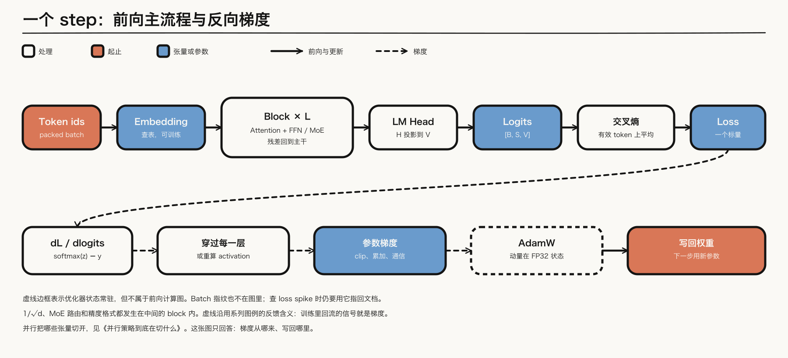
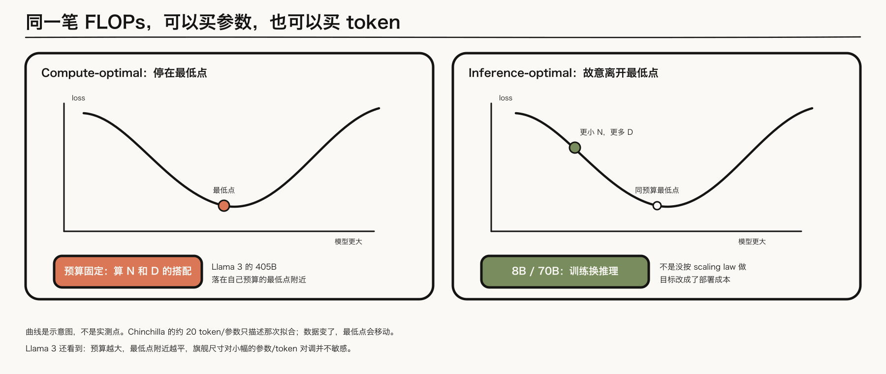
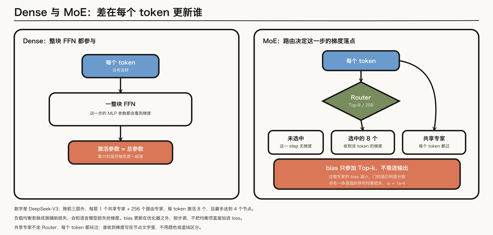
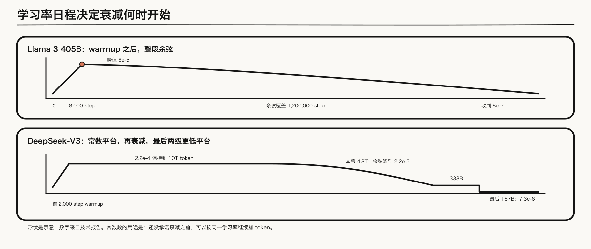
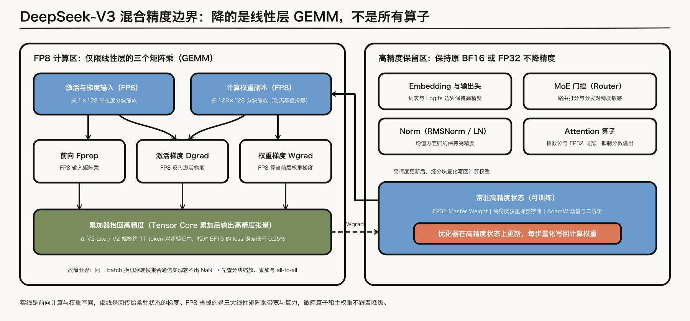
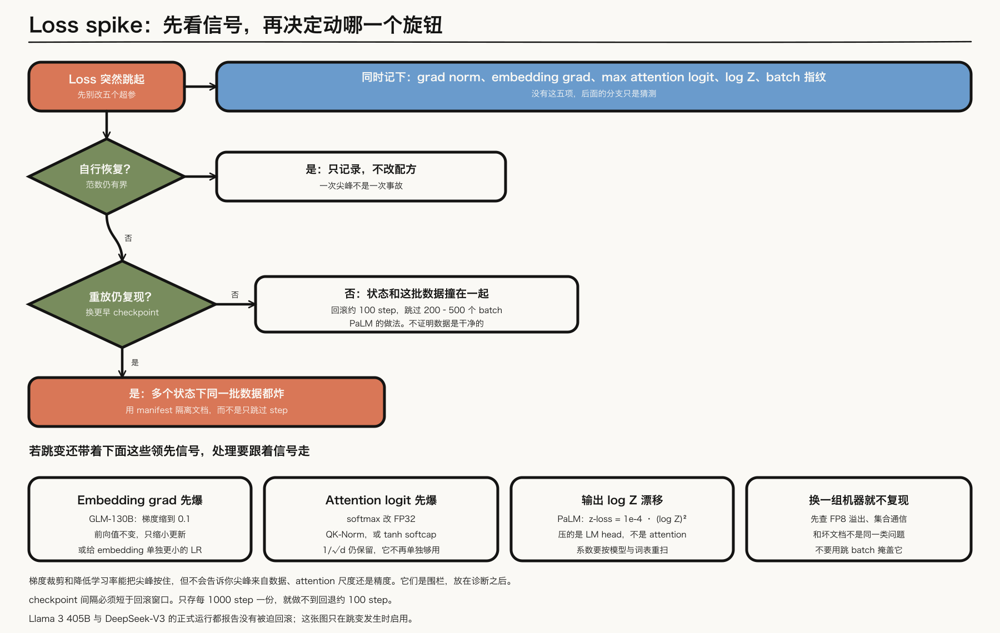

---

layout: post
tags: [LLM, NLP, Training]
title: 大模型是怎么炼成的（二）：预训练的目标、配方与 Loss Spike
date: 2026-8-27
author: Kyrie Chen
comments: true
toc: true
pinned: false

---

第一篇交过来的输入已经定死：冻结的 tokenizer、定好配比的 mixture 与训练/验证切片、写死序列边界的 packed sequence、可重放的 sample order，以及能指回具体批次和文档的 manifest。从这一步起，优化器才第一次看到 token。

预训练在做的事很窄。给定上下文 $$x_{\lt t}$$，模型输出词表上的分布，训练最小化下一个 token 的负对数似然。它不负责「变成助手」，也不负责证明某个架构先进。本篇要回答的是：这个目标在一个 step 里怎么流动，Scaling Laws 到底替你决定了什么，Dense 和 MoE 改变的是哪一种梯度，学习率日程为什么会卡住后面的数据实验，以及 loss 突然跳起来时，该看哪个信号、动哪个旋钮。

分布式切分不在这里重讲。[《并行策略到底在切什么》](/What-Each-Parallelism-Actually-Shards/)已经按张量形状拆过显存。本篇只在精度和 spike 碰到那些张量时引用它。

> **范围**：文本 LLM 的自回归预训练，对照 [Llama 3](https://arxiv.org/abs/2407.21783) 405B 与 [DeepSeek-V3](https://arxiv.org/abs/2412.19437) 的公开配方，并回看 [PaLM](https://arxiv.org/abs/2204.02311)、[GLM-130B](https://arxiv.org/abs/2210.02414) 里真正写过的不稳定案例。长上下文续训留到第三篇。数字都标明出处；报告没写的超参不补。

---

## 一、一个 step 里，前向和梯度各走一遍



*图 1：一个 training step。实线是前向和权重更新，虚线是梯度——沿用系列图例里「虚线表示反馈」的含义，训练里回流的信号就是梯度。AdamW 用虚线边框，表示它常驻但不在前向计算图上。*

前向路径是：

$$
h_0 = \mathrm{Emb}(x)
$$

$$
h_{\ell} = h_{\ell-1} + \mathrm{Block}_{\ell}(h_{\ell-1})
$$

$$
z = W_{\mathrm{head}} h_L
$$

$$
\mathcal{L} = -\frac{1}{\lvert\mathcal{T}\rvert}\sum_{t \in \mathcal{T}} \log \bigl[\mathrm{softmax}(z_t)\bigr]_{x_t}
$$

其中 $$\mathcal{T}$$ 是参与 loss 的位置。预训练里通常是几乎全部 token；packing 时文档边界是否断开，第一篇已经要求在样本格式里定死，这里不能再临时改。PaLM 明确不用 label smoothing，loss 就是平均对数概率，外加后面会讲的 z-loss。

这个平均的分母会直接改变第六节的诊断信号。token-mean 按有效 token 数平均；sequence-mean 先在每条序列里平均，再在 batch 上平均，短序列里每个 token 的梯度更大。梯度累积时，不要对每个 micro-batch 先做 mean 再把 loss 相加，否则有效 token 少的那一份会被放大。正确的写法是把各 micro-batch 的 token loss 之和累加起来，最后除以全局有效 token 数。日志里的 grad norm 必须和这个归一口径记在一起，否则尖峰可能只是分母变了。

反向路径比前向更容易被讲丢。交叉熵对 logit 的梯度是 $$\mathrm{softmax}(z) - y$$，它先穿过 LM head，再穿过每一层的 attention 和 FFN（或 MoE 专家），最后到达 embedding。AdamW 用这份梯度更新的是优化器状态里的动量和方差，再写回权重。因此常驻显存里有三份不同的东西：计算用的低精度权重、FP32 master weight、Adam 的两个矩。图 1 里 AdamW 用虚线框，是因为它不在前向计算图上，但每一步都在。

Activation checkpointing 不改变这个箭头的方向，只把「保存下来的激活」换成「反向时重算」。它省的是激活显存，不省参数，也不省 logits。logits 为什么会单独把卡打满，仍然是上一篇并行文章的问题。

这张图还故意没画 batch 指纹。指纹不参与梯度，但 spike 发生时，没有它你就无法把一次跳变指回第一篇的 manifest。日志里至少要能对上：step、loss、全局 grad norm、embedding 的 grad norm、attention logit 的最大值、输出 $$\log Z$$、以及这个 batch 的数据 ID。

---

## 二、Scaling Laws 决定的是搭配，不是一个魔法比例



*图 2：左图的橙点是固定 FLOPs 下 loss 曲线的最低点。右图的绿点故意离开最低点，换更小的模型和更多 token。曲线是示意图。*

[Kaplan 等（2020）](https://arxiv.org/abs/2001.08361)在当时的拟合里让参数量比数据量涨得更快。[Chinchilla](https://arxiv.org/abs/2203.15556)在同一笔计算预算上扫模型大小，得到的是参数和 token 大致同比缩放，常用的记忆点是约 20 token/参数。这是他们的数据、tokenizer 和拟合下的最低点，不是物理常数。数据变干净、重复策略变了，最低点会移动。

Llama 3 没有直接套 20 这个数。他们在 $$6\times 10^{18}$$ 到 $$10^{22}$$ FLOPs 上做 isoFLOP：每个预算训练若干尺寸，用二次曲线找 loss 最低的那一档，再拟合「最优 token 数随预算怎么涨」。两个对他们有用、也容易被讲丢的结论是：

1. 预算越大，最低点附近越平。旗舰尺寸对「参数和 token 对调一小截」不敏感，所以他们最终选了 405B，对应训练预算 $$3.8\times 10^{25}$$ FLOPs、15.6T token。报告把这个尺寸称为**在他们自己的 scaling law 下近似 compute-optimal**。
2. 8B 和 70B 被故意训过这个最低点。同样的推理预算下，更小的模型多吃 token，部署更便宜。这不是「没按 scaling law」，而是目标从「这笔训练 FLOPs 的最低 loss」换成了「上线之后每个 token 的成本」。

按 Chinchilla 的 20 token/参数，405B 配 15.6T（约 38 token/参数）会显得 token 偏多。和 Llama 3 自己的结论放在一起并不矛盾：最低点跟数据和拟合走，不跟 2022 年的一个比值走。这些拟合里的「参数量」默认是每个 token 都参与更新的 dense 参数。MoE 的总参数和激活参数是两笔账：DeepSeek-V3 的 671B 不能直接拿去和 Chinchilla 的 20 token/参数比，训练算力更接近每个 token 激活的约 37B。把哪一个数放进拟合，必须写在坐标轴上。

Scaling law 直接预测的是验证 loss，不是 benchmark。Llama 3 又做了第二步：先把正确选项的负对数似然和训练 FLOPs 关联起来，再用 sigmoid 把似然映射成准确率。这套外推跨了大约四个数量级，在 ARC-Challenge 上只是略低估了旗舰模型。它能用来选尺寸和数据配比，不能代替第一篇那种受控的数据消融。

---

## 三、架构里，真正改训练的是「梯度落到谁身上」

预训练的主干在 Llama 3 和 DeepSeek-V3 这一代很接近：Pre-Norm、RMSNorm、RoPE、SwiGLU、注意力分数除以 $$\sqrt{d}$$。注意力后来又分开了，第三篇只处理其中和序列长度有关的部分。这些选择影响稳定性，但它们不改变「每个 token 更新整块 FFN」这件事。Dense 和 MoE 改变的是这件事。



*图 3：Dense 的 MLP 参数每个 token 都会看到梯度。MoE 只有被路由命中的专家收到该 token 的梯度；共享专家不走 Router，每个 token 都经过。谁收到梯度写在节点文字里，颜色仍按系列图例使用。*

DeepSeek-V3 的配置可以当作一张具体的对照，而不是「MoE 大概长这样」：61 层、隐藏维度 7168；**前三层仍是普通 FFN**，其余层是 MoE；每层 1 个共享专家 + 256 个路由专家，每个 token 激活 8 个路由专家，并且最多被送到 4 个节点。总参数 671B，每个 token 激活约 37B。算力和激活显存跟的是 37B，通信和专家并行跟的是 256 路路由。

Switch 和 GShard 用 capacity factor 把超出专家容量的 token 丢掉。DeepSeek-V3 的报告里没有这个因子，也没有 token dropping：每个 token 仍然走完 top-8，再加共享专家。最多 4 个节点是路由约束，用来限制跨节点通信，不是把算不完的 token 从 loss 里拿掉。

负载均衡是第二个目标，会和语言模型损失抢梯度。辅助损失太大，专家利用更匀，但语言建模变差。DeepSeek-V3 的做法是把均衡移出 loss 的主项：

- 每个专家有一个 bias $$b_{i}$$。**Top-k 看的是亲和分加 bias，乘进专家输出的门控值仍用原来的亲和分。** bias 不进计算图，每个 step 按该专家是否过载加减一个速度 $$\gamma$$。前 14.3T token $$\gamma=0.001$$，最后 500B 设为 0。
- 仍保留一条很弱的序列级均衡损失，系数 $$\alpha=10^{-4}$$，用来避免单条序列走向极端，而不是用来把 batch 级均衡做满。

他们在小模型上比过三种做法。1B 规模的验证 loss 是：序列级辅助损失 2.258，无辅助损失的 bias 方法 2.253，batch 级辅助损失也是 2.253。3B 上同样是序列级更差，另外两种打平。所以「去掉辅助损失」本身不是魔法；**把均衡从「每条序列上都强行均匀」改成「batch 上均匀，或用 bias 在优化器之外调节」**，才是那次实验里 loss 下降的来源。

还有一个容易被当成架构花活、其实是训练目标的改动：Multi-Token Prediction。除了下一个 token，模型再用一层额外的 Transformer block 预测再下一个 token。深度 $$D=1$$，损失权重 $$\lambda$$ 在前 10T token 为 0.3，之后为 0.1。推理时可以丢掉这层，主模型独立工作；也可以留着做推测解码。报告给出的接受率大约 85%–90%，解码吞吐约 1.8 倍。训练侧该记住的是：主 loss 不再是唯一的梯度来源，调 $$\lambda$$ 就是在调「未来 token」占更新的比例。

注意力的 $$1/\sqrt{d}$$ 留到第六节。它是尺度问题，不是 MoE 问题。并行怎么把专家和序列切开，回到并行那篇文章。

---

## 四、学习率日程：衰减一开始，数据实验的含义就变了



*图 4：两条曲线都是示意，标注的 step、token 和学习率来自各自的技术报告。*

Llama 3 405B 用的是经典形状：AdamW，峰值学习率 $$8\times 10^{-5}$$，线性 warmup 8,000 step，然后余弦衰减，在 1,200,000 step 上收到 $$8\times 10^{-7}$$。Batch 先小后大，理由写的是前期稳定、后期效率：最初 4M token、序列长度 4096；在 252M token 之后把这些值加倍；在 2.87T token 之后 batch 再加倍到 16M。报告的措辞在中间档容易读成「8M 条序列」，那会意味着一步大约 650 亿 token，和后文 16M 的训练配置对不上。这里按「token 数和序列长度一起加倍」理解：中间档是 8M token、序列 8192。序列一加倍，activation 和 logits 的形状一起变，这不是把学习率画成余弦就能解释的。

DeepSeek-V3 更接近 [MiniCPM](https://arxiv.org/abs/2404.06395) 推广的 warmup–stable–decay，但衰减段不是一次收完。AdamW 的 $$\beta_{1}=0.9$$、$$\beta_{2}=0.95$$、weight decay 0.1，梯度裁剪 1.0。学习率 2,000 step 升到 $$2.2\times 10^{-4}$$，**保持到 10T token**，再用 4.3T token 的余弦降到 $$2.2\times 10^{-5}$$，最后 500B 里先用这个学习率走 333B，再用 $$7.3\times 10^{-6}$$ 走 167B。序列长度预训练阶段固定 4K。Batch 在前 469B token 里从 3072 条序列增到 15360 条，大约是 $$1.3\times 10^{7}$$ 到 $$6.3\times 10^{7}$$ token/step，之后保持 15360。

常数平台的工程含义是：还没承诺衰减之前，可以按同一学习率继续加 token，再决定何时进入 decay。衰减一旦开始，loss 的下降里就混进了学习率本身。第三篇会把高质量数据的升配放在这个窗口附近讨论；这里先记住实验约束——**不固定 token 数、日程和初始化，就不能把退火期的涨点归因于「低学习率更容易记住好数据」。**

Llama 3 405B 那一段没有重复 $$\beta$$、weight decay 和 clip。不要从 Llama 2 或从 DeepSeek 把这些数抄过去当作 Llama 3 的事实。DeepSeek 把 $$\beta_{2}$$ 写成 0.95 而不是 0.999，是有稳定性动机的：二阶矩忘得更快，梯度突然变大时，步长不会被很久以前的小梯度继续放大。这是预防，不是 spike 已经发生后的诊断。它也不是此后唯一的优化器。2025 年的 [Kimi K2](https://arxiv.org/abs/2507.20534) 用 MuonClip（Muon + QK-Clip）压住注意力 logit，并报告预训练 15.5T token 期间没有 loss spike。AdamW 仍是下面这张表里两家的选择。

| | Llama 3 405B | DeepSeek-V3 |
|---|---|---|
| 参数 | 405B，全部激活 | 671B 总参数，每 token 约 37B 激活 |
| Token | 15.6T | 14.8T |
| 优化器 | AdamW；β、weight decay、clip 未在该段写明 | AdamW，β=(0.9, 0.95)，wd 0.1，clip 1.0 |
| 峰值 LR | 8×10⁻⁵ | 2.2×10⁻⁴ |
| 日程 | warmup 8k step，余弦收到 8×10⁻⁷ | 常数到 10T，再余弦，最后两级平台 |
| 序列 | 4096 → 8192 | 预训练 4096；之后另做 32K/128K 扩展 |
| 稳定性自述 | 很少 loss spike，没有为发散做干预 | 没有不可恢复的 spike，没有回滚 |

---

## 五、精度：降的是 GEMM，不是所有算子

默认配方仍是 BF16 计算、FP32 master weight 和 Adam 状态。BF16 的指数位和 FP32 一样宽，attention 分数不容易像 FP16 那样直接溢出。GLM-130B 的 spike 发生在 FP16 栈上，报告没有做 BF16 对照。指数位同宽，所以换 BF16 有可能消掉其中一批溢出；这是从数值格式推出来的，不是那份报告的结论，也覆盖不了范数本身在漂的情况。

DeepSeek-V3 的 FP8 不是「整个模型用 FP8 训练」。三个 GEMM——前向、激活梯度、权重梯度——用 FP8 输入，累加再抬回更高精度。激活按 1×128 分块缩放，权重按 128×128 分块缩放，用来避免一个离群值把整块的 scale 撑爆。以下部分保持原来的 BF16 或 FP32：**embedding、输出头、MoE 门控、Norm、attention**。master weight、权重梯度和优化器状态也保持更高精度。

他们用来和 BF16 对比的相对 loss 误差低于 0.25%，这个数来自接近 DeepSeek-V2-Lite 和 V2 的规模、大约 1T token 的验证，不是 671B 全程对 BF16 重训一遍的差值。671B 本身没有不可恢复的 spike，说明这套「GEMM 用 FP8、敏感算子留高精度」在那次运行里站得住；它不说明任意一个 FP8 内核都可以打开。

精度故障和数据故障的分界很具体：同一 batch 换一组机器或换一个集合通信实现就不再出现 NaN，先查缩放、累加和 all-to-all，不要先去删文档。



*图 5：DeepSeek-V3 的混合精度边界。实线是前向计算与权重写回，虚线是回传给常驻高精度状态的梯度。左框三个线性层 GEMM 使用细粒度分块缩放的 FP8 输入并抬回高精度累加；右框敏感算子以及常驻的 FP32 master weight、权重梯度存储和 AdamW 状态保持高精度。*

---

## 六、Loss spike：先分类，再动旋钮

Loss spike 指的是 loss 在很少的 step 内明显跳起。它可能在几十到几百 step 里自己回到原轨迹，也可能走到 NaN。跳一次不等于配方错了。Llama 3 405B 和 DeepSeek-V3 的正式运行都报告没有被迫回滚。下面的路径是异常分支。

历史上写得最清楚的两次相反结论，应该放在任何「一定是坏数据」之前：

- **PaLM 540B** 大约出现 20 次 spike，尽管开了梯度裁剪。处理是：从 spike 开始前大约 100 step 的 checkpoint 重开，跳过前后大约 200–500 个 batch。他们把 spike 周围的 batch 拿到**更早的 checkpoint** 上重训，**没有再次跳变**。因此那次 spike 不是数据单独的属性，而是某一批数据和当时参数状态碰在一起。
- **GLM-130B** 在 FP16 混合精度下，梯度范数会先跳，loss 过几步才塌。异常梯度主要在 embedding。他们用 Embedding Gradient Shrink：前向值不变，反传时 embedding 梯度乘 0.1。最终运行里晚阶段仍有三次发散，继续把这个系数再缩小还能稳住。这和 PaLM 的「跳过 batch」不是同一类修复。



*图 6：上面两条分叉回答「要不要动数据和 checkpoint」。下面四格回答「信号已经指向某一层时，旋钮是哪一个」。梯度裁剪和降低学习率是围栏，放在诊断之后。*

### 6.1 重放实验，决定你动的是数据还是状态

先看这次跳变是否自行恢复，以及 grad norm、attention logit、$$\log Z$$ 是否仍然有界。若都有界，记下 step 和数据 ID 即可，不要为了一次尖峰改五个超参。

若没有恢复，用更早的 checkpoint 重放同一批数据：

- **不复现**：按 PaLM 的办法回滚大约 100 step，并跳过覆盖 spike 前后的那一段 batch。这不能证明数据干净，只证明「这个状态加上这批数据」才炸。checkpoint 间隔必须短于这个回滚窗口；只存每 1000 step 一份，这个办法就不存在。
- **在多个更早的状态上都复现**：才把文档隔离出去。第一篇的 manifest 在这里才用得上。只把 step 号跳过、不记下文档，下一次同样的页面还会进来。

### 6.2 三个数值旋钮，对应三种不同的爆炸

**Embedding 梯度先于 loss 跳。** GLM 的实现等价于：前向仍输出原来的 embedding，反传梯度乘 $$\alpha$$（他们用 0.1）。

```python
def embedding_grad_shrink(emb, alpha=0.1):
    # 前向值不变；autograd 把 dL/d(emb) 乘上 alpha
    return emb * alpha + emb.detach() * (1.0 - alpha)
```

给 embedding 单独一个更小的学习率，是同一意图的另一种写法。不要把它和「整个模型降学习率」混成一步。

**Attention logit 先炸。** 分数是

$$
\mathrm{score}(q, k) = \frac{q k^{\top}}{\sqrt{d}}
$$

其中 $$1/\sqrt{d}$$ 假定 $$q$$、$$k$$ 的分量是 $$O(1)$$。向量范数变大时，有效温度按范数的乘积涨，除以 $$\sqrt{d}$$ 补不上。softmax 饱和之后，梯度集中在极少数位置，下一次更新更容易把范数再推高。[ViT-22B](https://arxiv.org/abs/2302.05442) 把这个问题记成 logit 可以长到数万，并在点积前对 query 和 key 做归一化。语言模型里的常见形式是 QK-Norm：仍保留 $$1/\sqrt{d}$$，但先把 $$q$$、$$k$$ 拉回单位量级。

```python
def qk_norm_scores(q, k, eps=1e-6):
    # 放在点积之前。这里写成 RoPE 之前：先把向量拉回单位量级，再旋转。
    # RoPE 是正交变换，不带逐通道缩放时，先旋转再归一化在精确算术下与此可交换；
    # 带逐通道缩放时两种顺序得到的 q、k 不同。无论哪种，平方和都要在 FP32 里算。
    def rms(x):
        x = x.float()
        return x * torch.rsqrt(x.pow(2).mean(dim=-1, keepdim=True) + eps)

    q, k = rms(q), rms(k)
    # 分数和 softmax 都留在 fp32。写回激活时再 cast 回 bf16。
    return (q @ k.transpose(-2, -1)) * (q.size(-1) ** -0.5)
```

[Gemma 2](https://arxiv.org/abs/2408.00118) 用的是另一种钳制，不改向量范数，只把已经算出的 logit 压进一个光滑上界：$$\mathrm{cap}\cdot\tanh(x/\mathrm{cap})$$。attention 的 cap 是 50，最终输出 logit 的 cap 是 30。它和 QK-Norm 可以同时存在，但它们改的不是同一个量：一个管点积之前的向量，一个管点积之后的分数。

DeepSeek-V3 没有把 Gemma 的 softcap 写进报告。他们写的是：在 MLA 压缩后的隐向量上再加 RMSNorm，并在宽度瓶颈处乘额外的缩放因子。那是同一类「不要让宽度突然变窄的地方把尺度放大」的约束，不能把它复述成 QK-Norm。

softmax 用 FP32 计算，解决的是溢出，不是范数增长。GLM 在 FP16 上已经证明：分数一旦超出表示范围，后面的技巧都看不到真实梯度。BF16 或 FP32 softmax 是底线；QK-Norm 和 softcap 才是针对「尺度在漂」的修改。

**输出的 $$\log Z$$ 在漂，attention 并没有一起炸。** 交叉熵只看见正确 token 的 logit 与 $$\log Z$$ 的差。所有 logit 一起平移时，概率几乎不变，但 $$\log Z = \mathrm{logsumexp}(z)$$ 可以一直变大，直到溢出。PaLM 加的 z-loss 是

$$
\mathcal{L}_z = 10^{-4} \, \mathbb{E}\!\left[\log^{2} Z\right]
$$

它惩罚的是 LM head 的尺度，不是 attention。系数 $$10^{-4}$$ 是 PaLM 的选择；换一个模型和词表，这个数要跟着 $$\log Z$$ 的尺度重扫。

```python
def z_loss(logits, coef=1e-4):
    log_z = torch.logsumexp(logits.float(), dim=-1)
    return coef * log_z.square().mean()
```

### 6.3 不要先做的两件事

把全局梯度裁剪从 1.0 收到 0.3，或者把峰值学习率砍半，经常能让曲线看起来恢复。它们把更新的幅度按住了，没有告诉你幅度来自坏文档、embedding、attention 还是 FP8 的 scale。一次运行里同时改裁剪、学习率、数据和 Norm，下一次 spike 你仍然不知道是哪一项起了作用。

顺序应该是：日志五项齐全 → 判断是否自行恢复 → 重放，区分「状态×数据」和「数据本身」→ 若某个领先信号已经指向 embedding、attention 或 $$\log Z$$，只改对应的那一个旋钮 → 裁剪和学习率留到这些都对不上的时候，并且一次只动一个。

---

## 七、两套公开运行，稳定来自不同的地方

把第四、五、六节收成一次对照。

Llama 3 405B 是 Dense、BF16、长余弦、batch 和序列长度一起加。报告的稳定性结论是：spike 很少，**没有为了发散去做干预**。它没有公开一套 QK-Norm 或 z-loss 的开关列表。能从报告里拿走的工程事实是：早期更小的 batch、以及一个一直衰减到很低的余弦，对这次 405B 运行是够的。8B/70B 的「训得比 compute-optimal 更久」是推理成本决策，不是稳定性技巧。

DeepSeek-V3 是 MoE、FP8 GEMM、常数学习率平台、bias 式负载均衡，再加上 MTP 这条额外损失。敏感算子留在高精度，均衡项几乎不进主 loss。报告的稳定性结论是：**没有不可恢复的 spike，也没有回滚**。预训练 2.664M H800 GPU 小时这个数对应 14.8T token 的预训练本身；第一篇引用的 2.788M 还包含上下文扩展和后训练。不要把两个账本加成一次。

两次运行都稳定，只说明这两份 2024 年的配方在它们自己的运行里没有被迫回滚。更晚的运行也没有停在「BF16、早期小 batch、长余弦」这一组组合上：Kimi K2 换成了 MuonClip（Muon + QK-Clip），因为 Muon 更容易把注意力 logit 打爆。PaLM 和 GLM 写的是更大的模型第一次碰到表示范围和状态耦合时实际发生过的事。第六节的五项日志仍然要留：否则下一次不可恢复的跳变，你分不清该回滚、该隔离文档、该查 FP8，还是该查优化器把 logit 推高了。

---

## 八、预训练交出去的是一个 base model

预训练结束时，模型会续写，还不会按问题回答。问「法国的首都是哪里」，续写「德国的首都是哪里」对语言建模完全合理。SFT 才开始改这个条件，那是第四篇，不是第三篇。

留在工程台账上的只有几条硬边界：主监督仍是全部有效 token 上的负对数似然，MoE 的 bias 调节和 MTP 损失都要单独记账，梯度累积先求和再除以全局有效 token 数；Scaling 选的是这笔训练 FLOPs 下的参数和 token 搭配，小尺寸训过 compute-optimal 是替线上推理省钱，MoE 不能把 671B 总参数直接丢上稠密的 Chinchilla 轴；学习率一旦进入衰减，数据改动和日程改动就缠在一起，常数平台的价值是把这个决定往后推；Loss spike 先拿更早的 checkpoint 重放同一批数据——不复现就回滚并跳过那段 batch，跨状态都复现才回 manifest 隔离文档，embedding 梯度、attention logit 和 $$\log Z$$ 分别对应三个不同旋钮。

下一篇接收的是主干训练后段的阶段化 checkpoint（常数平台或衰减窗口），以及第一篇预留的来源、领域、质量、长度标签和可重配数据池。

---

## 参考资料

- [Kaplan et al., Scaling Laws for Neural Language Models](https://arxiv.org/abs/2001.08361)
- [Hoffmann et al., Training Compute-Optimal Large Language Models (Chinchilla)](https://arxiv.org/abs/2203.15556)
- [Chowdhery et al., PaLM](https://arxiv.org/abs/2204.02311)（loss spike 的重放实验与 z-loss）
- [Zeng et al., GLM-130B](https://arxiv.org/abs/2210.02414)（Embedding Gradient Shrink）
- [Dehghani et al., Scaling Vision Transformers to 22 Billion Parameters](https://arxiv.org/abs/2302.05442)（QK-Norm）
- [Hu et al., MiniCPM](https://arxiv.org/abs/2404.06395)（WSD 日程）
- [Llama 3 Herd of Models](https://arxiv.org/abs/2407.21783)
- [Gemma 2](https://arxiv.org/abs/2408.00118)（attention / logit soft-cap）
- [DeepSeek-V3 Technical Report](https://arxiv.org/abs/2412.19437)
- [OLMo 2](https://arxiv.org/abs/2501.00656)（公开配方中的 QK-Norm 与 z-loss）
- [Kimi K2](https://arxiv.org/abs/2507.20534)（MuonClip / QK-Clip）
