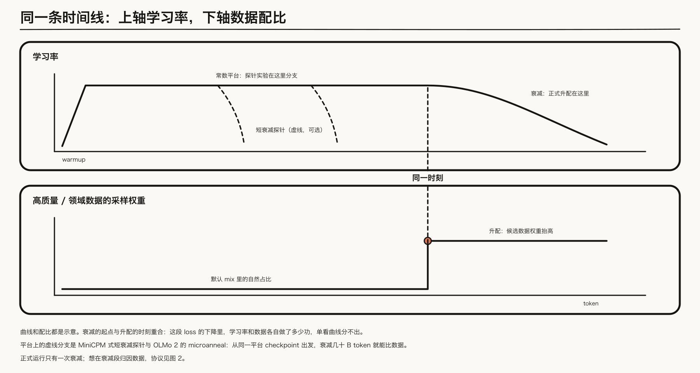
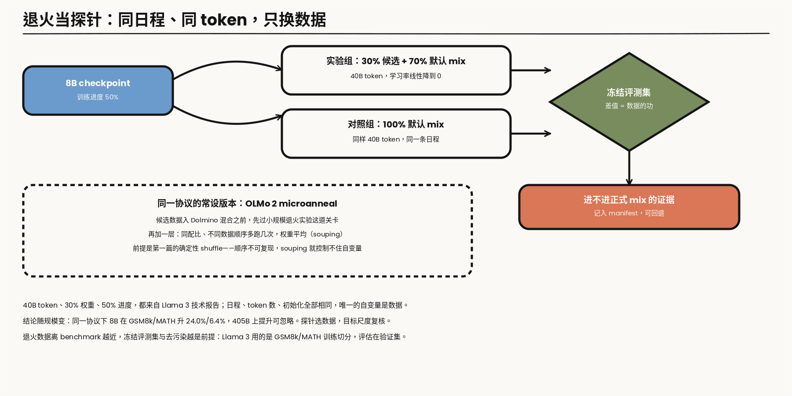
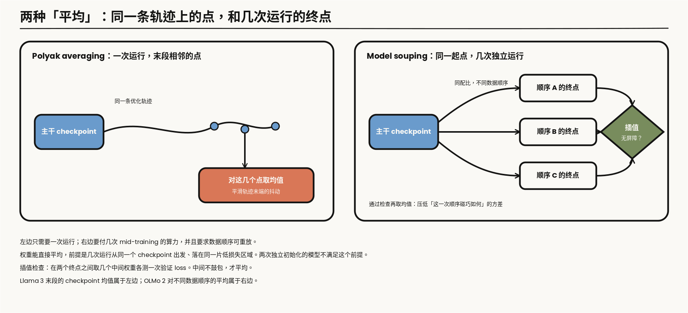
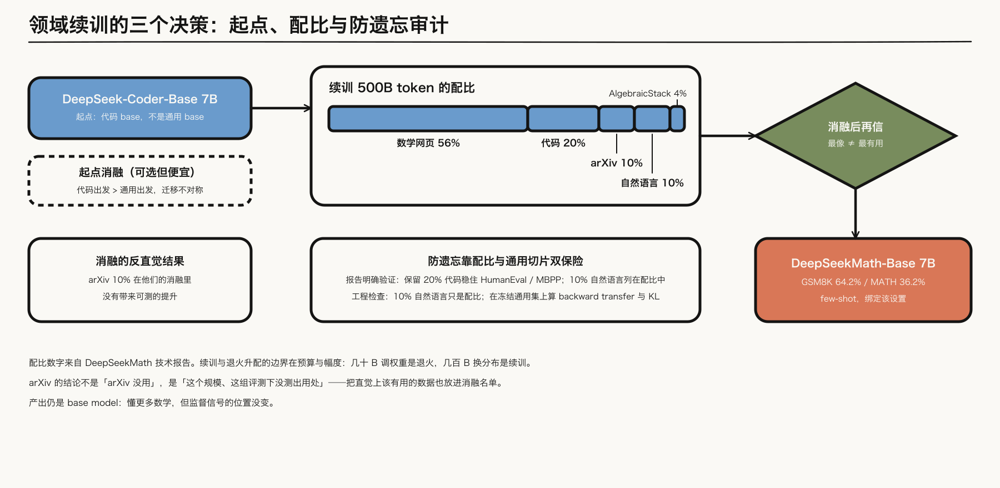
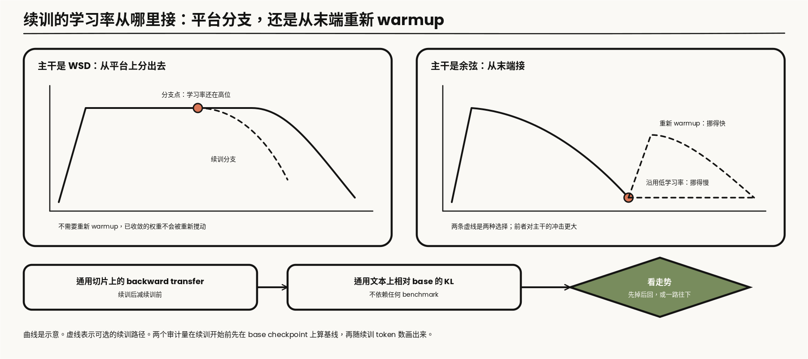
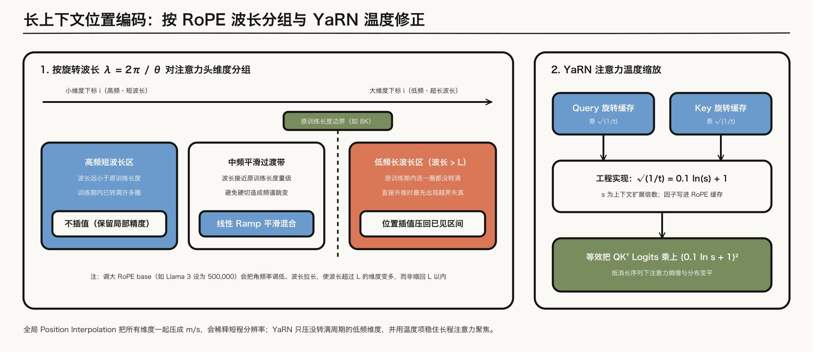
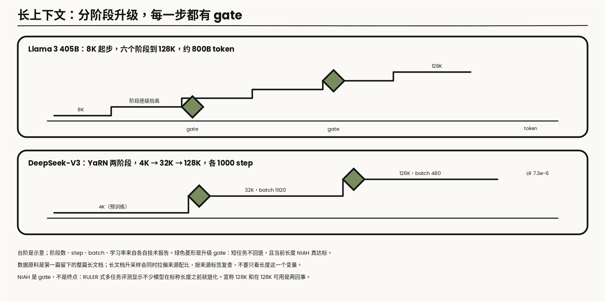
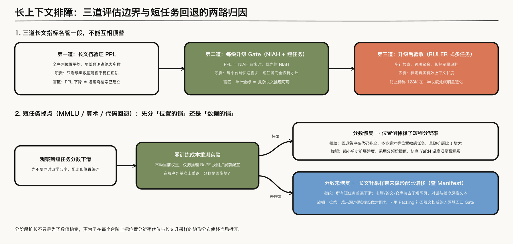

---

layout: post
tags: [LLM, NLP, Training]
title: 大模型是怎么炼成的（三）：Mid-training 的数据升配、领域续训与长上下文
date: 2026-9-18
author: Kyrie Chen
comments: true
toc: true
pinned: false

---

第二篇在学习率日程那一节留了一个结：常数平台的价值，是把「何时开始衰减」的决定往后推；而衰减一旦开始，数据改动和日程改动就缠在一起。本篇就发生在这个窗口附近——模型主干已经训完或接近训完，post-training 还没开始，中间这段仍然用语言建模目标做的继续训练，就是第一篇操作性定义过的 mid-training。论文里它可能叫 annealing、continued pretraining 或 context extension，名字不重要，动的分布才重要。

这一段里通常发生三类事：把高质量数据的采样权重抬高（退火升配），用领域语料继续预训练（领域续训），把序列长度从几 K 拉到上百 K（长上下文扩展）。三类操作动的是三个不同的分布——质量与领域配比、整个语料分布、位置分布——目标函数的形式仍是下一个 token 的负对数似然。这里说的「监督位置没变」，指主干仍对序列里的 token 全算 loss。MiniCPM 把 SFT 风格数据放进 decay，OLMo 2 的 Dolmino 里有 FLAN；公开报告没有写明这些样本是整段都算 loss，还是只算 response。若已经只训 response，它在语义上就是 SFT，只是还挂在同一个学习率日程上。这个边界是第四篇的起点，不是阶段名能决定的。

分布式与显存仍然不在这里重讲。[《并行策略到底在切什么》](/What-Each-Parallelism-Actually-Shards/)已经写过长序列把 activation 和 attention 显存推向哪里；本篇只在长上下文一节引用它。

> **范围**：文本 LLM 的 mid-training，对照 [Llama 3](https://arxiv.org/abs/2407.21783)、[DeepSeek-V3](https://arxiv.org/abs/2412.19437)、[OLMo 2](https://arxiv.org/abs/2501.00656)、[MiniCPM](https://arxiv.org/abs/2404.06395) 与 [DeepSeekMath](https://arxiv.org/abs/2402.03300) 的公开配方。SFT 数据、偏好数据留在后面对应篇目。数字都标明出处；报告没写的不补。

---

## 一、三个旋钮，不是一个「退火魔法」

把 mid-training 说成「退火涨点」是把三个决策压成了一个词。先拆开：

| 操作 | 改变的分布 | 不变的 | 公开参照 |
|---|---|---|---|
| 退火升配 | 数据质量与领域配比 | 目标函数、tokenizer、架构 | Llama 3、MiniCPM、OLMo 2 |
| 领域续训 | 整个语料分布 | 目标函数、架构 | DeepSeekMath |
| 长上下文 | 序列长度与位置分布 | 目标函数、数据主体 | Llama 3、DeepSeek-V3 |

三个旋钮可以组合，但消融要分开做。第一篇要求数据系统保留来源、领域、质量、长度标签，就是为了这一刻：同一池原料，退火时按质量标签重配，续训时按领域标签重配，长上下文时按长度标签取出当初没被切碎的整篇文档。标签没留，这三个旋钮就都拧不动。

公开预算不是一个点。[OLMo 2](https://arxiv.org/abs/2501.00656) 把这一段写成大约占训练 FLOPs 的 5%–10%。Llama 3 405B 的长上下文阶段约 800B token，相对 15.6T 大约 5%。DeepSeek-V3 的上下文扩展是 11.9 万 / 266.4 万 H800 GPU 小时，不到 5%。这几段换分布或换长度的预算，落在大约百分之一到一成。Llama 3 405B 把学习率线性收到 0 的正式退火只占最后约 40M token，相对 15.6T 约 0.00026%（百万分之二点六），比上面的上下文扩展短出四个数量级：它在保持 128K 上下文的同时上采样极高质量来源，并对退火期间的 checkpoint 做均值（Polyak averaging）收出最终底座，本身不承担几百 B 规模的分布迁移。

先解第二篇留下的那个结。

---

## 二、同一段曲线上，学习率和数据各自在做功



*图 1：上轴是学习率，下轴是数据配比，两轴共用同一条时间线。曲线与配比都是示意；要点只有一个——升配的时刻和衰减的起点重合，单看 loss 曲线分不出谁在做功。*

### 2.1 两个效应叠在一起

[MiniCPM](https://arxiv.org/abs/2404.06395) 把 WSD 日程的 decay 段讲清楚了两件事。第一，loss 在进入衰减后快速下降——这件事学习率自己就能解释，和数据无关。第二，他们把高质量数据和 SFT 风格的数据加在 decay 开始处，比把同样的数据全部留到 SFT 阶段更有效。两个效应叠在同一段曲线上：你看到 decay 段 loss 掉得很快、下游也在涨，但涨点里有多少来自数据、多少来自学习率，曲线本身不回答。这就是第二篇说的缠绕。

### 2.2 把退火改造成探针

解缠绕靠协议，不靠辩论。Llama 3 的做法是把退火本身改造成探针：取一个**训练到 50% 进度的 8B checkpoint**，用 40B token 把学习率线性降到 0，候选数据占 30%、默认 mix 占 70%；对照组用完全相同的日程和 token 数，只是数据换成 100% 默认 mix。同一套冻结评测集下比较，差值就是这份数据在这个日程下的价值。[Blakeney 等](https://arxiv.org/abs/2406.03476)把同类操作总结为「训练末段的领域升配评估」。



*图 2：Llama 3 的退火探针协议。40B token、30% 候选权重、50% 训练进度，都来自技术报告；对照组与实验组唯一的差别是数据。*

这个协议回答了第二篇结尾的问题——数据实验在常数段做还是衰减段做：**短衰减从平台或中途 checkpoint 分出来做，正式升配放在衰减段。** WSD 的常数平台意味着可以从同一个平台 checkpoint 分出多个短衰减分支，每个分支试一种数据，成本是 40B token 一次而不是重训一次；MiniCPM 正是用这种「平台分支 + 短衰减」把原来要全程重训的实验变便宜的。Llama 3 的 40B 探针不是在常数学习率上训，它本身就是一次降到 0 的短衰减，起点是训到 50% 的 checkpoint。正式运行里，高质量数据放在衰减段抬权重，MiniCPM、Llama 3、OLMo 2 的公开配方都是这么做的。

这笔探针的账是算术。按第二篇的 $$C\approx 6ND$$，8B 模型跑 40B token 约为 $$1.9\times 10^{21}$$ FLOPs，是 405B 正式运行 $$3.8\times 10^{25}$$ 的两万分之一；实验组和对照组各跑一次，合起来是万分之一。同样的预算，在旗舰尺寸上连千分之一的进度都走不完。便宜是探针存在的理由，也是它的局限：它便宜，是因为模型小、token 少，而这两样正是结论可能不随规模保持的地方。

探针量出来的是一个差值：这份数据，在这个尺寸、这个起点、这段日程下，比默认 mix 好多少。四个限定词里换掉任何一个，差值都要重量。

所以一次探针的记录要把这四样都带上。取值是示意：

```json
{
  "probe_id": "anneal-0412", "start_checkpoint": "8b-step-600000", "start_progress": 0.5,
  "schedule": {"shape": "linear_to_zero", "tokens": 4.0e10, "start_lr": "从起点 checkpoint 继承"},
  "arm": {"candidate": "math-web-v3", "candidate_weight": 0.3, "default_mix": "mix-v12"},
  "control": {"default_mix": "mix-v12", "same_schedule": true, "same_tokens": true},
  "eval_set": "frozen-holdout-v5", "decontam_run": "2026-09-02", "seeds": [0, 1, 2]
}
```

`decontam_run` 记的是候选数据对这套评测集跑去污染的日期，2.3 节会说明它为什么必须在。`seeds` 不止一个：第八篇 3.4 节算过，几百道题的评测集上一两个点的差值在抽样噪声里，单次运行的差值不能直接当结论。

### 2.3 贴着 benchmark 的退火

另一组实验回答的是另一个问题：如果退火数据就贴着 benchmark，会发生什么。Llama 3 把 GSM8K 和 MATH 的训练集放进退火，8B 的验证集分别涨 24.0% 和 6.4%，405B 上可以忽略。它说明退火会放大邻近数据的价值，也说明同一份做法的收益可以随规模归零。40B 探针只在 8B 上做过，没有这组 405B 对照。拿 8B 上任何一组退火结论直接改 405B 的配比，都等于没做实验。

为什么会随规模归零，报告没有解释。一种读法是：小模型在主干阶段还没有把这类题目的解法学稳，末段集中喂同分布的题能补上一截；大模型在主干阶段已经学到了，同样的数据带不来新东西。这是和现象相容的假说，没有被那组实验检验过。能确定的只有现象本身：同一份数据的价值，是模型已经会什么的函数。

报告写明，正式退火数据不含常用 benchmark 的训练集。上面这组是故意把这条线踩一遍，用来看踩了会怎样：训练集进退火，验证集上评估。退火数据离 benchmark 越近，第一篇的冻结评测集、按重复簇划分 holdout、每轮重跑去污染，就越是前提而不是形式。在衰减段抬高 benchmark 邻近数据的权重，是涨点最快的手段，也是评测失真最快的手段。

---

## 三、把 mid-training 做成制度：OLMo 2 的可复现版本

[OLMo 2](https://arxiv.org/abs/2501.00656) 干脆把这一段变成正式的第二阶段：主干先在通用混合上训练，然后切换到 Dolmino 混合做 mid-training——过滤后的高质量网页、指令风格的 FLAN 文本、合成数学数据、百科与学术文本——学习率在这一段内线性降到 0。7B 的 mid-training 预算是 50B token，13B 用到 100B 与 300B 的组合。相比 Llama 3 只在报告里给出协议，OLMo 2 连数据、checkpoint 和配比一起公开，是三家里唯一能逐步照抄的。

它有两个工程细节比配比本身更值得搬走。

### 3.1 Microanneal：数据入池的例行关卡

候选数据先过 microanneal——小规模退火实验——再决定进不进 Dolmino。这和第二节的探针是同一思路，区别是它不是论文里的一次性实验，而是数据入池的例行关卡。

OLMo 2 用它做的最典型的一件事是补数学。报告写的过程是：先发现模型在数学类评测上偏弱，再收集和合成若干候选数学数据源，每一个候选都从同一个 checkpoint 出发跑一次很短的退火，候选数据和通用的高质量网页数据各占一半，看数学评测的变化，同时看其他评测有没有被拖累。通过的才进最终混合。一次 microanneal 的 token 数远小于正式的 mid-training，所以可以对很多候选各跑一遍。

写成规程，它有四个固定项：同一个起点 checkpoint；同一段学习率日程；候选数据和一份固定的参照数据按固定比例混合；同一套评测，既看目标能力也看非目标能力。只有候选数据是变量。第一篇第七节的受控实验协议，在这里是一条每周都在跑的流水线。

它和第二节那个 40B 探针有同一个局限：结论是在短退火、特定起点上得到的。OLMo 2 的处理是把通过 microanneal 的数据放进正式的 mid-training 再验一次，而不是直接相信短实验的排序。

### 3.2 对数据顺序做平均

同一配比、不同数据顺序多跑几次 mid-training，把得到的权重做平均（model souping）当最终 checkpoint。这件事的前提是第一篇的确定性 shuffle 和可重放的 sample order：顺序不可复现，几次运行就不是「同配比不同顺序」，souping 连自变量都控制不住。

权重可以直接取平均，不是显然成立的。两个独立初始化、各自训练的网络，权重逐项平均之后通常是一个很差的模型：它们落在损失面上不同的区域，中间隔着高损失的屏障。[Model soups](https://arxiv.org/abs/2203.05482) 那篇工作的条件是，几次运行从同一个预训练权重出发，只是微调的超参或数据顺序不同；这样得到的解往往落在同一片低损失区域里，连线上的点损失也低，取平均不会掉进屏障。mid-training 的几次运行都从同一个主干 checkpoint 出发，学习率又在衰减，正是这种情形。

这和 Llama 3 末段做的平均不是一回事，虽然都叫平均。第一节提到 Llama 3 对退火期间的 checkpoint 取均值，那是 Polyak averaging：同一次运行、同一条轨迹上相邻的几个点。它平滑的是优化轨迹末端的抖动。Souping 平均的是几次独立运行的终点，它压低的是「这一次数据顺序碰巧如何」带来的方差。前者只需要一次运行，后者要付几次 mid-training 的算力。

平均之前有一个便宜的检查：在两个终点之间按比例插值出几个中间权重，各自测一次验证 loss。中间点的 loss 不高于两端，说明它们在同一片区域里；中间鼓起一个包，就不该平均。



*图 3：两种平均。左边是同一次运行末段相邻 checkpoint 的均值，右边是同一起点、不同数据顺序的几次运行终点的均值；右边在平均之前先做插值检查。*

这一节的功能是给个参照系：mid-training 不必是正式运行前临时起意的「最后冲刺」，它可以是有入池标准、有重复实验、有版本记录的常设阶段。

---

## 四、领域续训：起点、配比、防遗忘



*图 4：DeepSeekMath 的 500B 续训配比与工程防遗忘审计。配比数字来自其技术报告：报告明确验证保留 20% 代码能稳住代码评测，10% 中英自然语言列为配比组成部分；右侧的通用切片与偏移审计是工程上防止通用能力塌陷的检查项。*

### 4.1 DeepSeekMath 的三个决策

领域续训和退火升配的边界在预算和幅度：退火用几十 B token 调权重，续训用几百 B token 换掉整个分布。[DeepSeekMath](https://arxiv.org/abs/2402.03300) 是公开案例里写得最完整的一个：从 DeepSeek-Coder-Base-v1.5 7B 出发续训 500B token，配比是 56% 数学网页语料、20% GitHub 代码、10% arXiv、10% 通用自然语言、4% AlgebraicStack。它的三个决策对应领域续训的三个通用问题。

**起点**。他们的消融里，从代码 base 出发学数学，好于从通用 base 出发。领域之间的迁移不对称，起点不是「找个最新的通用模型」这么显然，值得用小规模消融先验证。

**配比**。56% 不是「越纯越好」的结果。通用自然语言占 10%，代码占 20%。论文明确写的是：把代码 token 留在续训里，HumanEval 和 MBPP 能保住；那 10% 自然语言被列为配比的一部分，报告没有单独把它写成防遗忘实验。领域续训最常见的失败仍然是通用能力悄悄塌掉，而评测里恰好没放通用切片。要一个数，而不是「看一看」：在冻结的通用集上算 backward transfer（续训后减去续训前），并在同一批通用 token 上算续训后模型相对 base checkpoint 的 KL。掉 0.5 个点和掉 5 个点会导向不同的 replay 比例。

**验证反直觉**。arXiv 论文在他们的消融里**没有带来可测的提升**。这不是「arXiv 没用」的普适结论，而是「在这个规模、这个 tokenizer、这组评测下没用」；但它足够说明问题——不做消融，你会把长得最像数学的数据当成最有用的数据。最像和最有用之间隔着一次受控实验。

### 4.2 防遗忘要两个数

上面说的两个量写出来是这样的。在冻结的通用评测切片上，记续训前后的得分为 $$S_{\mathrm{pre}}$$ 和 $$S_{\mathrm{post}}$$：

$$
\Delta_{\mathrm{BWT}} = S_{\mathrm{post}} - S_{\mathrm{pre}}
$$

在一批固定的通用文本 $$\mathcal{D}_{\mathrm{ref}}$$ 上，逐 token 比较续训前后模型的预测分布：

$$
\overline{\mathrm{KL}} = \frac{1}{\lvert\mathcal{D}_{\mathrm{ref}}\rvert}\sum_{t\in\mathcal{D}_{\mathrm{ref}}}\mathrm{KL}\big(p_{\mathrm{base}}(\cdot\mid x_{\lt t})\,\Vert\,p_{\mathrm{cpt}}(\cdot\mid x_{\lt t})\big)
$$

两个数回答的不是同一个问题。前一个是任务层面的：某项具体能力掉了多少。后一个是分布层面的：模型在通用文本上的预测整体挪了多远，不依赖任何 benchmark。

只看通用文本上的 PPL 不够。PPL 只用到模型给真实 token 的那一个概率，其余几十万个 token 上的概率怎么变，它看不见。续训可以让真实 token 的概率基本不动，同时把分布的其余部分重新排过；PPL 几乎不变，KL 已经不小。这部分改动会不会影响下游，取决于下游怎么用这个模型，KL 给的是一个更早的信号。两个数都要在续训开始之前，在 base checkpoint 上先算一遍基线。

### 4.3 学习率从哪里接

领域续训还有一个报告里很少单独讨论的决定：学习率从多高开始。

主干训到末段时学习率已经很低。从这个 checkpoint 接着训，有两种做法。沿用末段的低学习率，模型挪得慢，几百 B token 也许不够把分布换过来。重新 warmup 到一个较高的峰值，模型挪得快，主干学到的东西也被改得更多，4.2 节的两个数会更难看。DeepSeekMath 的报告写了它的续训有自己的 warmup 和峰值学习率，属于后一种；具体数值这里不引，以原文为准。

这和第二节的平台分支是一件事的两面。WSD 的常数平台上，学习率还在高位，从平台分出去续训不需要重新 warmup，也就没有「把已经收敛的权重重新搅动」的问题。从余弦末端接续训，才要面对这个选择。主干用什么日程，决定了后面续训的起点有多少余地，这是第二篇「常数平台把决定往后推」在这里的具体含义。

不管选哪一种，判据是同一个：4.2 节的两个数随续训 token 数怎么走。重新 warmup 之后通用切片先掉后回，说明冲击是暂时的；一路往下，说明峰值太高或 replay 太少。



*图 5：曲线是示意。左边从 WSD 的常数平台分支，不需要重新 warmup；右边从余弦末端接，两条虚线是两种可选的续训路径。下排是判断冲击是否过大的两个审计量。*

### 4.4 产出

这份配方的产出是 DeepSeekMath-Base 7B：GSM8K 64.2%、MATH 36.2%（few-shot）。数字绑定它的设置，搬走的应该是决策结构：起点消融、replay 配比、以及把「直觉上该有用的数据」也放进消融名单。

---

## 五、长上下文：位置分布的续训

### 5.1 为什么放在最后

长上下文几乎总是放在整个预训练的最后，对 Llama 3 和 DeepSeek-V3 是一笔很直接的账：稠密 attention 里有一项随序列长度平方增长，训练序列从 4K 拉到 128K，这一项涨约三个数量级；而绝大多数训练价值仍来自普通长度的文本。DeepSeek-V3 的账本里，上下文扩展用了 11.9 万 H800 GPU 小时，不到预训练 266.4 万的 5%——只有放在最后、用少量 step 做，这笔钱才是这个数量级。这笔账假设每层都做稠密 attention。2025 年的公开模型已经把这个前提拆开：[MiniMax-01](https://arxiv.org/abs/2501.08313) 混入线性注意力，[Nemotron-H](https://arxiv.org/abs/2504.03624) 混入 Mamba，Llama 4 使用交替注意力和 iRoPE。序列长度的成本不再自动是 $$S^2$$。稠密长上下文仍然贵，所以上面两家仍把它放在最后；混合注意力怎么改这笔账，见[《512K 上下文的全参 SFT》](/512K-Long-Context-SFT-Postmortem/)。

### 5.2 波长，和三条路

RoPE 给第 $$i$$ 对维度的旋转角频率和波长是

$$
\theta_i = \mathrm{base}^{-2i/d}, \qquad \lambda_i = \frac{2\pi}{\theta_i}
$$

波长超过训练长度的那些维度，在训练长度内转不满一圈，外推时最先出问题。Llama 3 的 8B、70B、405B 在架构表里都把 RoPE base 固定为 500,000。报告只说这个值有助于支持更长上下文，并引用 Xiong et al. 在 32,768 长度上的结果；「为后面的扩展留余量」不是报告里的表述。把 base 调大，是把角频率调低、波长调长，超过训练长度的维度会更多，不是把波长缩回训练长度以内。下面的代码可以把这件事数出来。[Position Interpolation](https://arxiv.org/abs/2306.15595) 是另一条路：把位置 $$m$$ 换成 $$m/s$$，把长序列压回训练过的位置区间，代价是短程分辨率。[YaRN](https://arxiv.org/abs/2309.00071) 按波长分组——转得快的维度不动、从没转满的维度做插值、中间平滑过渡——再给注意力加温度：$$\sqrt{1/t} = 0.1\ln(s)+1$$。工程上把这个因子同时乘进 query 和 key 的 RoPE 缓存，等效于把 logits 乘上 $$1/t = (0.1\ln s+1)^{2}$$。判断自己的模型哪些维度在外推，一段代码就够：

```python
import numpy as np

def rope_wavelengths(d_head=128, base=500_000.0):
    i = np.arange(0, d_head, 2)
    theta = base ** (-i / d_head)   # 每对维度的角频率
    return 2 * np.pi / theta        # 波长：转满一圈需要的 token 数

wl = rope_wavelengths()
print((wl > 8192).sum(), "/", wl.size, "维度在 8K 训练长度内没转满一个周期")
```

这段代码在默认参数下打印 29 / 64：base 取 500,000、每个头 128 维时，64 对维度里有 29 对的波长超过 8192。把 base 换成 10,000，同样的长度下是 14 对。这就是上面说的方向：base 越大，没转满的维度越多。这里的 128 维是示意用的头维度，不是某个模型的配置。

### 5.3 YaRN 的分段

YaRN 的分组可以写成公式。记原来的训练长度为 $$L$$，目标长度为 $$L'$$，扩展比例 $$s=L'/L$$。对第 $$i$$ 对维度，看它在原训练长度内转了多少圈：

$$
r(i) = \frac{L}{\lambda_i}
$$

用两个阈值 $$\alpha$$ 和 $$\beta$$ 把维度分成三段，定义一个从 0 到 1 的斜坡：

$$
\gamma(r) = \min\Big(1,\ \max\Big(0,\ \frac{r-\alpha}{\beta-\alpha}\Big)\Big)
$$

新的角频率是插值后的频率和原频率按 $$\gamma$$ 混合：

$$
\theta_i' = \big(1-\gamma(r(i))\big)\,\frac{\theta_i}{s} + \gamma(r(i))\,\theta_i
$$

读法是这样的。$$r$$ 很大的维度转得快，训练时已经见过很多个完整周期，$$\gamma=1$$，频率不动；对它们做插值只会损失短程的分辨率。$$r$$ 小于 $$\alpha$$ 的维度在训练长度内连一圈都没转满，$$\gamma=0$$，频率除以 $$s$$，等于 Position Interpolation，把新的长度压回训练时见过的角度范围。中间的维度线性过渡。YaRN 论文对 Llama 系模型给的建议值是 $$\alpha=1$$、$$\beta=32$$。

把分组数出来，和上一段代码用同一组示意参数：

```python
def yarn_groups(L, d_head=128, base=500_000.0, alpha=1.0, beta=32.0):
    i = np.arange(0, d_head, 2)
    r = L / (2 * np.pi / base ** (-i / d_head))     # 原训练长度内转了多少圈
    gamma = np.clip((r - alpha) / (beta - alpha), 0.0, 1.0)
    return int((gamma == 1).sum()), int(((gamma > 0) & (gamma < 1)).sum()), int((gamma == 0).sum())

print(yarn_groups(8192))    # (不动, 过渡, 完整插值)
```

取 $$L=8192$$ 时它打印 (19, 16, 29)：64 对维度里 19 对保持不动，16 对在过渡段，29 对做完整插值。Position Interpolation 是把 64 对全部除以 $$s$$；YaRN 只动了其中 29 对，另外 16 对动了一部分。6.1 节说 PI 会让短任务轻微回退，YaRN 的分段针对的就是那个代价。

温度项也可以代数。扩展 32 倍时，$$0.1\ln 32+1$$ 约为 1.35，平方后 logits 乘约 1.81；扩展 4 倍时乘约 1.30。上下文变长，注意力要在更多 token 之间分配，分布被摊平，这个因子把它重新拉尖。



*图 6：左框按旋转波长与原训练长度的相对关系把头维度分成高频不动、中频平滑过渡、低频插值三段；右框把 YaRN 的温度因子同时乘进 Query 与 Key 缓存，等效放大注意力 logits。*

### 5.4 两套公开路径

两套公开路径的形状不同，纪律相同：

| | Llama 3 405B | DeepSeek-V3 |
|---|---|---|
| 路径 | 8K 起步，六个阶段升到 128K | 4K → 32K → 128K，两个阶段 |
| 方法 | 调大 RoPE base 后分阶段续训 | YaRN |
| 规模 | 约 800B token | 每阶段 1000 step，batch 1920 / 480 |
| 学习率 | 未单独写明 | 7.3e-6，等于预训练末端的学习率 |
| 升级条件 | 短任务表现完全恢复，且当前长度 NIAH 全对 | 报告展示 128K NIAH 结果稳定 |



*图 7：台阶是示意；阶段数、step、batch 和学习率来自各自的技术报告。绿色菱形是升级 gate：短任务不回退，当前长度的检索真达标。*

表里有两处值得多看一眼。

DeepSeek-V3 的学习率是 $$7.3\times 10^{-6}$$，就是第二篇里预训练最后一级平台的值。上下文扩展没有重新 warmup，直接沿用末端的学习率。按 4.3 节的说法，这是「挪得慢」的那一种：每阶段只有 1000 步，要改的只是位置这一个分布，不需要大幅移动权重。

两个阶段的 batch 从 1920 降到 480，序列从 32K 升到 128K，都是 4 倍。算术：$$1920\times 32\mathrm{K}$$ 和 $$480\times 128\mathrm{K}$$ 都约为 6100 万 token。每步的 token 数没变，变的是这些 token 怎么分到序列里。

Llama 3 的六个阶段，报告只写了起点 8K 和终点 128K，没有列中间每一级的长度，这里不补。它写明的是升级条件：每一级要等模型在短上下文评测上的表现完全恢复，并且能在当前长度上完美解出 needle-in-a-haystack，才进下一级。分阶段的理由报告也写了：自注意力的计算随序列长度平方增长，所以逐步加长，而不是一开始就用最长的序列训。

### 5.5 数据原料

数据这一侧，第一篇 4.14 节的伏笔在这里兑现：长上下文阶段需要的是当初**没有被切碎的整篇文档**。如果数据系统只落了 4K 的 chunk，这一步就没有原料，回头重新解析的成本远高于当初多存一份。长文档升采样还会带来一次隐形的配比改动，下一节单独讲。

序列拉长之后 activation 显存、attention 矩阵和并行怎么重排，是[并行那篇](/What-Each-Parallelism-Actually-Shards/)的内容，不重讲。

---

## 六、升级失败时，先分清三对容易混淆的信号

第二篇给 loss spike 画了诊断分支；mid-training 的故障没有那么戏剧性——曲线通常很平，坏消息藏在评测切片里。这一节把三对最容易互相顶替的信号拆开。排查的前提仍然是第一篇的基础设施：冻结评测集有通用切片，manifest 能回答「这一段训练喂了什么」。

### 6.1 短任务回退：先分「位置的锅」还是「数据的锅」

长上下文阶段做完，MMLU 或 GSM8k 这类短任务掉了几个点。两个嫌疑人的作案方式完全不同，排查顺序也不该一样。

**位置这条线**，症状有指纹。Position Interpolation 的论文自己写了代价：把位置压回 $$m/s$$ 之后，原训练长度内的 PPL 会轻微上升——短程的位置分辨率被插值稀释了。如果回退集中在对位置敏感的任务（代码补全、多步算术这类依赖 token 间精确相对位置的任务），且回退幅度随扩展比例 $$s$$ 单调变大，先查位置侧：插值比例是不是一步跨得太大，YaRN 的温度项有没有加。这条线的检验很便宜——不动权重，只把推理时的 RoPE 配置换回扩展前的版本，在短序列上重测一遍。分数回来了，就是位置的锅。

**数据这条线**，症状没有指纹，要靠账本。长上下文阶段的 mix 往往同时动了两件事：序列变长，长文档被升采样。回退如果分布在所有短任务上、和位置敏感度无关，嫌疑就移到配比——书籍和论文挤掉了原 mix 里的指令风格文本和短网页。这时候位置侧怎么调都不会好，要回 manifest 看这一段的来源分布和主干阶段差了多少。

Llama 3 把「短任务表现完全恢复」设成每一级的升级 gate，等于强制在每个台阶上把这两个嫌疑人都审一遍，而不是六级跳完才发现回退、再去猜是哪一级引入的。这是分阶段比一步到位多出来的信息量，不只是稳定性。

### 6.2 长文 PPL 在降，不等于长上下文在工作

长上下文训练里最便宜的指标是长文档上的验证 PPL，它也几乎总在下降。但 PPL 是全位置平均：一篇 64K 的文档，绝大多数 token 用局部几百个 token 就能预测得不错，真正需要跨几万 token 检索的位置占比很小。模型完全可以靠「局部建模变好」把 PPL 压下去，而 128K 处的检索能力没有建立——PPL 降、NIAH 不过关，两个信号背离时，**信 NIAH**。

反过来的背离也存在，而且更隐蔽：NIAH 全绿、实际长任务不行。[RULER](https://arxiv.org/abs/2404.06654) 的结论就是这个——把任务从单针检索换成多针、聚合、变量追踪，不少模型在标称长度的一半处就明显退化。所以第五节说 NIAH 是 gate 不是终点：它适合做「这一级能不能升」的快速否决，不适合做「128K 可用」的证明。两类信号在冻结评测集里都要有，位置也不同——NIAH 在循环里每级都跑，RULER 式评测在升级完成后做验收。

把这两条背离连起来，长上下文的评估纪律就一句话：**PPL 用来看训练在不在正轨，NIAH 用来守升级的门，多任务长文评测用来宣称能力。三个各管一段，互相不能顶替。**

### 6.3 长文升采样是一次隐形的 mix 改动

第五节末尾提过一句，这里把它展开成可操作的检查，因为它是三类故障里最容易漏的——它不报错，也不立刻掉分。

按长度筛选文档，等于按来源重新抽样：长文档高度集中在书籍、论文、代码仓库这几类来源，短网页、对话、问答天然进不了长上下文池。于是「把序列拉到 128K」这个动作悄悄携带了一次领域配比改动——和第四节的领域续训做的是同一类事，区别是没人在配方里写它。如果长上下文阶段之后通用能力下滑，而你只在位置编码上找原因，就会一直找不到。

检查本身不贵，用第一篇的标签做两张对照表就够：这一阶段实际消费的 token 按**来源**和按**领域**各切一刀，和主干阶段的分布并排放。表的结构是这样的，格子里填你自己 manifest 的数，这里不给示例数字：

| 桶（按来源或领域） | 主干阶段 token 占比 | 本阶段 token 占比 | 差值 | 处理 |
|---|---|---|---|---|
| 书籍与长文 | 从 manifest 统计 | 从 manifest 统计 | 后者减前者 | 上升是预期；看有没有挤掉别的 |
| 代码仓库 | 同上 | 同上 | 同上 | 仓库级长文件进来了多少 |
| 短网页、问答、对话 | 同上 | 同上 | 同上 | 下降最多的通常在这里 |
| 指令风格文本 | 同上 | 同上 | 同上 | 掉到接近零要处理 |
| 多语言 | 同上 | 同上 | 同上 | 各语言的长文档供给差别很大 |

偏移大的桶，两个处理方向都是现成的。

一是把该来源的短文档拼接成长序列补回去，packing 本来就支持。它保住了配比，代价是这些长序列内部没有真正的长程依赖：模型在 128K 的序列上训练，但每一段只需要看自己那几百个 token。位置分布补上了，长程检索的训练信号没有补上。

二是在一个 batch 里混合长序列和短序列，各自保持原样。它保住了短文本的分布，代价是每步的有效 token 数随长短比例波动，第二篇 1.2 节的分母要跟着处理。

或者接受偏移，但把对应领域的回归评测加进这一级的 gate。选哪个是配方决策；不看这张表就升级，是流程缺陷。

这三类检查没有一个需要新工具，全部落在第一篇已经要求的资产上：标签、manifest、冻结评测集的切片。Mid-training 的故障排查之所以显得「没有方法论」，多数时候只是因为这三样在开训时没有留。



*图 8：上半部分区分长文 PPL、每级升级 gate（NIAH 与短任务恢复）以及终局多任务长文验收三道各自独立的关卡；下半部分在短任务掉点时，先用零训练成本的旧 RoPE 重测把位置分辨率稀释与长文升采样的隐形配比偏移拆开。*

---

## 七、交出去的仍然是一个 base model

Mid-training 结束，模型仍然在续写——只是比第二篇结尾那个 base 见过更多数学和更长文档。只要 loss 仍铺在全部 token 上，监督位置就没变；一旦某段数据只训 response，阶段名即使还叫退火，语义上已经是 SFT。

把这几段继续训练收进工程检查单：

- **三个旋钮拆开消融**：质量配比、领域分布、位置分布各有独立对照；同日程、同 token、同初始化只换一个因素，Llama 3 的 40B 探针和 OLMo 2 的 microanneal 都守这条线。
- **三件 Llama 3 退火事实不混引**：8B 中途 checkpoint 上的 40B 数据探针、405B 预训练末尾约 40M token 的正式退火、以及把 GSM8K/MATH 训练集放进退火的那次污染实验（8B 涨 24.0%/6.4%、405B 可忽略，且正式退火不含这些训练集）是三件不同的事。
- **长上下文三道指标各守一段，回退先分位置还是数据**：PPL 看训练是否平稳，NIAH 守升级 gate，多任务长文评测验收有效长度；短任务掉点时，先换回旧 RoPE 配置测短序列排除位置插值代价，再拉 manifest 里的来源与领域表核对长文升采样带来的隐形配比偏移。

下一篇从 mask 的位置开始，不从阶段名开始；它的输入是第一篇预留的 `messages`、chat template、role、loss mask 与生成 lineage。

---

## 参考资料

- [Llama 3 Herd of Models](https://arxiv.org/abs/2407.21783)（退火探针协议、长上下文六阶段）
- [DeepSeek-V3 Technical Report](https://arxiv.org/abs/2412.19437)（YaRN 两阶段扩展、算力账本）
- [OLMo 2](https://arxiv.org/abs/2501.00656)（Dolmino mid-training、microanneal、model souping）
- [Hu et al., MiniCPM](https://arxiv.org/abs/2404.06395)（WSD 日程与 decay 段数据实验）
- [Shao et al., DeepSeekMath](https://arxiv.org/abs/2402.03300)（领域续训配比与消融）
- [Blakeney et al., Does your data spark joy?](https://arxiv.org/abs/2406.03476)（训练末段领域升配评估）
- [Su et al., RoFormer（RoPE）](https://arxiv.org/abs/2104.09864)
- [Chen et al., Position Interpolation](https://arxiv.org/abs/2306.15595)
- [Peng et al., YaRN](https://arxiv.org/abs/2309.00071)
- [Hsieh et al., RULER](https://arxiv.org/abs/2404.06654)（长上下文有效长度评测）
- [Wortsman et al., Model soups](https://arxiv.org/abs/2203.05482)（同起点多次微调的权重平均）
- [MiniMax-01](https://arxiv.org/abs/2501.08313) / [Nemotron-H](https://arxiv.org/abs/2504.03624)（混合注意力，改写 $$S^2$$ 成本）
