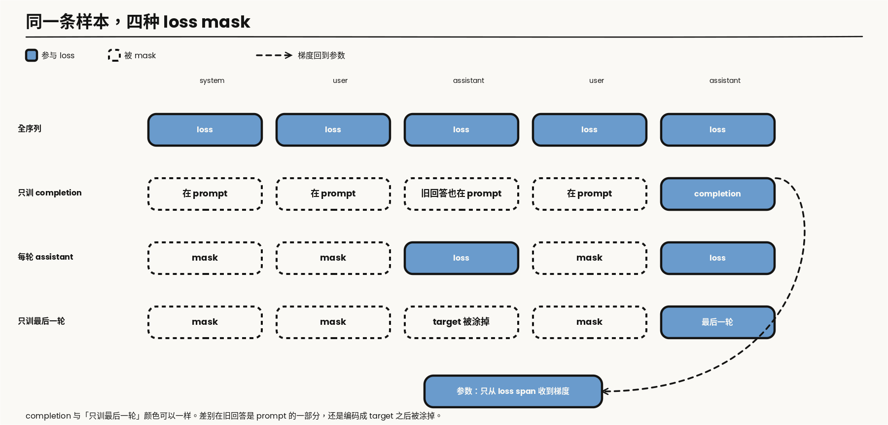
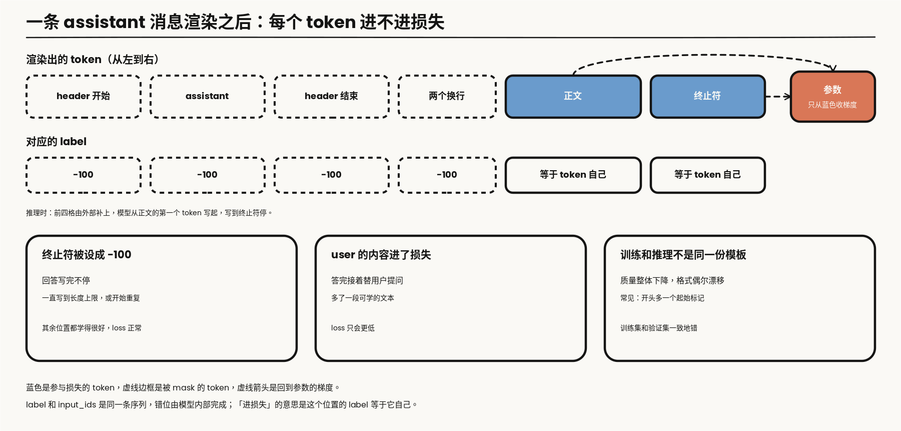
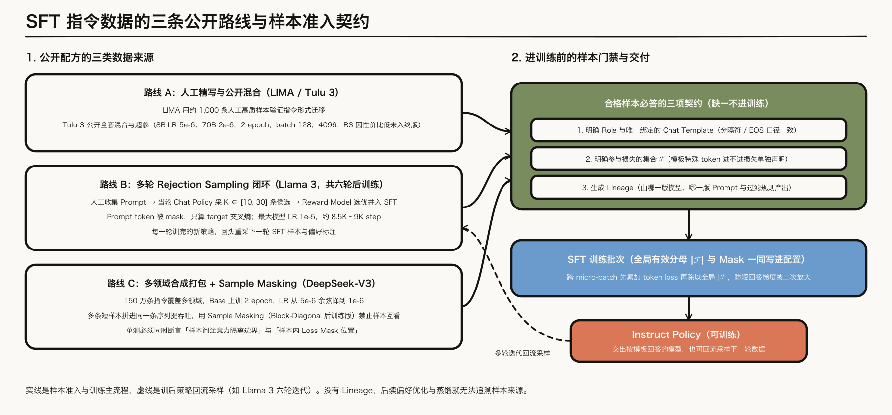
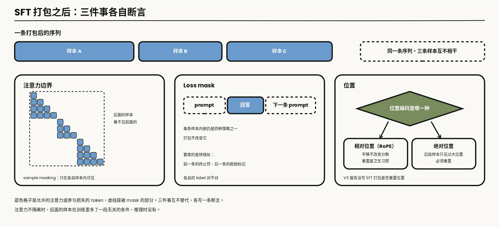
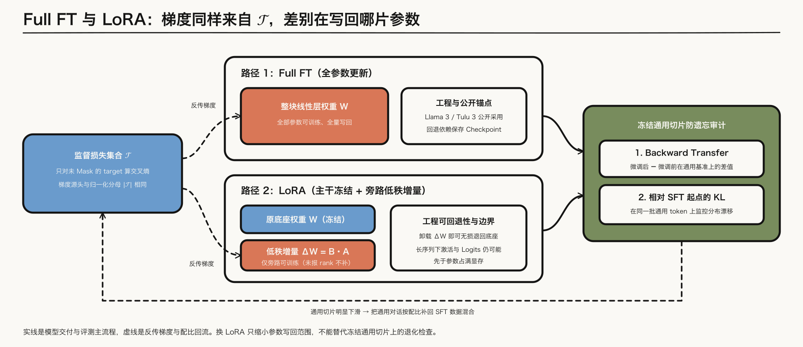

---

layout: post
tags: [LLM, NLP, Training]
title: 大模型是怎么炼成的（四）：SFT 的边界是 loss 铺在哪些 token 上
date: 2026-9-28
author: Kyrie Chen
comments: true
toc: true
pinned: false

---

问「法国的首都是哪里」，续写「德国的首都是哪里」，对只做过预训练的模型是合理的。它见过成排的问题。SFT 要改的是这个条件，不是再换一批更干净的网页。

第三篇的原话是：只要 loss 仍铺在全部 token 上，监督位置就还没变；一旦某段数据只训 response，阶段名即使仍叫退火，语义上已经是 SFT。MiniCPM 把 SFT 风格数据放进 decay，OLMo 2 的 Dolmino 里有 FLAN，两份报告都没写明这些样本是整段算 loss，还是只算 response。这一篇把这个「没写明」变成可以问出口的问题。阶段边界由 mask 的位置定义，不由学习率日程或阶段名定义。

第一篇已经预留了 `messages`、chat template、role、loss mask 和生成 lineage。这里用它们，不重新介绍数据湖。`-100` 只是 PyTorch 交叉熵的 ignore index，不是 SFT 的数学定义。loss 怎么平均，第二篇已经写过 token-mean、sequence-mean 和梯度累积，这里只引用。

> **范围**：文本指令微调。对照 [Llama 3](https://arxiv.org/abs/2407.21783) 的 SFT、[Tulu 3](https://arxiv.org/abs/2411.15124) 的公开配方，以及 [DeepSeek-V3](https://arxiv.org/abs/2412.19437) 报告里写明的 SFT 设置。报告没写的学习率、epoch、LoRA rank 不补。工具调用只写到 SFT 要学会的格式。文中标明「算术」的数字是从定义直接算出来的，不是某次运行的结果。

---

## 一、监督位置才是目标函数的变化

### 1.1 四种 mask

SFT 仍然是条件语言建模。给定渲染后的序列 $$x$$，损失还是

$$
\mathcal{L} = -\frac{1}{\lvert\mathcal{T}\rvert}\sum_{t \in \mathcal{T}} \log p(x_t \mid x_{\lt t})
$$

和第二篇的差别只在集合 $$\mathcal{T}$$：预训练里它几乎是全部 token，SFT 里它是 mask 留下来的那些位置。

四种合法策略都存在，选哪一种要先看样本结构与训练目的：

| 策略 | 进入 loss 的 span | 什么时候用 |
|---|---|---|
| 全序列 | system、user、assistant、工具文本 | 模板本身也要学；或 user 内容来自模型，需要被记住 |
| 只训 completion | 样本被存成 prompt + completion 时的 completion | 旧回答被算进 prompt，不再产生梯度 |
| 每一轮 assistant | 每一轮 assistant 的 target | 多轮里每一轮回答都要学，user 和 system 不学 |
| 只训最后一轮 | 最后一轮 assistant | 历史只作条件，避免反复拟合早期回答 |

选择取决于三件事：模板要不要学，user 内容是不是模型自己生成的，以及是否担心模型把 prompt 复述回去。



*图 1：同一条 system / user / assistant 样本。蓝色实心是参与 loss 的 span（token 资产），虚线边框是被 mask 的 span。虚线箭头是从参与 loss 的位置回到参数的梯度，沿用系列图例的反馈含义，和第二篇图 1 一致。「只训 completion」和「只训最后一轮」的差别在旧回答是留在 prompt 里，还是先编成 target 再被涂掉。*

### 1.2 同一条多轮对话，两种写法在梯度上相等

一条 $$N$$ 轮的对话有两种喂法。一种是整条进模型，每一轮 assistant 都算 loss。另一种是拆成 $$N$$ 条样本，第 $$k$$ 条把前 $$k-1$$ 轮当 prompt，只训第 $$k$$ 轮的回答。

因果注意力下，这两种写法给出的是同一组条件概率。第 $$k$$ 轮回答里每个 token 的 loss 只依赖它前面的 token，后面还有没有别的轮次，对它没有影响。所以两种写法在每个被训练的 token 上梯度相同，差别只在两处：算了多少遍前向，以及分母怎么除。

前向的账是算术。10 轮对话，每轮等长：整条喂一次，前向 10 轮的 token；拆成 10 条，前向的是 1 加到 10，共 55 轮的 token，其中 45 轮只是当条件被重复计算。轮数越多，这个比值越大。

分母的账在第四节。先记住结论：拆开之后每条样本只有一轮回答有 loss，如果每条样本内部先平均再合起来，短回答的轮次会被放大。

### 1.3 重复计数：数据已经被拆过一遍

「只训最后一轮」存在的理由，多半是数据在上游已经被拆过了。

很多公开的多轮数据集存的不是整条对话，而是每个前缀各一条：第 1 条到第 1 轮为止，第 2 条到第 2 轮为止，一直到第 $$N$$ 条。对这种数据再用「每一轮 assistant」的 mask，第 1 轮的回答会在 $$N$$ 条样本里各被训一次，最后一轮只被训一次。算术：10 轮对话展开成 10 个前缀，第 1 轮的回答得到 10 倍于最后一轮的梯度。loss 曲线不会提示这件事，模型学到的是开场白格外熟练。

所以选 mask 之前先看一眼数据是哪种形态。整条对话配「每一轮 assistant」，前缀展开的数据配「只训最后一轮」，两种组合在梯度上等价。另外两种交叉组合，一种是重复计数，一种是只学了每条对话的最后一句。

还有一种情况也该用「只训最后一轮」：历史里的 assistant 回答不是你想让模型模仿的。比如历史来自另一个模型，或者是故意放进去的错误回答，要训的是「在这样的上文之后怎样答好下一轮」。这时历史只作条件。

### 1.4 全序列什么时候是对的

全序列把 user 的内容也放进 loss。模型因此同时在学「怎样提问」和「怎样回答」。对一个助手，这通常是副作用：它会在回答结束后接着替用户写下一个问题，第二节的表里有这一行。

它是对的选择，有两种情况。一种是模板本身还没学过：特殊 token 是新加的，或者这一段训练的目的就是让模型见过完整的对话格式，第三篇 mid-training 里放进 decay 的 SFT 风格数据很可能是这种用法。另一种是 user 一侧的文本也是要学的输出，比如训练一个用户模拟器，或者 user 内容是模型自己上一步生成的、需要保持一致。

---

## 二、Chat template 是训练分布的一部分

### 2.1 渲染决定 token 边界

`messages` 进模型之前要被渲染成带特殊 token 的字符串。mask 的边界就是这次渲染结果里的 token 边界。模板、停止符和 mask 必须出自同一次渲染。训练用一套模板、推理用另一套，模型看到的是另一个分布，loss 不会报这个错。

以 Llama 3 的模板为例，一条消息渲染出来是这样一串：header 开始标记，role 的名字，header 结束标记，两个换行，正文，最后是消息结束标记 `eot_id`。整段对话最前面有一个 `begin_of_text`。推理时在末尾补上一个 assistant 的 header，让模型从正文的第一个 token 开始写，写到 `eot_id` 停。

这串 token 里，哪些进 $$\mathcal{T}$$ 要逐段声明。assistant 的 header 是 prompt 的一部分，推理时由外部补上，不需要模型自己生成。正文要进。`eot_id` 也要进：模型只有被要求预测过它，才知道回答在哪里结束。

Hugging Face 这一系的实现里，`labels` 和 `input_ids` 是同一条序列，错位由模型内部完成。所以「某个 token 进 loss」的意思是：这个位置上的 label 等于它自己，而不是 `-100`。第四节的单测断言的就是这件事。

### 2.2 三种 loss 看不出来的模板错误

下面这张表是检查清单，不是某份报告的统计。三行的共同点是训练 loss 照常下降。

| 错在哪 | 上线后的样子 | loss 为什么看不出来 |
|---|---|---|
| 终止符的 label 被设成 `-100` | 回答写完不停，一直写到长度上限，或者开始重复 | 被 mask 的位置不进损失，其余位置都学得很好 |
| user 的 header 或正文进了 loss | 答完之后接着替用户写下一个问题 | 多了一段可学的文本，loss 只会更低 |
| 训练和推理不是同一份模板 | 质量整体下降，格式偶尔漂移 | 训练集和验证集用的是同一份错的模板，两边一致 |

第三行最常见的几种形态：tokenizer 自动加了一个起始标记，模板里又写了一个，序列开头变成两个；训练时没有 system 消息，部署时框架默认塞了一条；训练时回答前面多一个换行，推理时没有。每一种只差一两个 token，但它们出现在每一条样本的固定位置，模型会把它学成格式的一部分。

防这一行的办法不是肉眼核对模板字符串，是断言：训练管线渲染出的 `input_ids`，和推理入口对同一条 `messages` 渲染出的结果逐位相等。



*图 2：以 Llama 3 模板为例。蓝色是参与损失的 token，虚线边框是被 mask 的 token，虚线箭头是回到参数的梯度。下排三格对应上表的三行。*

### 2.3 特殊 token 要落到词表上

特殊 token 如果已经在预训练词表里，SFT 只是让它们出现在新位置。Llama 3 的对话标记写在它的 128K 词表和 chat template 里，发布的 tokenizer 还留了一批保留的特殊 token，后面要加新标记时可以直接占用，不必改词表大小。

如果是这时才加进去的，embedding 是新增的行，输出头也多出对应的行，梯度只从见过这些 token 的样本来。新行怎么初始化不是小事。[Hewitt 的一篇笔记](https://nlp.stanford.edu/~johnhew/vocab-expansion.html)把问题写得很清楚：随机初始化的新行可能给出很大的 logit，新 token 在每个位置上都分走一部分概率，模型在还没训练之前的输出分布就已经偏离预训练模型；用已有 embedding 的均值初始化，新 token 的概率有上界，原来的分布基本不动。

用 LoRA 时这里还有一处容易漏。底座冻结，embedding 不在可训练的参数里，新加的那几行就永远停在初始值。新增了 token，就要把 embedding 和输出头显式列进可训练的部分。

### 2.4 工具调用在这里只是一种 role

工具调用在这一篇里只是一种 role：`tool` 或函数返回写成一段文本，mask 决定模型是在学「何时发起调用」，还是也在学工具返回的原文。默认是前者，工具返回和 user 内容一样只作条件。环境里的多轮信用分配不在这里，第七篇从这个默认值往下写。

---

## 三、数据从哪来，以及什么算一份合格样本

### 3.1 三条来源

三条来源并列，不是一条进化史。

人工撰写的公开极端是 [LIMA](https://arxiv.org/abs/2305.11206)：大约 1000 条仔细写过的样本，用来说明少量指令数据就能改变模型行为。Tulu 3 和 Llama 3 走的是另一笔预算。Tulu 3 的 SFT 混合、代码和超参是公开的：8B 学习率 $$5\times 10^{-6}$$，70B 为 $$2\times 10^{-6}$$，两个 epoch，有效 batch 128，序列长度 4096。他们试过 rejection sampling，在自己的设置里收益相对算力很小，所以没有放进最终配方。

Llama 3 把 rejection sampling 放进每一轮后训练。每个由人工标注收集来的 prompt 从当时的 chat policy 采 $$K$$ 条输出，$$K$$ 通常在 10 到 30 之间，用 reward model 留下一条，再和对其他来源的数据一起做 SFT。损失是 target token 上的交叉熵，prompt token 被 mask。最大模型的学习率是 $$10^{-5}$$，大约 8.5K 到 9K step。后训练做了六轮，每轮重新收集 SFT 数据和偏好标注。

DeepSeek-V3 的指令数据是 150 万条，覆盖多个领域，各领域的构造方式不同。SFT 在 base 上训两个 epoch，学习率从 $$5\times 10^{-6}$$ 余弦降到 $$10^{-6}$$。多条样本会打进同一条序列，并用 sample masking 让它们互相看不见。这是第一篇 4.14 节里 block-diagonal attention 的后训练版本：打包提高利用率，注意力边界和 loss mask 是两件都要断言的事。

### 3.2 三套公开配方放在一起

| | Llama 3 | Tulu 3 | DeepSeek-V3 |
|---|---|---|---|
| 规模 | 报告没有给总条数 | 约 94 万条，混合公开 | 150 万条 |
| 回答从哪来 | 人工 prompt 配拒绝采样的回答；针对特定能力的合成数据；少量人工精修 | 公开指令数据集，加按 persona 合成的技能数据 | 推理类由内部推理模型生成，非推理类由上一代模型生成、人工核验 |
| 训练量 | 最大模型约 8.5K 到 9K step | 两个 epoch | 两个 epoch |
| 学习率 | 1e-5 | 8B 为 5e-6，70B 为 2e-6 | 5e-6 余弦降到 1e-6 |
| 序列长度 | 未写 | 4096 | 未写 |
| 打包 | 未写 | 未写 | 打包，sample masking |
| 拒绝采样 | 每一轮都用 | 试过，未进最终配方 | 未写 |

三行「未写」是这张表里最该读的部分。Llama 3 没有给 SFT 的总条数和序列长度，V3 没有给序列长度，三家都没有写 loss 的归一口径。照着某一列复现时，这些格子要自己定，并且写进配置。

三家的学习率都落在预训练末段的量级附近：第二篇里 Llama 3 的余弦收在 $$8\times 10^{-7}$$，V3 的最后一级平台是 $$7.3\times 10^{-6}$$。SFT 没有回到预训练的峰值学习率。这是从三份报告的数字里读出来的共同点，报告自己没有把它写成一条原则。

### 3.3 指令数据特有的四个问题

第一篇的清洗管线对指令数据同样适用，另有四件事是网页数据没有的。

**和评测集靠得更近。** 指令数据的格式和 benchmark 的题目是同一种文体，重叠比网页多得多。Tulu 3 对训练混合和评测集做了重叠检查，把重叠明显的数据集拿掉或换成去污染的版本。第一篇 4.10 节的流程在这里要每加一个数据集就重跑一次。

**合成回答有口头禅。** 由模型生成的回答带着生成它的模型的习惯。Llama 3 的数据处理里有一步规则清洗：去掉过度使用表情和感叹号的样本，以及高频出现道歉句式的样本。第一篇 4.11 节要求抽样检查模板泄漏和固定开场，是同一件事。

**质量和难度要分开打分。** Llama 3 写了一套修剪流程：先训一个主题分类器给样本分桶；质量用两个信号，一个是 reward model 的分数，一个是让 Llama 3 的 checkpoint 按固定的评分表打分，报告说这两个信号的分歧很大，合起来用召回最好；难度是另一维，用意图标签的个数和模型打分来估；最后在每个簇里按「质量乘难度」排序，逐条挑选，和已选样本太相似的跳过。质量高而太容易的样本，和难而质量差的样本，都不是想要的。

**多样性靠构造。** Tulu 3 的合成数据按 [persona](https://arxiv.org/abs/2406.20094) 展开：先给出不同身份的提问者，再让模型以这个身份出题，用来对抗同一个 prompt 模板反复生成相似指令。

拒绝采样的账也在这里。每个 prompt 采 $$K$$ 条再留一条，生成的开销是 $$K$$ 倍。Llama 3 每轮都付这笔钱，并且在后几轮给采样加了 system prompt，用来把回答的语气和格式往想要的方向引。Tulu 3 在自己的设置里量过，收益不值这个开销。两个结论并列，各自绑定它的 RM 质量和数据规模。

### 3.4 什么算一份合格样本

一份能进训练的样本至少要回答三件事：role 是什么，哪一段参与 loss，生成它的模型和 prompt 版本是什么。最后一项是第一篇的 lineage。没有它，后面的偏好数据和蒸馏就不知道这条回答从哪来。



*图 3：左侧并列三条公开指令数据路线，右侧绿色门禁卡住进训练前的三项声明（role 与模板、损失集合 $$\mathcal{T}$$、生成 lineage）。虚线表示训完的策略在多轮后训练里回流采样下一轮数据。*

---

## 四、Loss masking 的代码，和它的分母

图 1 上被 mask 的 span，在代码里就是 label 变成 ignore index 的位置。

### 4.1 TRL

TRL 当前的 `DataCollatorForLanguageModeling` 先把 `output["input_ids"]` 拷成 `output["labels"]`。样本若开 `completion_only_loss` 且带 `completion_mask`，0 的位置被设成 `-100`，对应图 1 的「只训 completion」；若开 `assistant_only_loss` 且带 `assistant_masks`，0 的位置同样被设成 `-100`，对应「每一轮 assistant」。padding 的 label 也是 `-100`，那是补齐，不是策略。

```python
output["labels"] = output["input_ids"].clone()
if self.completion_only_loss and "completion_mask" in examples[0]:
    # ... pad completion_mask -> (batch, seq_len)，1 = completion，0 = prompt
    output["labels"][completion_mask == 0] = -100
if self.assistant_only_loss and "assistant_masks" in examples[0]:
    # ... pad assistant_masks -> (batch, seq_len)，1 = assistant span
    output["labels"][assistant_masks == 0] = -100
```

`assistant_masks` 是 tokenizer 渲染模板时一并返回的，哪些 token 算 assistant span 由模板里的标注决定。终止符在不在这个 span 里，取决于模板怎么写，不取决于这几行代码。这就是 2.1 节说的「mask 和模板出自同一次渲染」在实现里的样子，也是 4.5 节要断言它的原因。

### 4.2 LLaMA-Factory

LLaMA-Factory 的 `SupervisedDatasetProcessor._encode_data_example` 在多轮编码时做同一件事。`IGNORE_INDEX` 就是 `-100`。`self.data_args.train_on_prompt` 为真时，source 和 target 都进 loss，对应「全序列」；否则 source 整段填成 `IGNORE_INDEX`，target 保留，对应「每一轮 assistant」。`self.data_args.mask_history` 会先把 `encoded_pairs` 倒序，使 `turn_idx == 0` 成为最后一轮，更早轮次的 target 也被忽略。

```python
if self.data_args.mask_history:
    encoded_pairs = encoded_pairs[::-1]  # 倒序后，turn_idx == 0 是最后一轮
# 倒序之后，下面的判断发生在每一轮内部
if self.data_args.train_on_prompt:
    source_label = source_ids
else:
    source_label = [IGNORE_INDEX] * source_len
if self.data_args.mask_history and turn_idx != 0:
    target_label = [IGNORE_INDEX] * target_len
else:
    target_label = target_ids
```

两个开关合起来正好是图 1 的四行里的三行。`mask_history` 就是 1.3 节那个选择：数据是前缀展开的，打开它；数据是整条对话，关掉它。

### 4.3 分母

mask 会让每条样本的有效 token 数差很多。sequence-mean 先在序列内平均，短回答的每个 token 梯度更大。算术：一个 batch 里一条回答 20 个 token，另一条 2000 个，各自先平均再合并，短的那条每个 token 的权重是长的 100 倍。梯度累积时如果每个 micro-batch 先 mean 再相加，有效 token 少的那一份会被再次放大。

第二篇的写法在这里仍然适用：把各 micro-batch 的 token loss 之和累加起来，最后除以全局有效 token 数。分母 $$\lvert\mathcal{T}\rvert$$ 要和 mask 一起写进训练配置，不能只写学习率。3.2 节那张表里，三份报告都没有写这一项。

预训练里这个问题不显眼，因为每条序列几乎都是满的。SFT 里一条样本可能只有最后十几个 token 有 loss，分母之间差两个数量级是常态。换一种 mask 策略，等于同时换了分母；只改 mask、不重新看学习率，两次实验的有效步长并不相同。

### 4.4 打包之后，三件事各自断言

DeepSeek-V3 把多条样本打进同一条序列。打包之后有三件事要分开看。

**注意力边界。** 不加处理时，排在后面的样本能看见前面的样本。训练时它的条件里多了一段无关的对话，推理时没有。sample masking 把注意力限制在各自的样本内，是第一篇那张 block-diagonal mask 在 SFT 侧的版本。

**loss mask。** 每条样本内部仍是第一节的四种策略之一，打包不改变它。要查的是样本之间的拼接处：前一条的终止符和后一条的起始标记，各自的 label 对不对。

**位置。** 位置要不要在每条样本的起点重新计数，取决于位置编码。RoPE 下注意力分数只依赖两个 token 的相对位置，样本之间又互相不可见，整条样本平移多少个位置，在精确算术下不改变任何结果。使用绝对位置编码的模型则不同：排在序列后段的样本只在靠后的位置上被训练，推理却从位置 0 开始，这是真实的分布差异。重新计数成本很低，可以当作默认的卫生习惯；V3 的报告没有写它的 SFT 打包是否重置位置，这里不替它补。



*图 4：三条样本打进一条序列之后的三件事。蓝色格子是允许的注意力或参与损失的 token，虚线是被 mask 的部分。位置要不要重置，取决于位置编码是相对的还是绝对的。*

### 4.5 单测

单测是第一篇 QA gate 里「packed sequence mask 单测」在 SFT 侧的兑现。做法是把所有 label 不是 `-100` 的连续片段解码出来，和你声明的策略逐字比对。

```python
def trainable_spans(input_ids, labels, tok):
    spans, cur = [], []
    for i, l in zip(input_ids, labels):
        if l != -100: cur.append(i)
        elif cur: spans.append(tok.decode(cur)); cur = []
    if cur: spans.append(tok.decode(cur))
    return spans

msgs = [{"role": "system", "content": "简短回答。"},
        {"role": "user", "content": "法国的首都是哪里"}, {"role": "assistant", "content": "巴黎。"},
        {"role": "user", "content": "德国呢"}, {"role": "assistant", "content": "柏林。"}]
ex = encode(msgs)                                   # 训练管线自己的渲染与打标
ids, labels = ex["input_ids"], ex["labels"]
assert trainable_spans(ids, labels, tok) == ["巴黎。<|eot_id|>", "柏林。<|eot_id|>"]
assert all(l in (-100, i) for i, l in zip(ids, labels))            # label 没有错位
assert tok.apply_chat_template(msgs, tokenize=True) == ids         # 和推理是同一份模板
```

期望值按你声明的策略写。上面是「每一轮 assistant」配 Llama 3 模板：两段，各自以终止符结尾，不含任何 header、system 或 user 的文字。换成「只训最后一轮」，期望值就只剩后一段。三条断言分别对应 2.2 节表里的三行。

模板或框架升级之后重跑。开了 packing，还要同时断言样本之间的 attention 边界，口径回到第一篇 4.14 节。label 整体错一位、模板分隔符被算进 loss、上一轮 user 被标成可训，loss 曲线都可以照常下降。长上下文全参 SFT 里，loss 正常而模型仍然是坏的，[《512K 上下文的全参 SFT》](/512K-Long-Context-SFT-Postmortem/)已经记过现场；mask 错了是同一类问题的短序列版本。

---

## 五、Full FT 和 LoRA 改的不是同一个东西

### 5.1 更新了谁

Full FT 更新全部权重。[LoRA](https://arxiv.org/abs/2106.09685) 在选定的线性层旁边加低秩增量，底座可以冻结。对一个权重 $$W_0$$，前向变成

$$
h = W_0 x + \frac{\alpha}{r}\,B A x
$$

其中 $$A$$ 和 $$B$$ 是两个小矩阵，秩为 $$r$$，只有它们被训练。$$B$$ 初始化为零，所以第 0 步的输出和底座完全相同，训练从底座的行为出发，不从一个随机扰动出发。训练完可以把 $$\frac{\alpha}{r}BA$$ 加回 $$W_0$$，推理时没有额外的层。

梯度仍然只从 $$\mathcal{T}$$ 来，但写回的参数集合不同。参数量是算术：一个 4096 乘 4096 的权重有约 1680 万个参数；秩取 16 作为示意，增量是 $$16\times(4096+4096)$$，约 13 万个，不到 1%。这里的 16 只是为了算这笔账，不是推荐值。

作用在哪些层上会改变结论。LoRA 原论文主要加在注意力的 query 和 value 投影上。[QLoRA](https://arxiv.org/abs/2305.14314) 报告，要追上全参微调，需要把增量加到所有线性层上，秩的大小反而没有那么关键。

Llama 3 和 Tulu 3 公开的 SFT 设置是全参微调，两份报告都没有给出一套 SFT 用的 LoRA rank。没有这个数字，就不写 rank。

### 5.2 可回退性和显存

可回退性不一样。LoRA 可以卸掉增量，回到底座；同一个底座上可以挂多份增量，各管一个任务。Full FT 要靠 checkpoint。

显存也不一样：LoRA 不需要给底座的权重存梯度和优化器状态，第二篇图 1 里常驻的三份东西只剩一份。但前向和反向的激活仍然要算，长上下文下的激活和 logits 仍然可能先于参数把卡打满，那是并行那篇文章和 512K 那篇的账，不在这里重算。

### 5.3 遗忘

SFT 数据过窄时，通用能力会掉。检查用第一篇冻结评测集里的通用切片。第三篇领域续训一节的两个数在这里同样适用：续训后减去续训前的 backward transfer，以及在同一批通用 token 上相对 SFT 起点的 KL。掉多少再决定要不要把通用对话加回混合，而不是等榜单出来再猜。

LoRA 在这件事上不是免费的保险，也不是没有作用。[Biderman 等](https://arxiv.org/abs/2405.09673) 在代码和数学两个领域比过：LoRA 在目标领域学到的通常比全参微调少，在原有任务上忘掉的也更少；全参微调学到的权重改变量，秩比常用的 LoRA 配置高一到两个数量级。学得少和忘得少是同一个约束的两面。用 LoRA 换来的遗忘缓解，要和它在目标任务上少学的那部分一起算。



*图 5：实线是模型交付与评测流程，虚线是来自损失集合 $$\mathcal{T}$$ 的反传梯度以及通用能力下滑时的配比回流。可训练与冻结写在节点文字里；LoRA 只把写回范围收窄到旁路低秩增量，不能省略右侧冻结通用切片上的 backward transfer 与 KL 检查。*

---

## 六、排查：loss 正常，模型不对

SFT 的故障很少表现为 loss 异常。下面这张表把前面几节的机制倒过来读，按上线后看到的现象查。它是检查顺序，不是某份报告的结论。

| 现象 | 先看的信号 | 对照 | 只动这一个旋钮 |
|---|---|---|---|
| 回答停不下来 | 终止符位置的 label 是不是 `-100` | 4.5 节第一条断言；推理侧的停止符配置 | mask，或模板里 assistant span 的范围 |
| 答完替用户提问 | user 的 span 有没有进 loss | 解码出的可训片段里是否有 user 文字 | mask 策略 |
| 训练指标好，部署后变差 | 训练和推理渲染出的 token 是否逐位相等 | 4.5 节第三条断言；开头的起始标记个数 | 统一模板入口 |
| 开场白千篇一律 | 训练集回答开头的高频 n-gram | 留出集 loss 是否在第二个 epoch 起点出现台阶 | 数据去同质；减少 epoch |
| 单轮好，多轮崩 | 多轮样本的占比；数据是不是前缀展开 | 1.3 节的两种组合 | `mask_history` 与数据形态对齐 |
| 换了 mask 之后训练不稳 | 每步有效 token 数的分布 | 同一批数据按两种分母各算一次 loss | 归一口径，然后再看学习率 |
| 新加的标记输出混乱 | 新增 embedding 行的范数；它们是否可训练 | 用均值初始化重跑一小段 | 初始化；可训练参数列表 |
| 通用能力下滑 | 通用切片上的 backward transfer 和 KL | SFT 起点的 checkpoint | 混合里加回通用数据 |

第四行里的台阶值得解释一句。训练 loss 在每个 epoch 开头突然下降一截，说明模型在第二次见到同一条样本时认出了它。这本身不是错误，但台阶很大、留出集 loss 同时上升时，模型是在背样本。同质的合成数据最容易出现这种情况，3.3 节的口头禅清洗管的就是它的来源。

---

## 七、交出去的是 instruct model

SFT 结束时，模型会按模板回答，还没有经过偏好优化。上线或进入下一环之前，先过这几道检查：阶段边界只看哪些位置进入损失集合 $$\mathcal{T}$$，模板特殊 token 进不进损失、分母 $$\lvert\mathcal{T}\rvert$$ 怎么汇总必须和 mask 一起写进配置并配单测；样本缺了 role、loss mask 或生成 lineage 就不能进训练；Full FT 与 LoRA 只改参数更新范围，不替你补通用切片上的 backward transfer 与 KL 审计。

偏好优化需要的是同一套模板下的 chosen 与 rejected，或者好/坏标签，以及产生它们时的 policy 版本。

---

## 参考资料

- [Llama 3 Herd of Models](https://arxiv.org/abs/2407.21783)（SFT 对 target token 的交叉熵、rejection sampling、数据清洗与修剪、学习率与 step）
- [Tulu 3](https://arxiv.org/abs/2411.15124)（公开 SFT 混合与超参；rejection sampling 未进入最终配方）
- [DeepSeek-V3 Technical Report](https://arxiv.org/abs/2412.19437)（150 万条指令数据、两个 epoch、packing 与 sample masking）
- [Zhou et al., LIMA](https://arxiv.org/abs/2305.11206)
- [Ge et al., Persona Hub](https://arxiv.org/abs/2406.20094)（按 persona 合成数据）
- [Hewitt, Initializing New Word Embeddings for Pretrained Language Models](https://nlp.stanford.edu/~johnhew/vocab-expansion.html)
- [Hu et al., LoRA](https://arxiv.org/abs/2106.09685)
- [Dettmers et al., QLoRA](https://arxiv.org/abs/2305.14314)（增量加到所有线性层）
- [Biderman et al., LoRA Learns Less and Forgets Less](https://arxiv.org/abs/2405.09673)
- TRL `DataCollatorForLanguageModeling`；LLaMA-Factory `SupervisedDatasetProcessor`（`train_on_prompt` / `mask_history`）
