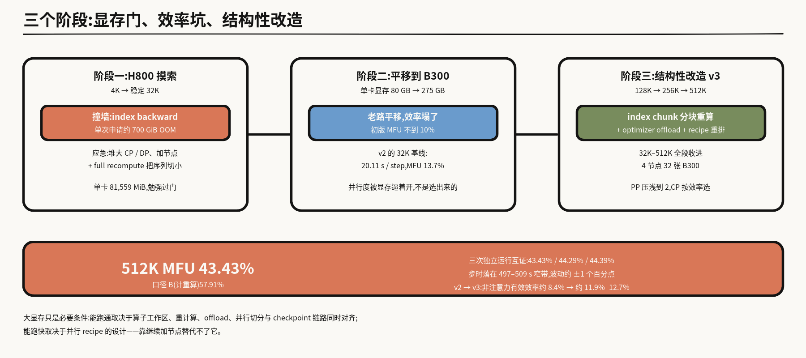
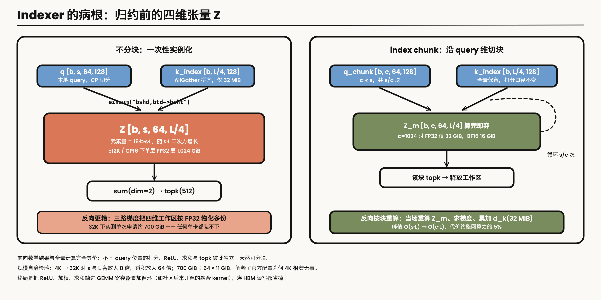
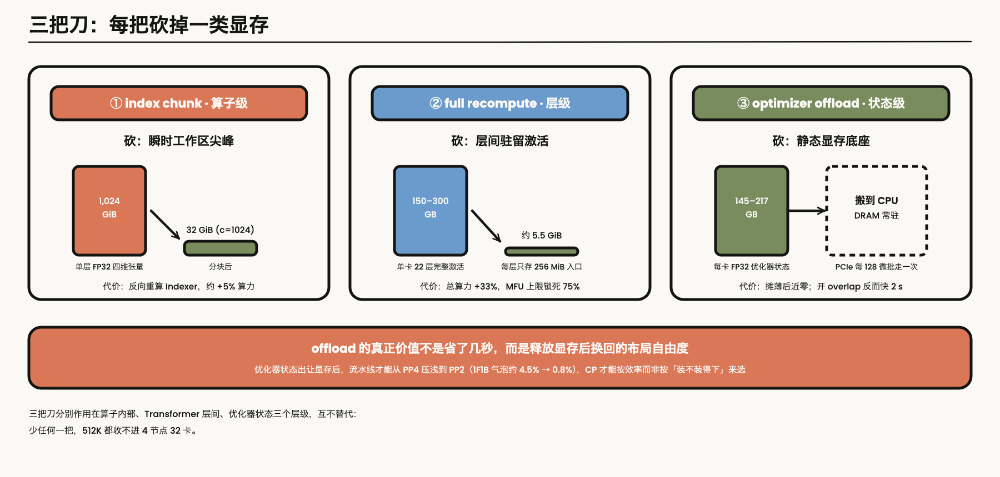
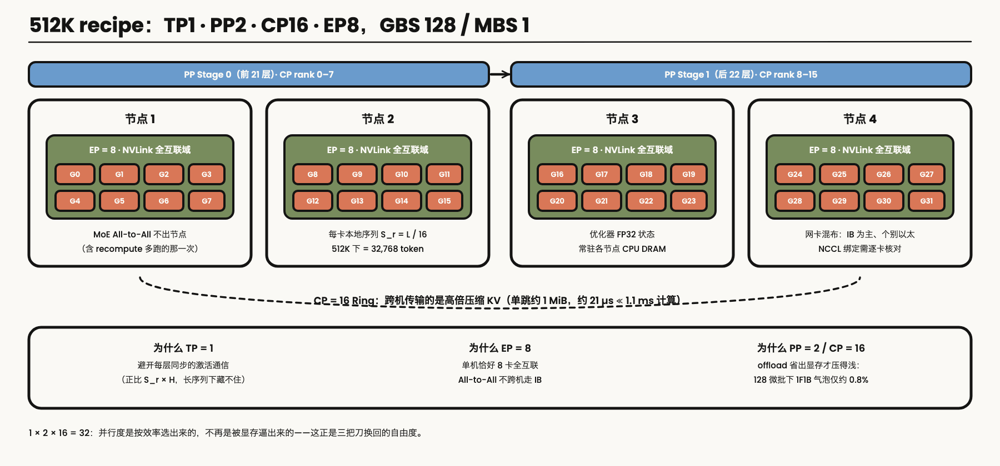
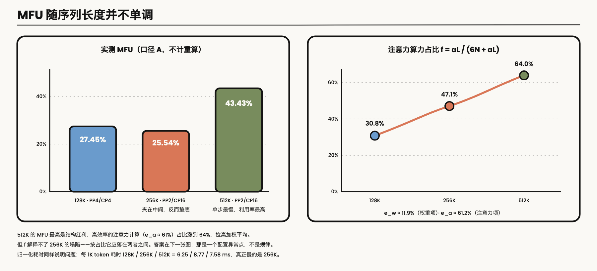
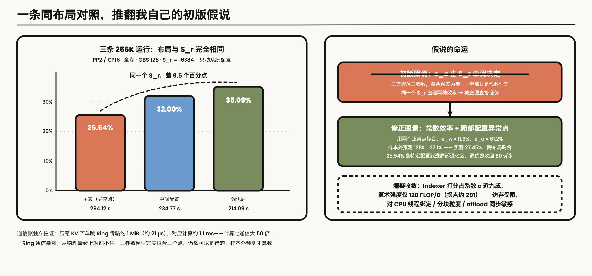
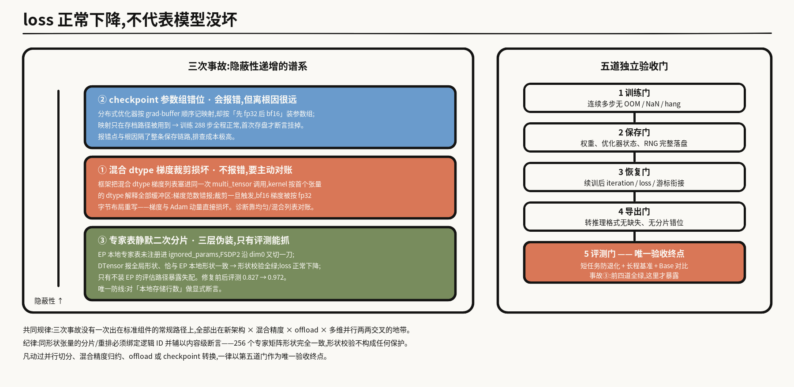

---

layout: post
tags: [LLM, NLP, AI Infra, Training]
title: 512K 上下文的全参 SFT：显存、MFU，以及 loss 说明不了的事
date: 2026-9-8
author: Kyrie Chen
comments: true
toc: true
pinned: false

---

过去几个月，我在把一个混合注意力 MoE 的全参 SFT，从官方训练栈默认的大约 4K 上下文，推到 512K。模型总参大约 290B，每个 token 激活大约 14.2B。推完之后，32K 到 512K 都能放进 4 个节点、32 张 B300。512K 这一档的 MFU 是 43.43%。

中间有三处和我事先想的不一样。稀疏注意力里的 Indexer，在反向时一次性申请了大约 700 GiB，先撞在这块工作区上。显存过了之后，MFU 随序列长度走成一条折线：256K 一度只有 25.54%，比 128K 和 512K 都低。还有，loss 正常往下走的时候，模型仍然可能是坏的。最危险的一次，形状检查全绿，只有独立评测把问题暴露出来。

下面按事情发生的顺序写。先把两件容易混在一起的事分开：调性能时，专家路由是强制均衡的，这样不同实验的吞吐可以比较；要交付权重的训练一律用真实路由，强制均衡会改掉「哪个 token 激活哪个专家」。有限步数里 loss 在降，我不把它当成模型已经具备长程能力。文中的数字来自训练日志、现场拓扑和模型源码。

---

## 一、275 GB 只够进门

官方代码的默认训练路径，上下文停在 4K 左右。迁到 B300 之前，这套训练已经在 H100/H800 上稳定跑过 32K。H800 现场记下来的单卡占用大约 81,559 MiB。

B300 单卡大约 275 GB，一个节点 8 卡。换卡有两个具体理由：上下文还要继续往 128K、256K、512K 走，吞吐也得提上来，不然算法侧的迭代太慢。

数据有几个口径，先排开。这一阶段实际喂进去的长上下文数据大约 20B tokens，来自一个更大的多源池；packing 之前大约 100 万条原始样本。样本打包后的目标长度是 128K。训练系统这边，packed 窗口的容量上限被验证到了 512K。工程上是按 128K、256K、512K 逐级打通的。



*图 1：三个阶段。H800 上靠把并行度开大，越过 32K 的显存门。同一套切分平移到 B300，MFU 掉到 10% 以下。后来提上来，靠的是 Indexer 分块重算、优化器卸到 CPU，以及把并行切分按效率重排。*

275 GB 让 512K 有机会跑起来。能不能跑通，还要看算子工作区、重计算、offload、并行切分、网卡拓扑和 checkpoint 是不是同时对齐。能不能跑快，看的是这套切分本身。继续加节点，替代不了它。

---

## 二、反向一次要了 700 GiB

### 报错已经把范围缩得很小

最早从 4K 直接拉到 32K，报错很干脆：`index backward` 里抛出 `Tried to allocate ~700 GiB`。

这不是碎片，也不是多层激活慢慢攒爆。某一个算子一次性要了 700 GiB，代码里一定有一个随序列长度剧烈膨胀的中间张量。换更大显存的卡也没用。700 GiB 超过 H800 的 80 GB，也超过 B300 的 275 GB。

### 归约之前，einsum 先摆出一整张四维表

这个模型的主干是 43 层，没有用单一的全注意力，而是三类层交错。符号先约定一下：$$L$$ 是全局序列长度，$$\mathrm{CP}$$ 是上下文并行度，$$s = S_r = L/\mathrm{CP}$$ 是单卡本地 query 长度，$$b$$ 是单卡微批大小。长序列下 $$b$$ 固定为 1。

- **2 层滑窗注意力**：只看最近 128 个 token。
- **20 层高压缩注意力**（压缩比 128）：每连续 128 个 token 的 KV 压成 1 个代表 token，再在 $$L/128$$ 个压缩 KV 上做稠密注意力。
- **21 层压缩稀疏注意力**（压缩比 4）：压完还有 $$L/4$$ 个压缩 KV。全量注意力太慢，于是做成两级。先用很轻的 Indexer（64 个打分头，head_dim 128）粗筛 top-512 个压缩块，再用主注意力只在这 512 个块、加上 128 个滑窗 token 上做精确计算。

Indexer 就是 CSA 层里的第一级粗排。打分收成两行：

```python
# q: [b, s, 64, 128], k_index: [b, L/4, 128], weights: [b, s, 64]
index_score = torch.einsum("bshd,btd->bsht", q, k_index)       # [b, s, 64, L/4]
index_score = (index_score.relu_() * weights.unsqueeze(-1)).sum(dim=2)
topk_indices = index_score.topk(512, dim=-1).indices            # [b, s, 512]
```

问题出在这两行之间。送进 `topk` 的分数已经是三维 `[b, s, L/4]`，但沿 64 个头求和之前，`einsum` 会先把四维打分张量 $$Z$$ 完整实例化出来，形状 `[b, s, 64, L/4]`：

$$
\mathrm{Elements}(Z) = b \times s \times 64 \times \frac{L}{4} = 16 \, b \, s \, L
$$

它正比于 $$s \cdot L$$，随序列长度二次方增长。从 4K 到 32K，$$s$$ 和 $$L$$ 各放大 8 倍，乘积放大 64 倍。32K 下那 700 GiB 除以 64，同一个张量在 4K 下大约 11 GiB。官方配置在 4K 下能跑，直接拉到 32K 就在反向炸穿，对得上。



*图 2：左边，einsum 在归约前摆出完整的 [b, s, 64, L/4]，体积随 s·L 二次方增长，反向还要按更高精度物化多份工作区。右边沿 query 切开，每次只算 [b, c, 64, L/4]，用完即弃，反向按块重算。峰值从 O(s·L) 降到 O(c·L)。*

前向和反向的体积还差一个数量级。前向里这个张量在 BF16 下是 34.4 GB，反向申请量是 700 GiB。前向的 `.relu_()` 是原地的，求和之后工作区可以马上放掉。反向要对 `einsum`、ReLU 和逐头乘 `weights` 同时求梯度：求门控权重的梯度，需要 ReLU 之后的完整四维张量；求 $$\mathrm{d}Z$$，要把三维上游梯度外积广播回四维，再乘 ReLU 掩码。没有手写的融合反向 kernel 时，autograd 会把还没归约的四维中间结果和梯度，按 FP32、按多份工作区一起物化出来。

### 当时是把序列切碎，硬挤过去的

第一次撞上这面墙，最直接的办法是把 $$s = L/\mathrm{CP}$$ 切小：CP 和 DP 开大，节点加上去，full recompute 打开。H800 上，32K 就是这么过去的。

同一套配置平移到 B300，再往更长的序列推，副作用马上出来。跨节点通信和流水线气泡一起涨。B300 上第一版移植的 MFU 掉到 10% 以下。下一版还停在「把并行度开大」这条路上，后面叫 v2，32K 基线也只有 13.7%。那时候的并行度，尤其是 CP，是被 Indexer 的显存峰值逼上去的，还没按计算和通信的效率来选。

算子工作区的峰值如果还跟序列长度绑在一起，切分就还是得听显存的。

---

## 三、显存其实是三笔账

单靠一种手段不够。瞬时尖峰在算子里面，层间激活是另一笔，优化器状态又是一块几乎不动的底座。图 3 从左到右是这三列。



*图 3：index chunk 去掉单次几百 GiB 的尖峰；full recompute 把驻留激活从上百 GB 压到大约 5.5 GiB；optimizer offload 把 145–217 GB 的 FP32 优化器状态搬到 CPU。*

### 沿 query 把 Indexer 切开

四维张量贵，是因为它一次算完本卡全部 $$s$$ 个 query。沿 query 维切开，块长 $$c \ll s$$。不同 query 位置的打分、ReLU、求和和 topk 彼此独立。

前向每次只拿长度 $$c$$ 的 query，和全量 `k_index` 算局部张量 `[b, c, 64, L/4]`。筛完这块的 top-512 就释放。结果和一次算完相同，峰值缩小 $$s/c$$ 倍。

反向时前向没有留下四维张量，就在算子里按块循环：重算当前块的打分，算出这块的梯度，把 `d_k` 累加进一个只有 32 MiB 的缓冲区，然后丢掉这块。

取 $$L = 512\mathrm{K}$$、$$\mathrm{CP}=16$$（$$s = 32{,}768$$）：不分块的单层 FP32 四维分数要 **1,024 GiB**。切到 $$c = 1{,}024$$，降到 32 GiB，BF16 下 16 GiB。单次几百 GiB 的尖峰没有了。代价是反向多跑一次 21 层 Indexer 的前向打分，大约占整网训练算力的 5%。

社区后来开源的融合 kernel，比如 DeepGEMM 的 `fp8_mqa_logits`，把 ReLU、加权和求和融进 GEMM 的寄存器累加，HBM 读写也省了。我们当时的分块，是在训练框架里先落地的一版。再往下，是把这种寄存器级融合和反向一起写进 CUDA 或 Triton。

### 整层重算，省的是层和层之间那一叠

Full recompute、selective recompute，和上面的分块重算，经常被说成同一件事。它们管的粒度不一样。

| 机制 | 作用粒度 | 前向保存什么 | 收益和代价 |
|---|---|---|---|
| **Full Recompute** | Transformer 整层 | 每层只留 1 个层输入（512K、CP16 下每层 256 MiB） | 驻留激活从数百 GB 压到约 5.5 GiB；总计算量 +33%，MFU 理论上限锁在 75% |
| **Selective Recompute** | 层内注意力核心 | 留下 QKV 投影和 MoE 路由展开，丢掉 core_attn 的大张量 | 算力代价小，但留下的激活在 512K 下仍有上百 GB；当时的混合注意力也不能对 core_attn 单独打 checkpoint |
| **index chunk 重算** | 算子内部 | 不保存四维打分张量 | 去掉单层反向 700 GiB–1 TiB 的尖峰，开销约 5% |

具体到 512K、CP16。不开 full recompute 时，MoE 层每个 token 激活 6 个专家，SwiGLU 中间态单层大约 3.2 GiB，加上 QKV 投影，单层完整激活 6–8 GiB。单卡管 21 到 22 层，叠起来会到 150–300 GB。打开之后，每层只留 256 MiB 的入口张量，22 层合计大约 5.5 GiB，少了 95% 以上。

代价也要算进去。标准训练一步大约是 $$3F$$，一次前向、两次等效反向。Full recompute 之后变成 $$4F$$，有 25% 的硬件算力花在重跑前向上。口径 A 不计重算，等于口径 B 乘以 $$3/4$$。512K 上硬件跑出来的口径 B 是 57.91%，折成口径 A 就是 43.43%。重算整层前向时，MoE 的 All-to-All 也会多走一次。EP 后来被锁在单机 NVLink 里，这也是原因之一。

### 优化器卸出去之后，切分才选得动

Offload 做的事很物理。单机有 TB 级 CPU 内存，HBM 只有 275 GB。不需要每个毫秒都留在 GPU 上的状态，用 PCIe 的双向 DMA 搬出去。

优化器状态是那块静态底座。290B 总参在 TP1 / PP2 / EP8 下，每卡大约负责 18.1B 参数的更新。标准混合精度 AdamW 的 FP32 状态，主权重、动量、方差，要占每卡 **145–217 GB**。卸到 CPU 之后，这些状态常驻主机内存。GBS 是 128，MBS 是 1，跑完 128 个微批、几十秒，才更新一次优化器。摊到每个微批上，PCIe 几乎看不见，HBM 空出一百多 GB。

激活也可以流着卸。用独立的 CUDA 传输流和双缓冲：前向算完第 $$l$$ 层，就把检查点激活异步卸到 CPU 锁页内存；反向走到第 $$l+1$$ 层之前先预取回来。传输和 Tensor Core 重叠。

「搬出 GPU 会不会被 PCIe 拖慢」，我们量过。256K 这一档，打开优化器状态搬运和计算的重叠，单步是 289.0 秒和 285.6 秒；关掉重叠是 294.12 秒。快大约 2 秒，显存峰值不变。搬运的开销是真的，计算能盖住大半。

更值钱的是下一笔。优化器状态让出显存之后，流水线才有条件从 PP4 压到 PP2。128 个微批时，1F1B 的理论气泡从大约 4.5% 降到 0.8%。CP 也可以按计算效率选，不用再按「装不装得下」选。看 offload 值不值，要看放开切分之后的整步时间。锁死布局、只数 PCIe 传了多少字节，会把这笔账看小。

### 32 张卡上最后用的切分

这套改完，后面叫 v3。512K 在 4 个节点、32 张卡上定成：

```text
4 nodes / 32 B300 GPUs
TP = 1, PP = 2, CP = 16, EP = 8
GBS = 128, MBS = 1
full recompute + optimizer offload + indexer 分块重算
路由口径分两线：性能基准 = 强制均衡；生产训练 = 真实路由
```



*图 4：4 个节点、每节点 8 卡。EP=8 落在单机 NVLink 里，MoE 的 All-to-All 不出节点。CP=16 跨两台机器切序列，传的是高倍压缩后的 KV，容易藏进计算。PP=2 配合 128 个微批，气泡大约 0.8%。*

四个数字是模型尺寸和节点拓扑一起定的。

**TP = 1。** 每层同步的 TP 激活通信正比于 $$S_r \times H$$。序列一长，这笔通信又重又难藏。CP 在 Ring 上传送的是压缩之后的 KV，容易藏。14.2B 激活参数的单卡矩阵乘已经够吃满算力，专家维又由 EP 切开了。

**EP = 8。** 一个节点正好 8 卡，机内 NVLink 全互联。专家并行定在 8，All-to-All 留在机内，不跨机走 IB。Full recompute 多出来的那次也留在机内。

**PP = 2，CP = 16。** $$1 \times 2 \times 16 = 32$$。Offload 省出显存之后，流水线才能压到 PP2，1F1B 的理论气泡是 $$1/129 \approx 0.8\%$$。512K 靠 CP16 装下。

还有四条路实际走过，又停掉了。Selective recompute 想用，当时的混合注意力没法对 `core_attn` 单独打激活检查点。少重算的组合试过，长序列、每卡 token 一多就直接 OOM。专家并行想开到 8 以上、跨到机外，通信库在跨机路径上创建 IB QP 就失败了。非交错流水线的 P2P overlap，框架做不到。四件事停下来的原因是同一类：不是参数没调好，是当时的前提就不成立。早点认出这一类，能省很多排障时间。

集群拉起来时还有一个硬件细节。机内 8 卡 NVLink 是全互联的，GPU 却挂在两个 NUMA 域上，到不同网卡的路径不一样。更隐蔽的是网卡链路层混在一起：大部分端口是 InfiniBand，个别端口是 Ethernet。不能用通配符把同型号端口都当成 IB 网卡交给 NCCL。上线前要按链路层类型，对照 NCCL 的选路日志，逐卡核对。

---

## 四、512K 一步最慢，利用率却最高

长序列训练里，不同团队报出来的 MFU 经常差很远。多半是分母没对齐。我们用的每 token 算力是：

$$
\mathrm{FLOPs/token} \approx 6N + aL, \qquad N \approx 14.2 \times 10^{9}, \quad a \approx 2.89 \times 10^{5}
$$

其中 $$6N$$ 跟序列长度无关，是词表、注意力投影和专家矩阵乘。前向 $$2N$$，反向 $$4N$$。$$aL$$ 是注意力：整条序列的计算量随 $$L^2$$ 涨，摊到每个 token 上就是 $$aL$$。

系数 $$a$$ 可以从结构里逐层算出来。2 层滑窗只看固定窗口，对 $$a$$ 的贡献是 0。21 层 CSA 的主注意力稀疏到 640 个 key，那一部分进常数项；Indexer 必须对全部 $$L/4$$ 个压缩 KV 打分。单层每 token 的前向是 $$2 \times 64 \times 128 \times L/4 = 4{,}096L$$，21 层合计 $$86{,}016L$$。20 层 HCA 对 $$L/128$$ 个压缩 KV 做注意力，按 QK 折半计 $$10{,}240L$$。前反向乘 3：

$$
a = 3 \times (86{,}016 + 10{,}240) = 288{,}768 \approx 2.89 \times 10^{5}
$$

这个 $$a$$ 里面，Indexer 占了 89.4%。后面看 256K 那个点的时候，这个比例会再出现一次。MFU 的分母取 BF16 稠密峰值 2250 TFLOP/s/GPU。口径 B 等于口径 A 乘以 $$4/3$$。

三档都是 32 卡、全参 SFT、full recompute，路由按性能基准强制均衡：

| 档位 | 并行切分 | S_r = L/CP | step time | TFLOP/s/GPU | MFU（A / B） | token/s/GPU |
|---|---|---|---|---|---|---|
| **128K** | PP4 / CP4 | 32768 | 104.86 s | 617.7 | 27.45% / 36.60% | **5000** |
| **256K** | PP2 / CP16 | 16384 | 294.12 s | 574.7 | 25.54% / 34.05% | 3565 |
| **512K** | PP2 / CP16 | 32768 | 508.51 s | **977.2** | **43.43% / 57.91%** | 4124 |

512K 这行有三次运行互相印证。主表来自一次 8 步运行的前段快照；同配置跑满 8 步的两条独立运行，是 44.29% 和 44.39%。三次步时落在 497–509 秒。主表取的是偏保守的那一档。



*图 5：左边是口径 A 的 MFU，512K 最高，夹在中间的 256K 反而最低。右边是注意力算力占比 $$f$$，512K 时高效率的注意力占到 64%。$$f$$ 解释得了 512K，解释不了 256K。*

512K 单步 508.51 秒，是三档里最慢的，利用率却最高。256K 垫底。这里有两个很容易比错的地方。

全局 batch 固定时，单步处理的 token 数随 $$L$$ 成倍增加，步时不能直接比谁快。折成每处理 1K token 的墙钟时间：128K 是 6.25 ms，256K 是 8.77 ms，512K 是 7.58 ms。这么一看，慢的是 256K。

MFU 更高，也不等于每秒产出更多 token。中间隔着每个 token 要做多少计算：

$$
\mathrm{token/s/GPU} = \frac{P_{\mathrm{peak}} \times \mathrm{MFU}}{\mathrm{FLOPs/token}}
$$

从 128K 到 512K，分母涨了 1.92 倍，MFU 只涨了 1.58 倍。512K 的单卡吞吐因此比 128K 低 17.5%。序列拉长之后，每个 token 上的二次方注意力，涨得比效率快。

以后再把这种数放进一张表，我会把四件事写在一起：峰值算力的分母、系数 $$a$$ 里有没有做因果折半、重算算不算进 MFU，以及归一化之后每 1K token 的耗时。缺一件，名次就可以完全反过来。

### 43% 是占比变了，不是某次调参调出来的

把每 token 的计算量拆成权重项 $$6N$$（有效效率 $$e_w$$）和注意力项 $$aL$$（有效效率 $$e_a$$）。整机 MFU 是这两块的加权平均：

$$
\mathrm{MFU} \approx (1 - f) \cdot e_w + f \cdot e_a, \qquad f = \frac{aL}{6N + aL}
$$

三档的 $$f$$ 是 30.8%、47.1%、64.0%。非注意力部分被几件事拖着：MBS=1 时 MoE 路由很散，矩阵很小；还有 full recompute、流水线气泡和 offload。$$e_w$$ 只有十几个百分点。注意力和 Indexer 是大块的规整矩阵乘，$$e_a$$ 超过 60%。高效率的那一块从 30.8% 涨到 64.0%，整体 MFU 就跟着上去。512K 的 43.43%，就是这个占比抬起来的。

### 我先把 256K 解释错了

占比 $$f$$ 解释得了 512K 为什么最高。它解释不了 256K：$$f = 47.1\%$$，按理该落在中间，实测却是最低的一档。

主表里最显眼的差别，是单卡本地序列有多长。128K 配 CP4，512K 配 CP16，$$S_r$$ 都是 32768。256K 当时为了稳妥装下，把 CP 从 4 拉到 16，$$S_r$$ 被切成 16384，比 128K 还短一半。

我按 Ring Attention 的教材直觉，写了第一版假说：注意力效率 $$e_a$$ 只由 $$S_r$$ 决定。$$S_r$$ 砍半，分片变碎，算术强度下降。三档数据代入三个方程，解出来是 $$e_w = 12.66\%$$、$$e_a(32768) = 60.74\%$$、$$e_a(16384) = 40.03\%$$。

假说马上给出一个可以去跑的推论。512K 用 CP16 装得下，256K 没必要也用 CP16。改成 CP8，$$S_r$$ 回到 32768，预测的 MFU 大约 **35.3%**。实测方向一致：CP8 那一族落在 218.88–242 秒，MFU 31–34.3%。相对 CP16 主表的 294.12 秒、25.54%，明显回来了，也都落在预测带里。

到这里我以为账已经平了。建一个模型，做一个预测，换一套配置，实测恢复。机制是错的。

### 同一套布局，把这个解释打掉

三个方程解三个未知数，代回去误差是零，只说明代数上是恒等的。它说明不了「$$e_a$$ 随 $$S_r$$ 变差」是真的。主表里 128K 用的是 PP4/CP4，256K 和 512K 用的是 PP2/CP16，布局也不一样。

后来有一条运行，和主表的 256K 完全同布局、同模式：PP2/CP16，全参，GBS 128，full recompute。动过的是 CPU 线程绑定这一类系统配置。

| 运行 | 布局 | S_r | step time | MFU | token/s/GPU |
|---|---|---|---|---|---|
| 256K 主表（异常点） | PP2/CP16 | 16384 | 294.12 s | 25.54% | 3565 |
| 256K 同布局，中间配置 | PP2/CP16 | 16384 | 234.77 s | 32.00% | 4466 |
| **256K 同布局，调优后** | PP2/CP16 | **16384** | **214.09 s** | **35.09%** | 4898 |



*图 6：三条 256K 的布局和 $$S_r$$ 相同，MFU 从 25.54% 到 35.09%。$$e_a$$ 如果只由 $$S_r$$ 决定，这张图不该存在。用两个正常点拟合出 $$e_w \approx 11.9\%$$、$$e_a \approx 61.2\%$$，再去预测没参与拟合的 128K，得到 27.1%，实测 27.45%。*

三条运行的 $$S_r$$ 一模一样，效率差了 9.5 个百分点。

通信的量级也对不上「Ring 暴露出来了」。这个架构的 KV 是高倍压缩的。$$S_r = 16384$$ 时，单跳大约 1 MiB，400 Gb/s 的 IB 上大约 21 微秒；对应的打分计算大约 1.1 毫秒。计算比通信大 50 倍以上。

拿同布局里正常的 256K（35.09%）和 512K（43.43%）去拟合一组跟 $$L$$ 无关的效率，得到 $$e_w \approx 11.9\%$$、$$e_a \approx 61.2\%$$。用这组数去预测没有参与拟合的 128K，得到 27.1%，实测 27.45%。布局换过，仍然对得上。

所以这张图景更站得住：$$e_a$$ 在这个区间里大约是 61%。512K 的 MFU 最高，是因为 $$f$$ 到了 64%。主表里的 256K，是某套系统配置走进了局部退化区。同布局调完，一步收回大约 80 秒。

退化出在哪里，账本可以把范围收窄。占系数 $$a$$ 近九成的 Indexer 打分，算术强度只有 128 FLOP/B，低于 B300 的计算访存拐点（大约 281 FLOP/B），是访存受限的。嫌疑集中在 CPU 线程绑定、分块粒度，以及它们和 offload 同步怎么缠在一起。调优时改的也是这些。

第一版解释粗一点没关系。要用控制变量的运行去检验它。长序列下，系统旋钮的局部退化区是真的。序列长度翻倍时，不要顺手把 CP 一起翻倍；其他维度先固定，用很少的步数扫一遍。

### 去掉「序列变长」，系统改造还剩多少

v2 在 32K 下的基线，是单步大约 20.11 秒，MFU 大约 13.7%。代入这个模型：32K 的 $$f$$ 只有 10%，用 v3 的效率去预测，应该在 16.8%–17.5%。反过来把 $$e_a$$ 固定住，v2 的非注意力效率只有大约 8.4%。

从大约 8.4% 到大约 11.9%–12.7%，这才是 Indexer 分块、offload，以及用省出来的显存换更浅的流水线，在非注意力路径上的收益。不把序列变长带来的注意力占比剥掉，很容易把结构红利记成优化的功劳。

---

## 五、loss 在降，模型可能已经坏了

训练、保存、恢复、导出、评测，后来被拆成五道门。这是三次事故之后才这么做的。三次藏得不一样深。



*图 7：左边按隐蔽程度排。Checkpoint 错位会报错，但报错点离根因很远；梯度裁剪损坏不报错，要对账才看得见；专家表被切了两次，形状全对、loss 正常，只有评测能抓到。右边五道门里，第三次事故是前四道全绿、第五道才暴露。*

### 一次 kernel，把 bf16 梯度按 fp32 的字节重写了

为了装下 290B 的全参，并且配合 CPU offload，参数组是混合精度的。少数标成 `keep_in_fp32` 的参数保留 fp32 梯度，其余是 bf16。fp32 参数恰好排在每个参数组的最前面。当时的框架把整份混合 dtype 的梯度列表，塞进同一次 `multi_tensor_l2norm` / `multi_tensor_scale`。Kernel 按列表里第一个张量的 dtype，解释后面所有缓冲区。

报出来的全局梯度范数是错的。裁剪一旦触发，bf16 梯度会按 fp32 的字节布局被重写，梯度和 Adam 动量一起坏掉。

诊断是拿同一份 kernel，分别喂均匀列表和混合列表。均匀列表正常，混合列表必错。修复是调用前按 dtype 分组。它不报错，也不出 NaN。看得到的只有训练质量异常，要主动对账才找得到。

### 训了 288 步，死在第一次存盘

还是这组混合精度参数。上游的 DistributedOptimizer 按 grad-buffer 的顺序记录参数索引，安装优化器组的时候却是先放 fp32 分片、再放 bf16 主参数。这张映射只在保存和加载时用，所以训练全程正常，第一次写 checkpoint 才在断言上挂掉。32K 的任务跑了 288 步，死在第一次存盘。官方修复比当时的平台镜像晚了一周，我们做了 runtime backport。

这次会报错。报错点和根因隔着整条保存链路，而且只在「训了几百步、头一回写盘」时出现。

### 专家表被切了两次，形状检查全程通过

三次里最危险的一次，出在同一套体系的另一条线上。那条线用 FSDP2 做专家并行。EP 改完之后，每层专家表变成每个 rank 只持有 $$1/\mathrm{ep}$$ 个专家。这些参数没有放进 `fully_shard` 的 `ignored_params`，FSDP2 沿 dim0 又切了一刀。

它有三层看起来都正常的表象。DTensor 报告的是全局形状，和 EP 声明的本地形状恰好一致，形状校验全程通过。Teacher 和 student 共用同一个坏掉的 backbone，loss 正常下降。评估路径不装 EP，用的是完整专家表，失配才会露出来。修复前后，评估指标从 0.827 回到 0.972。靠得住的检查，是对本地存了多少行做显式断言。

三次都出在标准组件离开常规用法的地方：新架构、混合精度参数组、CPU offload 和多维并行叠在一起。标准组件被验证过的前提，是标准用法。每加一个维度，那些没写出来的假设都要重新对一遍。

Loss 只说明前向和反向在这张计算图里是自洽的。梯度被按错 dtype 重写的那次，和专家表被多切一刀的那次，loss 都看不出来。动过并行切分、混合精度归约、offload 或 checkpoint 转换之后，验收停在外部评测：短任务看有没有退化，再看长程基准，和 base 比。256 个专家的矩阵形状完全一样，分片和重排要按逻辑 ID 存取，再加内容上的断言。上线前还有一次值得做的对照：保存之前直接评测，和保存、恢复之后再评测，两边应该一致。

---

## 六、做基准时按住了路由，交付时没有

性能数字要不要在真实路由下测，MoE 绕不开。我们拆成两条线。

做基准时，专家强制均衡。调优要回答的是这次改动让系统快了多少。路由是随机变量，按住它，两次运行的差别才能归到改动上。第四节的 MFU 都在这条线上。

交付训练用真实路由。强制均衡改的是哪个 token 走向哪个专家，训出来的权重和真实推理对不上。512K 的生产训练在真实路由下走完了训练、checkpoint（530 GiB）和推理格式导出。

有一个数我现在给不出。两条线的全局批大小不一样，也没有「同一批数据、只切换路由开关」的对照。真实路由下，专家倾斜到底吃掉多少吞吐，还没有一次干净的测量。定性上看，有两件事在缓冲：packed 窗口里混着多源样本，单步有千万级 token，专家热度会被抹平一些；EP=8 又整个落在机内，机内带宽能吸收一部分偏斜。这是推断。等到投喂的长文档高度集中在一个领域，或者 EP 扩到跨机走 IB，热门专家的长尾会被放大。那之前，这组对照得补上。

路由结果本身不能改，一改，模型语义就变了。要往跨机扩，能动的是逻辑专家放在哪张物理卡上。做法分五步：先采每个专家的 token 计数，以及各 rank 在通信上等了多久；再一起算「专家放在哪张卡」和「机内、跨机 All-to-All 各要多少」，不能只按 token 数均分，经常一起出现的专家要是被拆到跨机链路上，会更慢；Router 的输出保持不变，只改逻辑 ID 到物理 rank 的映射，或者给热门专家留一份冗余；checkpoint 和卸到 CPU 的优化器状态，要能按逻辑专家 ID 搬走；最后在偏斜的数据和跨机环境里，用步时、慢卡等待、MFU 和评测把这件事收口。

第四步最容易走回上一节的坑。256 个路由专家的 gate、up、down，形状完全一样。放置一变，如果 checkpoint 和 CPU 上的动量仍按物理 rank 的顺序读写，恢复的时候形状检查不会响，权重和动量会再次张冠李戴。

---

## 七、这次实际留下的判断

几个月下来，真正改变我做法的是这么几件事。

遇到长序列 OOM，我现在会先看报错：是一次申请了几十、上百 GB，还是一层层攒满的。前者直接去查还没归约的多头打分，或者自定义反向，先不要加节点——那块随 $$s \cdot L$$ 二次方增长的一次性工作区，卡再大也绕不过，得在结构上分块。

Offload 值钱的地方，是它让出来的并行布局。评它的时候，看放开切分之后的整步时间，别盯着 PCIe 传了多少字节。

MFU 不随序列长度一起涨，这件事我现在当成默认。512K 最高，是因为高效率的注意力占到了 64%；主表里的 256K，是一套配置走进了退化区。序列翻倍的时候，CP 单独扫一遍，很便宜。

解释可以先写粗，但要给它留一条能被打掉的路。同一个 $$S_r$$ 跑出 25.54% 和 35.09%，比三个点完美拟合三个参数更有用。

最后是 loss。它只说明这张计算图在内部对得上——最危险的那次事故，loss 全程正常。保存前的评测和恢复后的评测要能对上；形状相同的专家，按逻辑 ID 存取。

---

## 如果你想自己验算那两个效率

单卡测到的有效算力满足：

$$
P \cdot \frac{6N\,e_w + aL\,e_a}{6N + aL} = \mathrm{TFLOP/s/GPU}_{\mathrm{measured}}, \qquad P = 2250
$$

用同布局的两个正常点联立，是我现在会拿去用的那组：

- 256K 调优点（$$\mathrm{MFU}=35.09\%$$，$$f=0.4708$$）：$$0.5292\,e_w + 0.4708\,e_a = 0.3509$$
- 512K（$$\mathrm{MFU}=43.43\%$$，$$f=0.6401$$）：$$0.3599\,e_w + 0.6401\,e_a = 0.4343$$
- 解得 $$e_w \approx 11.9\%$$、$$e_a \approx 61.2\%$$。代入没参与拟合的 128K（$$f=0.3078$$），预测 27.1%，实测 27.45%。

主表三档也可以联立，那是后来被打掉的一版：$$e_w = 12.66\%$$、$$e_a(32768) = 60.74\%$$、$$e_a(16384) = 40.03\%$$。最后一个数把「这套配置异常」记成了「$$S_r$$ 短所以慢」。三个参数配三个点，误差可以是零，结论仍然可以是错的。这组数留在这里，就是为了看见这件事。
